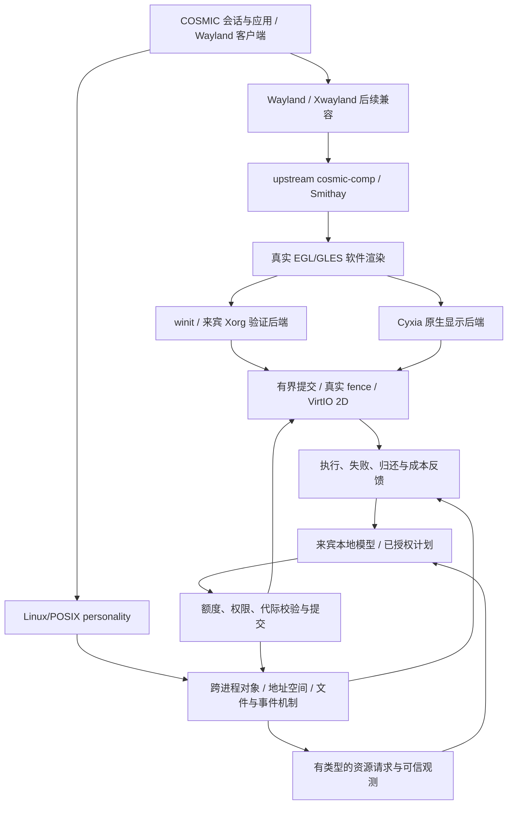
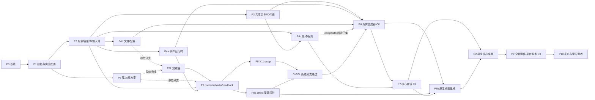

# CyxiaOS：COSMIC 移植实施计划

版本：1.0 · 日期：2026-10-18（Asia/Muscat） · 复杂度：高，涉及内核对象、图形运行库及桌面会话。

本文件是 `/ecc plan 移植 COSMIC` 的规划交付。实施状态以 [移植记录](docs/implementation/cosmic-port.md) 和客体验收报告为准；本文的“新增文件”“接口”“门禁”均为待实施设计，不能当作已经存在的代码或成功证据。

2026-10-20 实施更新：P1 的 30 组件元数据盘点和受控构建工具已落地；P2 全局 OFD 与 P3 SCM_RIGHTS、memfd/MAP_SHARED、真实 wl_shm 固定池协议已形成 [18 组同镜像客体检查](artifacts/cosmic-shared-r3/summary.json)，包含原桌面操作及持久化回归。P4a 已实现 [单调 timerfd](docs/implementation/timerfd.md) 的 73 项客体检查；P5 的 Mesa r9 已修复较大计算工作组 dispatch 准备阶段的 OOM 崩溃，并通过真实错误、输出不变、恢复及旧库对照，详见 [Mesa 记录](docs/implementation/mesa-softpipe-port.md)。固定 Smithay 生成绑定也已在 Rust 客体静态调用真实 EGL/GLES 并验证像素，完整 Smithay renderer 尚未集成。P1 完整传递闭包、P2 会话扩容 profile、P4a 完整 reactor、完整 G-SHM、G-EGL 及 C0–C3 仍按下文退出条件分别验收，不能据此标为已完成。

2026-10-20 后续实施：P4a 的真实提交事件驱动 ET epoll、连接流 sendto 及固定 Mio 已通过 ARM 客体检查；P5L 的真实 Smithay `EGLContext/GlesRenderer` 已完成三次渲染/纹理/回读验收。Mesa 显式缩小 NIR GC slab，保持现有内存模型输入域和 16 MiB 额度。对应 [最新实现记录](docs/implementation/cosmic-port.md) 更新了这些子项，完整 COSMIC、Tokio/calloop、窗口呈现与会话资源配置继续按各自退出条件实施。

## 1. 目标与约束

2026-10-22 最新实施：[锚定缩放与抓取清理工作包](docs/implementation/smithay-resize-native.md) 已通过三次独立 ARM 验收，包含左上角/左边缘缩放、ACK 与匹配缓冲绑定的位置提交、反向运动、普通重绘，以及按钮仍按住时关闭所有者并接管剩余释放。通用模块实现并单测八个方向；其余六个方向尚无本轮客体证据。原移动/右下角缩放和原桌面回归通过。下一步推进动态客户端接入、其余方向客体验收、保留窗口的 Escape 回滚及通用窗口管理，再继续 cosmic-comp 闭包与会话容量验证；本轮尚未达到 C0 退出条件。

2026-10-22 先前实施：[交互移动与缩放](docs/implementation/smithay-interactive-native.md) 已验收真实 xdg move/右下角 resize、按下序号及所有者校验、无效/过期/跨客户端请求拒绝，以及移动后的普通重绘。

2026-10-22 先前实施：[xdg-shell 生命周期工作包](docs/implementation/smithay-xdg-native.md) 已验证真实配置确认、resize、close 与错误客户端隔离后恢复，使用依次运行的客户端。

2026-10-22 实施更新：[真实 Smithay 前端、GLES、原生显示和座席输入](docs/implementation/smithay-wayland-native.md) 已完成三次独立 ARM 验收，每次两个独立客户端、六帧和 73,728 个实际屏幕像素。全部对象、页和 AI grant 回到基线。该普通 `wl_surface` 工作包完成，后续 xdg-shell 与并发多表面合成增量见上。完整 G-SHM、G-EGL、C0–C3 的退出条件保持不变。

将固定版本的真实 COSMIC 源码移植到 CyxiaOS 自研 Rust 内核，逐步达到原生主桌面和整套组件可验收。首版保持单核 ARM64；本地模型决定正常资源准入、CPU 派发、内存和图形额度，内核执行权限、对象生命周期、协议和持久化语义。

延续既有要求：

- 内核不基于 Linux；Linux AArch64 personality 是应用兼容层。所有目标程序在 CyxiaOS 来宾 EL0 执行。
- 模型在来宾本地运行；宿主仅负责构建、QEMU、输入传输和证据采集。宿主窗口、远程 Linux 桌面或界面仿制不构成移植结果。
- 现有 Xorg/Openbox/LXPanel/PCManFM 桌面和冻结镜像继续作为回归基线。
- 平台、ISA、同步、资源策略、图形后端解耦；首版只声明实际验证过的 ARM64 单核能力。
- 继续建设学习能力，但参数更新必须经过隔离验证与发布门禁；学习不能改变权限、用户输入、文件内容或可靠消息顺序。
- POSIX 和广泛 Linux 程序兼容继续按各自专项验收；完成 COSMIC 不自动代表完整 POSIX/Linux ABI。

## 2. 已完成基线与真实缺口

固定镜像：`artifacts/cosmic-bootstrap-r3/cyxia-kernel.elf`。
SHA256：`0d31c3fcb2668b67b31a9e1388c62579f32025aefc47babbb121560c595e2b5d`。
配置：单核 ARM64、512 MiB，`graphics,lxpanel,large-memory,spawn-test`。

[联合报告](artifacts/cosmic-bootstrap-r3/summary.json) 记录 9 组客体门禁 PASS，以及 274 项主机 Rust、128 项 large-memory 配置、109 项 Python 测试；默认与 large-memory 测试有重叠，不能相加称独立用例总数。

| 领域 | 已验证 | 本计划需要补齐 |
|---|---|---|
| Rust | 官方标准库启动、分配、HashMap、文件、TLS/线程同步、备用信号栈、futex 位集、睡眠 | 实际 COSMIC/Cargo 依赖闭包使用的运行时；不是完整 std/Tokio 验收 |
| Wayland | upstream libwayland 客户端/服务器线程、registry/output/sync | 独立进程、SCM_RIGHTS、共享文件映射、wl_shm、窗口内容及协议生命周期 |
| 键盘 | upstream libxkbcommon 内存 keymap/state | 完整所选布局、物理输入、合成器 seat/keymap/焦点和应用集成 |
| 事件 | level/oneshot epoll、字节流 sendmsg/recvmsg、eventfd、超时和 FD 复用保护 | readiness 转变驱动的 edge epoll、timerfd、所需信号掩码/嵌套能力及真实 Rust 事件循环 |
| 显示 | VirtIO-GPU 2D、软件 Xorg、真实 fence 与输入 | EGL/GLES、Mesa driver/加载、COSMIC/Smithay 后端；没有现成 DRM/GBM/3D |
| 进程 | 8 槽、现策略最多 7 活跃组；8 线程/组、native spawn | 会话容量、跨进程 FD 继承、Rust/spawn 适配、服务就绪与监督 |
| 内存 | 每进程匿名池 16 MiB；映像池 16 MiB（另有栈 VA，物理额度含 256 KiB 初始栈） | 可测量的新资源配置、共享页对象和映射；单次匿名申请仍最多 2,048 页 |
| 文件与资源 | RAMFS 64 节点、4 KiB/文件、95 字节路径；静态启动资产 | 大配置/运行时资产、足够目录/FD、变更通知、可靠配置保存；memfd 不得沿用 RAMFS 4 KiB 内容数组 |
| 服务 | 无完整会话 D-Bus、网络、音频、登录身份体系 | 分层建立，不能用永远成功的服务替身满足上游 |

当前还有两实例/每实例 16 watch 的 epoll 边界、16 FD/进程、52 MiB 大内存启动目录预算和 128 个启动资产/程序条目上限。既有模型输入域也有上限：8193 为 free≤64/request≤8；8194 为 free≤4096/request≤2048；8195 为 free/request≤4096；CPU 选择器最多 8 个候选。扩容必须同步处理模型、账本、地址空间和元数据。

固定 [cosmic-session 启动路径](https://github.com/pop-os/cosmic-session/blob/8093b59bb1262b0612d814e6540ba936303f735a/src/main.rs) 已有至少 14 个进程启动意图（含 session 自身），另有 D-Bus、面板 applets、应用和恢复余量。这是源码启动意图数，不是已测稳态峰值。因此 7 活跃槽是明确阻塞；不能仅增加 QEMU `-m`。

## 3. 交付层级与“完成”的定义

| 层级 | 可交付结果 | 不得混淆的范围 |
|---|---|---|
| C0：合成器 | 固定 upstream cosmic-comp 在来宾运行，合成真实独立 Wayland 客户端，键鼠/resize/关闭正确 | 一个合成器窗口不是完整桌面 |
| C1：核心开发会话 | 真实 cosmic-session 启动 comp、panel、启动器、工作区、背景、通知、设置服务及终端/文件管理，生命周期真实 | 单身份开发自动启动不能称安全登录或全部组件完成 |
| C2：原生核心桌面 | 原生 Cyxia 显示/输入后端，启动后进入 COSMIC；剪贴板、文件、终端、设置保存/重启恢复等核心流程通过 | 不依赖外层 Xorg；认证、网络或音频未完成时标为开发预览，不称可安全登录的完整主桌面 |
| C3：冻结套件完成 | 固定 epoch 的全部 30 个 gitlink 组件逐项通过功能矩阵，所需网络/音频/权限/商店/媒体等服务完成，打包、恢复和性能门禁通过 | 任一必需组件 `pending`/`blocked`，整体不能标为完成 |

完整套件是长期交付目标。阶段内可以禁用未完成功能并清晰标注，但不能把这些组件从 C3 的分母删除。`simple-wrapper` 在该 epoch 只有遗留 `.gitmodules` 条目、没有 gitlink；README 提到的 `cosmic-theme-editor` 也不在这 30 项内。两者进入范围差异/额外依赖核对，不能编造版本或算作已固定组件。

## 4. 架构决策与必须先验证的假设

### 4.1 图形入口

优先候选为 **winit 嵌套后端 + 真实软件 EGL/GLES + 来宾 Xorg**，用于尽早验证原始合成器。该路线在 CyxiaOS 上尚未证实。

现有 Xorg 禁用 DRI/DRI2/DRI3/GLX/MIT-SHM。Mesa 26.2.3（`31e9a6b2e95e30d84bf3177d1f497d063e59b6b2`，现已由 `ports/cosmic/mesa-source.json` 固定）有真实 X11 软件路径：强制软件模式可绕过 DRI3 连接失败，在缺少 XSHM 时使用普通 `xcb_put_image`。该 EGL/GLES 窗口路径现已通过三轮客体像素检查，Smithay/winit 与 COSMIC shader 集成仍待验收；内部 DRI software loader 也不等于要求 Xorg 提供 DRI3。[Mesa 固定 X11 实现](https://gitlab.freedesktop.org/mesa/mesa/-/blob/31e9a6b2e95e30d84bf3177d1f497d063e59b6b2/src/egl/drivers/dri2/platform_x11.c)

固定 Smithay winit 默认请求 **GLES 3.0**，仅在 10-bit/8-bit config 间回退；GLES renderer 需要 `GL_EXT_texture_format_BGRA8888`。首个实验必须到实际 context、格式、COSMIC shader、FBO/readback 和呈现，不能在 `eglInitialize` 或清屏处结束。[Smithay winit](https://github.com/Smithay/smithay/blob/e3d461a057ba244d213a8498ec372b0799cca103/src/backend/winit/mod.rs)、[GLES renderer](https://github.com/Smithay/smithay/blob/e3d461a057ba244d213a8498ec372b0799cca103/src/backend/renderer/gles/mod.rs)

决策顺序：

1. 固定 Mesa 版本及其真实构建选项；先试 softpipe，减少 LLVM/JIT 依赖。审查版本选项为 `gallium-drivers=softpipe`，不能照抄旧 `swrast` 配置；候选禁用 GLX，不采用与该 EGL 组合冲突的 `glx=xlib`。能否满足 COSMIC shader/扩展必须实测。
2. 对 EGL API 加载、Mesa 内部 driver 加载、GL proc lookup、winit/Xlib/xkbcommon 加载分别建表。Smithay 明确加载 `libEGL.so.1`，审查 Mesa 的 EGL/Gallium 构建显式使用 `shared_library`；`default_library=static` 不会自动解决这些层次。[Smithay EGL FFI](https://github.com/Smithay/smithay/blob/e3d461a057ba244d213a8498ec372b0799cca103/src/backend/egl/ffi.rs)、[Mesa EGL 构建](https://gitlab.freedesktop.org/mesa/mesa/-/blob/31e9a6b2e95e30d84bf3177d1f497d063e59b6b2/src/egl/meson.build)、[Gallium 构建](https://gitlab.freedesktop.org/mesa/mesa/-/blob/31e9a6b2e95e30d84bf3177d1f497d063e59b6b2/src/gallium/targets/dri/meson.build)
3. 若静态绑定和 driver 注册可维护，则实现明确的 feature/符号绑定补丁；若必须保留动态加载，启动 P5L 的真实 ELF/动态链接/TLS/RELRO 门禁。
4. 若 X11 window surface 路线失败，但真实 surfaceless/offscreen EGL/GLES 可用，则选择原生 Cyxia 后端，以真实 readback 和现有异步 blit 呈现；保留 upstream Glow 渲染逻辑。
5. 如果连选定 GLES 扩展和 shader 都不满足，停止合成器集成，评估另一真实软件 driver 或 GPU 路线；记录新成本和所需 JIT/W^X/设备能力，不能用空 EGL 调用掩盖。

`libwayland-egl` 不是 EGL/GLES 实现；现有 `renderer_pixman` 也不能替代 COSMIC 主渲染链对 `AsGlowRenderer` 的依赖。完整应用还需按组件核对 libcosmic/iced/wgpu/GLES/tiny-skia 特性，不能假设所有组件能使用同一种软件后端。

### 4.2 平台边界



ISA 相关页表/TLB/context 保留在 `crates/arch-aarch64`；共享对象、引用和事件状态不依赖 AArch64 地址常量。CPU0 单所有者实现继续明确标注；多核同步接口、锁序和跨核撤销契约在接口设计中保留，但本计划不把接口预留写成 SMP 已实现。

## 5. 按依赖推进的工作包

所有工作包在开始时记录输入提交/库/模型版本，结束时输出独立门禁报告。任务中的新文件名是拟定位置，可以在实现时沿用等价目录，但不能把边界重新集中进一个巨大的 syscall switch。

### P0：保护基线（已完成，持续执行）

- 保留 r3、`ai-system-r2` 等冻结镜像与报告，不覆盖旧失败。
- 从现有工作树增量实施；不重置当前大量未提交变更。
- 验收证据统一包含 kernel/ELF/source/model/config SHA、QEMU 配置、真实输入、退出与资源快照。

### P1：锁定闭包、容量测量和图形路线实验设计

**复杂度：中；依赖：P0。**

1. 核对 epoch 30 个组件的 Cargo.lock、Git 子依赖、C 库、license、assets、生成工具和功能开关，形成 `ports/cosmic/dependencies.json` 与 `docs/implementation/cosmic-capability-matrix.md`。核对各 lock 的 libcosmic/protocols/settings-daemon 版本差异；comp lock 的 settings-daemon pin 与 epoch 组件 pin 不同，不能盲目统一或忽略接口兼容。
2. 记录每个组件实际需要的 syscall、设备、环境、D-Bus 名称、配置/字体路径、启动子进程及加载机制；区分必需/可禁用/运行期可选，记录理由。
3. 新建受控 Cargo 交叉构建入口 `tools/build_cosmic.py`：独立目标目录、host/target pkg-config、固定 target musl、构建锁、锁文件、补丁 hash、license 和 ELF 检查。每次显式选择组件，取源和执行构建分开。
4. 初始 profile 记录可取得的静态 ELF/BSS、资产量、源码启动下界及运行时未知量；不能要求尚无法运行的全套会话先给出峰值。随 P5/P6/P7 链接和运行补充真实 heap、进程/线程/FD/映射高水位，再逐次冻结 profile。启动调用图至少计入 session、其 13 个子程序意图、bus、applets、用户应用和恢复进程。
5. 形成 `ports/cosmic/resource-profile.json`：候选 RAM/VA/页表/FD/对象/线程/目录预算、内核与推理保留池、实验工作负载及性能阈值。512 MiB 仅是旧基线；1/2 GiB 可以进入实验矩阵，尚未验证。1024×768×4 一帧为 3 MiB，60 次完整复制约 180 MiB/s，仅是单份数据量推算，不是实测帧率或总带宽。
6. 固定 Mesa 源和 G-EGL 实验清单；链接前后测体积。若最小实验超出旧映像/heap，先走 P2，不能在宿主通过后冒称来宾可行。

**退出条件 G-LOCK：**固定闭包清单可复核；所有未知项有明确验证任务/负责人；资源总账无重叠；已选实验不会隐式下载整套或污染宿主/目标库。完整闭包未准备完时保留该状态，不能沿用现有 comp 单一 Cargo.lock 宣称全套锁定完成。

### P2：共享对象模型与可扩展资源配置

**复杂度：高；依赖：P1。**

拟修改：`crates/posix/src/{lib,spawn,unix,epoll}.rs`、`kernel/src/user{,/unix,/spawn,/ai}.rs`、`kernel/src/{user_heap,exec_memory}.rs`、`crates/posix/src/{vm,executable,usermem}.rs`、平台/页表配置、`kernel/build.rs`、`crates/ai-runtime`。拟新增 `crates/posix/src/open_description.rs`、`kernel/src/user/objects.rs`。

1. 将进程私有 FD 表与共享 open-file-description/内核资源对象分离，使用稳定 handle+generation 和受控引用。文件偏移/status flags 随 OFD 共享，CLOEXEC 属于 FD 表条目。
2. 明确 FD 强引用、socket 在途权利、活动 syscall、映射及 DMA 引用的取得/释放。epoll watch/等待代际关系必须单独设计，watch 不得成为把对象永久保活的强引用。watch 按显式 DEL、epoll 销毁或 OFD 最终生命周期清理，不能仅因 FD 表引用归零就删除：在途 SCM 或活动 syscall 可能仍保活 OFD。映射/backing 与 OFD 的最终释放也分别建模；进程退出不能再无条件 `close_owner` 销毁已转交对象。
3. 分批迁移普通文件/pipe/PTY/eventfd、dup/close/spawn/Unix/epoll 的旧语义，再增加跨进程继承，保持每批可回归。
4. 映像/匿名/共享/元数据/资产预算分别入账，动态可用物理页和 VA 由明确 profile 管理；新根表、加载窗口、页表数、栈预算、引导镜像/资产方案同步更新。
5. 扩大候选数/额度前调整模型特征范围、定点溢出界、版本/ID登记和训练验证数据。保持旧 profile 可运行；不得 clamp 超范围输入、伪造 free 值或绕过模型获得容量。
6. 同步建立 request/decision/grant/receipt 身份与对象代际；FD 表项、队列引用、映射记录、事件元数据和共享物理页分别计费。多资源申请先准备再提交/取消；模型故障不能阻止已提交操作完成和确定性清理。P10 扩展学习，而非把这些基础 AI 契约延后。

**退出条件 G-OBJECT：**重复 dup/spawn/退出/FD 复用和引用回收无泄漏；单对象物理页只扣一次；新配置精确总账闭合；模型拒绝不改变对象/映射。超过容量明确失败，恢复和模型保留页仍可用。

增加 watch/inflight 交叉门禁：被 watch 的对象进入 SCM 队列后，发送方关闭最后一个 FD，接收方安装后旧 watch 仍对应同一 OFD；同号新 FD 不得劫持该关系。销毁无人接收队列并释放最终 OFD 引用时，watch 才按契约清理。Linux 参照是最终 `__fput` 的 `eventpoll_release`，不是单次 close 或 FD 计数归零。[固定 Linux OFD 释放实现](https://github.com/torvalds/linux/blob/v6.12/fs/file_table.c)

### P3：跨进程共享缓冲与 FD 传递

**复杂度：高；依赖：P2。**

拟新增 `crates/posix/src/{shared_memory,ancillary}.rs`、`kernel/src/user/shared_memory.rs`、`user/ported/wayland_shm_probe.c`、`tools/verify_wayland_shm.py`；扩展 `kernel/src/user/event.rs` 及地址空间/Unix 适配。

1. 建立页支撑的共享文件对象，实施所选闭包需要的 memfd/shm 创建、尺寸变更、stat、偏移读写和 seal 子集。它不是普通 4 KiB RAMFS 文件的别名。
2. 实现 MAP_SHARED 与 per-address-space 映射引用、权限和边界检查，扩展 usercopy 的合法区域解析；不能把共享页塞进退出时整池清零的私有 Heap。fd 关闭不销毁活映射；sender 退出后 receiver 引用仍有效。零填充扩展、部分 munmap、mprotect、seal 的写入/映射约束、截断后 SIGBUS/撤销及页尾行为必须冻结；未实现情形明确拒绝。首轮共享图像内存不可执行，后续执行映射必须在全部别名上维护 W^X。
3. 实现 SCM_RIGHTS：记录逻辑字节位置及 ancillary 边界；排队持有 OFD 引用；接收安装 FD 前校验容量和用户缓冲。按实际 Linux ABI 处理部分接收、MSG_CTRUNC、MSG_CMSG_CLOEXEC、peek/错误等已声明行为，未支持语义明确拒绝。
4. 多 FD 接收的安装/回滚、消息取消、receiver 死亡、socket close、queue 背压均释放恰好一次。初期可限定可传对象类型；若闭包需要传 socket，须补引用环回收，不能靠普通 refcount 永久泄漏。
5. 用两个独立 EL0 进程执行真实 upstream wl_shm 的 pool/buffer、attach/commit、resize、frame callback、release、销毁与重连；另验 wl_keyboard keymap FD。验证映射页确实共享，不能用 payload 复制伪装 MAP_SHARED。原始映射/FD 探针先通过，再接协议和现有 2D 呈现，避免依赖尚未完成的 COSMIC。

P2 接口冻结后，共享页对象与 ancillary 队列可以分开实施；SCM_RIGHTS 先传普通文件，不必等待 memfd。传递 socket 前需完成有界在途引用环回收。最终 G-SHM 同时依赖这两条分支。

**退出条件 G-SHM：**跨进程写入/读取与屏幕测试图内容一致；sender 提前退出仍可读；consumer 完成前 buffer 不复用；非法偏移/stride/size/溢出、安全封印、截断、FD 满、取消及进程死亡路径无越界/泄漏；预算和对象回收精确。

### P4：真实 Rust 事件循环、文件配置与会话服务基础

**复杂度：高；依赖：P2；跨进程部分依赖 P3；可与 P5 库构建并行。**

**P4a 事件运行时。** 扩展 `epoll.rs`、`kernel/src/user/event.rs`，新增 timerfd 状态与 probe。edge 必须来自后端真实提交通知或 readiness 转变，不能把“每次扫描仍就绪”当新边沿；同一对象仍然可读时再次写入也可能产生新通知，例如 Mio Waker 的 eventfd。覆盖 oneshot rearm、backpressure、close/dup、跨进程交接和睡眠/信号竞争。按依赖需求实现临时信号掩码/嵌套，或明确使用并验证不需要这些功能的后端。跑固定 calloop/polling/Tokio 的真实 reactor/任务/唤醒/定时测试，不能以 std 线程门禁替代。

read/write/连接/关闭等状态改变入口维护通知序列/ready-list；测试两次 wait 之间 ready→not-ready→ready。timerfd 包括 8 字节到期计数、周期积累、读取清除、disarm/rearm、NONBLOCK/CLOEXEC 和 epoll 集成；REALTIME/CANCEL_ON_SET 仅在改时与取消语义实现后开放，不能忽略 flags。先 syscall 探针，再官方 Mio ET/Waker 与固定线程数 Tokio/calloop 测试。

**P4b 文件与持久化。** 拓展 `crates/ai-fs`、目录/文件 personality、`kernel/src/storage.rs` 和 snapshot；为容量、长路径、配置原子替换、变更通知、锁和运行时目录建立所选契约。实现真实 fsync/fdatasync/目录同步或明确的上游保存适配，覆盖断电恢复。旧两槽快照及专用测试盘保留；新格式必须版本化，不能直接复用旧 4 KiB/64 节点快照预算。

优先页/extent 分配，避免直接扩大节点内数组导致快照、栈帧和内存翻倍。cosmic-config 的 atomicwrites 是按 key 替换，不承诺跨 key 事务；真实 inotify/notify 需覆盖 rename、删除、连续修改、队列溢出和临时文件过滤。若开发阶段使用显式保存适配，记录其局限；全套依赖所需的 fsync/rename/目录持久性仍须在 C3 关闭。

**P4c 启动和服务。** 实施 Rust `std::process::Command`/上游进程启动的受控移植（native spawn 后端或实际所需 exec 接口），传递 argv/env/cwd/socket/pipe、保留 CLOEXEC、执行 ready handshake、wait/SIGCHLD/退出和重启策略。移植真实会话 bus 与认证/Unix FD 语义；按源码核对 comp、session、settings-daemon 的启动顺序。没有 fork 时不能声称任意 fork 已实现；应用 PTY/作业控制与进程组按实际终端需求补齐。

bus 认证与桌面账户登录分别验收：D-Bus peer credentials 由内核身份产生；名称争用、调用/响应、信号、所需激活、FD 转交和服务死亡重启均须真实。固定 cosmic-session 先取得 bus 名称再启动主要子进程，关闭 systemd/logind feature 不会消除这些要求。

**退出条件 G-RUNTIME：**固定事件循环工作负载无忙等/丢唤醒；bus 的真实客户端调用、信号、断连与重连通过；子进程确实独立执行；保存配置在来宾重启后恢复且失败不假报成功。无宿主服务参与业务。

### P5：真实软件 EGL/GLES 与呈现

**复杂度：高；依赖：P1，来宾运行取决于 P2/P4a；所需共享接口依赖 P3。**

拟新增 `ports/cosmic/mesa-source.json`、版本化 `ports/cosmic/patches/`、`tools/build_mesa.py`、`user/ported/egl_probe.c`、`tools/verify_egl.py`。

**条件工作包 P5L：真实加载器。** 仅当静态绑定方案不成立或所选闭包要求动态加载时启动，依赖 P2 的 VM 和 P4b 的库文件存储接口。实施 musl 动态链接器所需 ET_DYN/PT_INTERP、文件映射/重定位、符号解析、TLS、RELRO/W^X、构造析构及 `dlopen`/`dlsym`/句柄生命周期；冻结实际支持范围。通过双库符号解析、线程 TLS、缺符号/错误架构/损坏 ELF 拒绝和退出回收后，才允许 P5 的动态版本进入 G-EGL。静态分支也必须验证线程 context 和符号缺失失败，不做伪 `dlopen`。

1. 编译固定 Mesa/GLES/所需 X11 库及 driver，记录 host generators 与 target libs。明确每一处动态调用如何实现，禁止成功 stub。
2. 从 GLES3/BGRA context 和纹理/shader/FBO 到 readback exact pixels，再到当前来宾 Xorg 的 window surface/swap 和截图内容，按顺序验证。嵌套方案需先运行固定 Smithay 的最小 winit/Glow 探针，再做大规模 comp feature 分离。
3. 用 COSMIC 实际 shader 和要求的扩展检查 blur、裁剪、阴影、纹理格式、blend、缩放及 resize；分别报告基础与效果配置，不能只验证一个三角形。
4. 测 CPU、heap、映像、线程、缓冲和每帧 copy/fence 成本。按 P1 固定的判据选择静态/动态加载、嵌套/direct 路线并记录 ADR。

**退出条件 G-EGL：**真实 API/符号/driver/GL proc 链闭合、shader 渲染与屏幕像素通过，退出/失败不泄漏；软件路径满足扩展及资源边界。嵌套分支要求实际 X11 swap 呈现；替代分支要求 offscreen 像素加 P8a direct 呈现通过，不能仍把 X11 成功列为替代路线的前置条件。两者均失败则返回架构决策，不推进 C0 宣告。

### P6：固定 upstream cosmic-comp，交付 C0

**复杂度：高；依赖：G-SHM、G-RUNTIME 的 compositor 所需部分、G-EGL。**

1. 对固定 comp/Smithay 做可复核 feature 分离：Cargo 与 `backend/mod.rs`、`state.rs`、render elements、`cosmic-comp-config` 的非可选 input 依赖共同隔离 KMS/GBM/libinput/udev/libseat/Vulkan。建立 `cyxia-winit`/`cyxia-direct` 配置并保持原 Linux 后端编译检查；只加 `--no-default-features` 不算完成。不广告未实现的 DRM/DMA-BUF 协议。
2. 先关闭明确未实现的 Xwayland 路径，保留 Wayland compositor 的真实 workspace/window/render/protocol 逻辑。
   嵌套分支使用经验证的 winit；若选 direct 分支，本阶段完成最小 `cyxia-direct` comp 适配（BackendData/output/render/input），以 P8a 的呈现机制承载真实合成器。该适配是 C0 的前置交付，不能留到依赖 C0 的 P8b。
3. 跨进程启动真实 Wayland 测试应用；验证输出、seat、键盘布局、鼠标、聚焦、移动、resize、窗口关闭、frame/release 与客户端崩溃。
4. 形成 `tools/verify_cosmic_compositor.py` 和 C0 证据：精确 upstream commit/patch/ELF 身份、独立客户端 PID、可观察协议状态、输入效果、图像及回收。

**退出条件 G-COMP：**upstream comp 真的在 CyxiaOS 内合成客户端内容；重复创建/关闭和故障路径通过。视觉截图必须绑定协议/进程证据，不能单独作为成功判定。

### P7：核心开发会话，交付 C1

**复杂度：高；依赖：P6、P4b/c。**

逐组件移植 cosmic-session → settings-daemon → panel/背景/启动器/工作区/通知 → 终端与文件管理；具体偏序以 fixed session 源码和服务 readiness 决定，不依赖固定 sleep。fonts/icons/locale/MIME/.desktop 数据与输入法协议需求同阶段核对。

应用工具包渲染路径逐个取证；终端需要真实 PTY 与子进程、文件管理需要真实文件/挂载能力，剪贴板和拖放需要真实流与 FD 生命周期。未完成的网络/电源/音频 applet 只能在 C1 明确禁用并保留 C3 阻塞项。

**退出条件 G-SESSION：**真实 session 管理进程树、启动应用、终端读写文件、窗口/工作区切换、通知、剪贴板、设置保存/恢复和注销；服务崩溃按已授权的有界重启策略恢复，无僵尸/重启风暴。C1 只允许声明单身份开发会话，不声明认证登录。

### P8：原生显示/输入后端，交付 C2

**复杂度：高；P8a 依赖 P2/P4a 与 P5 已验证的 offscreen 子集；P8b 依赖 P6/P7。**

拟新增 `ports/cosmic/patches/*-cyxia-backend.patch` 与后端适配库；扩展显示 ABI 仅在确有需要时进行。

**P8a 后端机制与可行性探针。** 把真实 EGL/GLES 输出接入 Cyxia display/input capability 接口：像素格式/stride、damage、时钟、缩放、输入事件、重同步、队列背压及真实 fence。不依赖完整 comp，可用独立探针验证 offscreen→readback→blit；若 P5 嵌套路线失败，它先完成并参与 G-EGL，解除 P6 的依赖环。

**P8b 主桌面集成。** 嵌套先行分支在此把 P8a 的机制接入 comp；direct 先行分支复用 P6 已交付的最小适配。随后与 P7 汇合，完成启动选择、输出控制、独占输入和恢复。保留 compositor/driver 的生命周期分界，不能在 pending DMA 或 wl_buffer 使用期间归还 backing。direct compositor 与 Xorg 不得同时消费现有输入 FIFO；所有权转交和恢复由确定性接口执行。

**退出条件 G-NATIVE：**不启动外层 Xorg 即可由 Cyxia 启动器进入 COSMIC；核心 C1 工作流仍通过；无 GPU/设备失效时串口恢复可用。强制命中提交在途时 owner 死亡、设备错误和预算拒绝的故障注入必须有独立证据。

### P9：补齐冻结套件和平台服务，交付 C3

**复杂度：高，包含独立系统项目；依赖：P7/P8。**

按第 6 节矩阵移植所有剩余组件及其服务。网络、TLS、音频/媒体、身份认证/greeter、权限/portal、安装更新并非已有能力；它们需要分别建立驱动、协议、服务与威胁边界的详细子计划和验收，不能被概括为“链接对应库”。

Xwayland 兼容作为单独子项：实际 Xwayland binary/DDX、X11 socket/认证和窗口交互通过，不能复用外层旧 Xorg 的截图当证据。高级应用需要动态 ELF/JIT 时回到真实装载与可执行内存契约，不绕过 W^X。

必须形成以下子计划并汇入同一功能矩阵：网络驱动/协议栈/DNS/TLS 与真实状态控制；音频驱动/PCM/音量/路由和媒体同步；账户/凭据/greetd-PAM 或原生认证后端；设备/电源/空闲与锁屏授权；portal 前端及文件选择/截图/录屏/PipeWire 等真实后端；Store 的包管理/仓库/签名/更新回退。错误密码拒绝、锁屏隔离、断网恢复、实际音频输出、安装—更新—卸载均需行为证据；greeter mock 和应用空窗口不能关闭功能项。

**退出条件 G-SUITE：**全部 30 组件矩阵无未处理必需项，功能、数据、依赖与失败行为对应同一版本组合；网络/音频等未实现时 C3 保持未完成。禁用项、硬件适用性及其依据清楚展示，不能把操作失败显示为成功。

### P10：AI 自适应、稳定性、打包与升级恢复

**复杂度：高；每阶段已有 AI 准入/调度，本阶段增加跨域反馈与学习验收。**

1. 基于 P2–P5 已完成的分域可信观测、版本化提案、唯一提交账本及执行/失败/释放回执，增加跨域协调与联合评估；此前各阶段门禁已要求这些记录齐全。跨域协调器按既有 AI 契约独立实施，不能从模型 ID 存在推定完成。
2. 分别记录模型推理成本、等待、真实执行、帧/输入延迟、拒绝、回收与保护来源。阻塞解除只恢复 runnable；下一执行对象和预算仍由本地模型决定。
3. 新候选学习先 shadow，再隔离 holdout/canary；发布和回退遵循既有契约。当前仅 FS cache 已有在线学习，其他域必须单独证明，不承诺上线即全域自学习。
4. 在冻结工作负载和阈值下比较旧/新策略，包含 CPU/内存/文件/显示同时受压；不得用训练集证明收益或把保护回退计作 AI 优化。
5. 构建带版本和校验的发布包、启动选择/回退、数据格式升级及恢复路径；保留现有桌面恢复入口。生成一次完整可重复的来源与验证清单。

**退出条件 G-RELEASE：**C3 的正确性门禁、所选性能目标、资源拒绝/故障恢复与持久化通过；学习失败能回退且不损害已提交资源；正式发布只声明验证过的平台/功能/模型范围。

## 6. 固定组件覆盖矩阵

以下行完整覆盖 manifest 的 30 个 gitlinks；括号内的辅助进程可能增加运行时进程数，不能把仓库数量当进程上限。

| 组件组 | 固定组件 | 首次集成 / 完成所需依赖 |
|---|---|---|
| 合成器与输出 | cosmic-comp、cosmic-randr | C0：Wayland、GLES/加载、output-management；C2：原生后端 |
| 会话与配置 | cosmic-session、cosmic-settings-daemon、cosmic-settings | C1：真实 bus、spawn/继承、配置监控和持久化；完整设置逐项对接系统能力 |
| 桌面入口 | cosmic-panel、cosmic-applets、cosmic-bg、cosmic-workspaces-epoch、cosmic-launcher、cosmic-app-library、pop-launcher | C1：所选 panel/plugins 与搜索/启动；C3：所有列入矩阵的 applets、插件及各服务 |
| 交互辅助 | cosmic-notifications、cosmic-osd、cosmic-osk、cosmic-idle、cosmic-screenshot | C1/C2 逐项：输入/焦点、通知、文本输入、idle/inhibit、截图；安全屏幕锁依赖真实身份和授权 |
| 应用 | cosmic-files、cosmic-term、cosmic-edit、cosmic-viewer、cosmic-monitor | C1 核心文件/终端，后续完整功能；files-applet 作为额外程序核算，终端/monitor 的 Linux 专属假设需替换为真实服务 |
| 媒体与分发 | cosmic-player、cosmic-store | C3：实际编解码、音频/设备、网络/TLS、包格式/仓库/安装升级/权限等；目前均无完成证据 |
| 登录与首次设置 | cosmic-greeter、cosmic-initial-setup | C3：真实身份、会话授权/锁定、凭据存储、locale/配置；不得以始终认证成功的适配替代 |
| 门户 | xdg-desktop-portal-cosmic | C3：真实 portal/权限决策和后端；截图/录屏/文件选择等逐项验证，拒绝正确返回 |
| 资产 | cosmic-icons、cosmic-sound-theme、cosmic-wallpapers | 早期打包，C3 校验安装路径/查找/许可；sound theme 还依赖可用音频 |

此表是范围索引，不是完整业务功能矩阵。P1 必须为每个组件建立“功能→接口→服务→目标测试→状态”，禁止用 `--version` 或能编译代替功能验收。

`cosmic-applets` 是多二进制 workspace，P1 还须展开“二进制→feature→面板位置→服务接口→测试”的子矩阵，不能把它按一个进程预算。[固定 applets workspace](https://github.com/pop-os/cosmic-applets/blob/406d1b7d627138fdf4078f654268d3d8774e50f1/Cargo.toml)

服务子计划的源码依据包括：[配置的 notify/atomicwrites](https://github.com/pop-os/libcosmic/blob/d922ac380134c00208d2acf93947d44fb217eec5/cosmic-config/src/lib.rs)、[greeter 的 PAM/greetd 依赖](https://github.com/pop-os/cosmic-greeter/blob/98df07df93df1cb091c95451f7162dca1a2ae2dd/Cargo.toml)、[Portal 依赖](https://github.com/pop-os/xdg-desktop-portal-cosmic/blob/9d35e6300b69cf06da723a502a9a56604a022786/Cargo.toml)、[Store 的 Flatpak/PackageKit 路径](https://github.com/pop-os/cosmic-store/blob/c7b36a2fdccf1ce88944793af67c3664413ee560/Cargo.toml)、[Player 的 GStreamer 依赖](https://github.com/pop-os/cosmic-player/blob/900453787f999ec151b8d58683923e3110b727e1/Cargo.toml)。这些外部依赖不能因移除默认 feature 就被假定消失。

## 7. 依赖、并行与停线条件



G-EGL 的两条呈现入边是候选替代路线，按决策选择一条；P5L 只在动态加载分支启用。嵌套先行时 P8a 可延后到 P8b 前；direct 先行时 P6 自己完成最小合成器后端适配。P4a、P3 的共享页和 FD 队列在 P2 接口冻结后可并行。P9 服务子计划在 P1 建立，独立基础可提前实施；C3 联合验收仍在 C2 之后。

并行可以分为内核对象/共享内存、事件/会话服务、图形库/后端、组件/工具链四条工作流。共享文件必须指定单一编辑者，尤其 `kernel/src/user.rs`、`linux.rs`、`crates/posix/src/lib.rs`、模型 schema 和 `kernel/build.rs`；工具构建使用现有锁，guest 测试用隔离输出与测试盘。

停线规则是技术 gate，不是每步重新向用户请求批准：

- 源未固定、host/target 混入、依赖闭包未知：停止该组件构建/通过声明，补证据。
- 图形 API/driver 或 shader 未通过：停止 comp 呈现集成，执行路线替代评估。
- 资源账本无法守恒、跨进程对象提前释放、模型输入域不覆盖：停止上层应用扩容。
- 所需语义只有成功 stub：回到对应机制实现，不进入后续验收。
- 测试失败/样本丢失/图像与 PID 无法绑定：保留失败，不能用跳过转绿。

## 8. 复用模式与文件边界

| 类别 | 既有依据 | 实施应遵循的模式 |
|---|---|---|
| 命名/构建 | [build_wayland.py](tools/build_wayland.py)、[build_xkbcommon.py](tools/build_xkbcommon.py) | `build_*` 只构建、`verify_*` 运行客体；原生生成器与 target 库隔离、固定源/许可/产物 hash |
| 错误/边界 | [POSIX 对象](crates/posix/src/lib.rs)、[event.rs](kernel/src/user/event.rs) | `Result<_, Errno>`；先验证，再提交；不支持的能力显式失败，不吞未实现标志 |
| 对象引用 | [spawn.rs](crates/posix/src/spawn.rs)、[unix.rs](crates/posix/src/unix.rs) | 继承/传递保留真实语义；现有私有描述表只是重构起点，尚无可直接复用的全局 OFD 实现 |
| AI/日志 | [user/ai.rs](kernel/src/user/ai.rs)、[accounting.rs](crates/ai-runtime/src/accounting.rs) | 区分提案/批准/提交/实际执行/归还及 AI/机制/保护来源；不可把队列成功等同于 I/O 完成 |
| 数据 | [ai-fs](crates/ai-fs/src/lib.rs)、[持久化](docs/implementation/persistent-storage.md) | 文件权限/字节与存储屏障保持确定性；扩大文件格式必须同时扩大模型与 snapshot 契约 |
| 测试 | [verify_wayland.py](tools/verify_wayland.py)、[verify_rust_std.py](tools/verify_rust_std.py)、[epoll.rs](crates/posix/src/epoll.rs) | 主机测状态机边界，真实 ARM guest 测跨进程/设备；精确镜像、重复使用、失败和最终回收 |

目前没有真实 EGL/GLES、动态装载器、跨进程共享文件映射或完整会话服务实现；这些应新建独立模块，不能在规划中描述为“调用现有实现”。

## 9. 验证与证据规范

新门禁至少覆盖：正常流程、容量耗尽、模型拒绝、用户地址错误、对象/FD 复用、信号打断、进程死亡、服务重启和最终引用回收。共享内存和图形测试增加映射别名权限、截断、损坏协议、buffer release/fence 时序；持久化增加双槽/新格式损坏及断电点恢复。

每阶段同一新镜像回归相关旧门禁；涉及全局对象/VM/调度时运行完整冻结回归集。仅文档修改做链接/证据校验，不为规划重新启动全部 QEMU 或构建依赖。

已有可复用命令（这些不是运行 COSMIC 的启动命令）：

```sh
python3 tools/cosmic_ports.py inventory
python3 tools/cosmic_ports.py check
python3 tools/verify_rust_std.py --elf artifacts/cosmic-bootstrap-r3/cyxia-kernel.elf --output artifacts/cosmic-plan-check/rust
python3 tools/verify_wayland.py --elf artifacts/cosmic-bootstrap-r3/cyxia-kernel.elf --output artifacts/cosmic-plan-check/wayland
python3 tools/verify_xkbcommon.py --elf artifacts/cosmic-bootstrap-r3/cyxia-kernel.elf --output artifacts/cosmic-plan-check/xkb
```

当前 `cosmic_ports.py check` 预期返回非零，因为 compositor 尚未具备就绪条件。不得把检查未就绪误当作已有基础门禁失效，也不得篡改检查使它无证据返回成功。

发布报告包含 C0/C1/C2/C3 分开状态；所有依赖、补丁、工具链、程序、内核、资源 profile、模型版本与日志哈希；明确配置、测试工作负载、帧/交互延迟分布、资源峰值、失败和禁用项。性能阈值在实验前固定，不能见到结果后降低阈值换取 PASS。

## 10. 风险、范围和启动顺序

| 风险 | 影响 | 应对与验收 |
|---|---|---|
| 软件 EGL 路线/扩展不成立 | C0 无法呈现 | P5 先证明真实链，失败转 direct 或真实 driver 评估，不继续堆 UI |
| 静态 ELF 与动态加载矛盾 | 即使库齐全仍无法启动 | P1/P5 分开 API/driver/GL proc/窗口库；动态路线需真实加载器里程碑 |
| FD/共享页引用错误 | UAF、越权、泄漏或死锁 | P2 先建生命周期；P3 故障注入和账本守恒后才扩范围 |
| 预算模型及候选域仍为旧范围 | 新会话拒绝或错误推理 | 版本化 profile/模型，验证数值域和新并发；旧 profile 保持回归 |
| 上游会话进程与资产多 | 启动槽/ROM/文件限制失效 | P1 调用图+产物测量，P2/P4 扩容；至少 14 进程意图不是完整峰值 |
| 单核软件渲染成本高 | 功能可运行但交互不可用 | 实测推理/渲染/复制/fence 成本，验证 damage、队列额度及效果配置；不承诺未经验证的 FPS |
| 完整套件依赖网络/音频/身份 | C3 工程量显著超出桌面 UI | 独立系统子计划，保留阻塞项和验收责任；不削减完成定义 |
| 本机磁盘有限 | 中途构建失败 | 本次只读检查约 11 GiB 可用；构建前测所选闭包峰值和保留空间，逐组件构建；未经授权不删除用户数据/旧证据 |

推荐先执行 **P1 的固定闭包与图形路线实验配置**，同时设计 **P2 的 OFD/共享页引用契约**。待资源 profile 与这些边界固定后进入 P2/P3 和 P5 并行实施。C0 通过后才推进完整会话；不从同时启动全部 30 个组件开始。

## 11. 规划审核记录

审核目标是清除本计划中的依赖遗漏、成功标准混淆和已知架构矛盾；实现风险和技术待验证项不因规划审核而变成已解决。三路独立审核覆盖图形/加载、内核对象/AI 预算、会话/组件范围；修订后再次核对依赖闭环。

| 审核发现 | 计划修订 | 实施时仍须证明 |
|---|---|---|
| 无 DRI3/MIT-SHM 被误判为绝对阻断，或反过来直接假定 EGL 可用 | §4 引用真实 X11 swrast 普通传图分支；P5 验 GLES3/BGRA/实际 shader 与 swap | 当前来宾 visual/config、运行和性能 |
| 静态 musl 与上游动态加载存在未展开依赖 | 分开 API/driver/proc/window 库；引入条件 P5L | 静态绑定或真实加载器的闭环 |
| direct 替代路线可能让 P6 与 P8 相互等待 | P8a 先验机制；P6 条件实现最小 direct comp；P8b 才验主桌面 | 两种路径各自实际通过 |
| 按 syscall 逐项填补无法保证跨进程生命周期 | P2 先全局对象/OFD、代际和引用分类；P3 再传 FD/共享映射 | 发送后退出、别名、截断、队列销毁、环回收 |
| epoll 扫描和普通 refcount 隐藏丢边沿/泄漏 | 真实 readiness 状态通知；watch 与强引用分离；socket 传递前处理引用环 | 故障与复用测试、完整账本归零 |
| 把“最后 FD 关闭”误当 OFD 最终释放 | watch 清理改按显式 DEL/OFD 终结；保留 SCM 在途和 syscall 引用 | watch→SCM→close→receive 的身份连续性与最终回收 |
| 扩容可能越过模型特征域，且学习被误认为已有 | P2 同步 profile/模型范围和资源事务身份；P10 单列新域学习验收 | 新输入域、推理成本、隔离学习与回退 |
| 先测全套峰值再扩容形成先后矛盾 | P1 记录静态下界/未知量，P5/P6/P7 逐步补测并冻结 profile | 真实启动峰值和稳态边界 |
| 合成器或开发自动启动被称完整桌面 | C0—C3 分层；C1/C2 无认证时明确开发预览 | 真实登录/锁定/身份隔离，全部服务功能 |
| 30 仓库被当作完整运行清单，外部服务被漏掉 | 全量组件索引、applets 子矩阵、资产/服务子计划，差异条目保留未锁 | 完整闭包、功能矩阵及版本接口兼容 |

文档校验只检查链接、30 项覆盖和引用的冻结证据；不把本次规划审核写成软件缺陷已清零。运行时技术未知项在各工作包和风险表中保留。

2026-10-18 复核结果：图形/加载、内核对象/AI、会话/组件范围三路复核通过，提出的计划修订项均已关闭。技术可行性仍按 G-EGL/G-SHM 等运行门禁验证。

2026-10-18 文档校验结果：30 个组件各覆盖一次；本计划本地链接均存在；依赖图无环；冻结内核 SHA256、9 份客体报告与 source-manifest 的哈希一致；清单内 278 个源码文件与 r3 相同；空白/冲突标记检查及 `git diff --check` 通过。本轮只更新计划与索引，未构建或运行新的 COSMIC 程序。

本轮不提供未经测量的日历完成时间。P1 的产物、依赖闭包和图形实验将为后续工作包提供可信的规模估计；当前总复杂度为高，C3 包含多个尚未建立的 OS 子系统。
