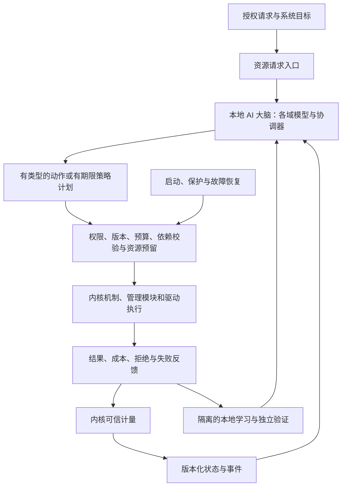

# CyxiaOS 全系统 AI 决策契约

版本：0.4。关联架构版本：v0.12。状态：尚未全域审核或实现验证；已实现的文件域子集与偏离/限制见 [Shell 与 AI 文件系统切片](docs/implementation/shell-ai-fs.md)。

最新资源域实现范围见 [AI 内存/任务/设备管理](docs/implementation/ai-resource-management.md)；固定模型切片尚未完成全系统统一调度或全域学习验收。

新增 [EL0/POSIX 子集](docs/implementation/posix-compatibility.md)：用户池准入复用内存模型，用户态派发使用模型 12290；异常/时限保护与正常 AI 策略分开。2026-10-16 新增 [固定 ELF 多进程/IPC 基础](docs/implementation/desktop-process-foundation.md)，模型 12289 选择可运行 EL0 进程，12290 分配预算；防饥饿保护单独统计，仍非全系统统一调度或全套 POSIX。

## 1. 用户要求与判定标准

用户明确要求：所有设计都必须围绕本地 AI 大脑的调度、决策实现。适用于进程/任务、CPU、内存、文件/存储、设备、网络、学习及后续平台扩展，不能把这些模块建设成各自独立优化、AI 只负责监控和解释的传统系统。

“AI 大脑”是一个逻辑决策主体，由本地高频策略模型、各资源域模型和后续低频协调模型构成；不要求一个大语言模型处理全部事件，也不要求每次底层指令都重新运行模型。这是实施方案选择。所有模型都在 CyxiaOS 客体内执行；浏览器原型和宿主工具不满足客体本地部署要求。

正常资源策略只有两种合法来源：模型本次生成并通过校验的动作，或模型此前生成、仍在有效期和适用范围内的策略计划。确定性逻辑可解释和执行模型输出，不能私自决定新的优化目标或改用另一套隐藏调度器。各模块必须标明“观测、请求、AI 决策、校验、执行、反馈”接口和状态。

用户意图、应用语义与资源策略分开：创建进程、读取指定文件等是授权请求；AI 决定合法请求的资源准入、额度和运行次序，不得擅自修改文件内容、改变读取对象或虚报操作成功。自主暂停/结束/重启仅限明确可管理的测试任务或具有授权恢复策略的服务；用户数据删除、权限扩大、模型运行时代码替换不能作为普通优化动作。

## 2. 所有模块遵守的主链

模块向 AI 提供有界数值观测，不暴露内核指针、任意内存或默认采集文件正文。应用不直接写计量值。AI 不能自行更改授权规则、保留池、最大预算、验收阈值或看门狗；内核限制模型的执行权限，不负责正常资源优化。

## 3. 各域的决定权与执行职责

| 模块 | AI 大脑正常决策 | 模块执行且不得擅改的语义 | 保护与拒绝 |
|---|---|---|---|
| 进程/任务 | 合法启动请求的准入与资源合同、可管理任务暂停/恢复、服务恢复方案、核归属提案 | 进程地址空间、线程/任务创建、装载、上下文、退出清理；等待对象就绪时转 runnable，不自行选择下一执行者 | 清单授权、父子所有权、生命周期依赖、不能任意结束用户任务；首版静态装载明确属启动来源 |
| CPU | 当前任务、时间片、后续多核放置与迁移提案 | 执行经验证动作，维护上下文、计时、就绪状态和唯一核归属 | 固定截止、合法时间片、保护等待下限；模型超时进入显式恢复 |
| 内存 | 新资源授予、应用预算、合法申请的竞争次序、可回收缓存目标、未来换入换出策略 | 按已授予合同分配具体空闲页、清零、映射、撤销、引用和归属管理 | 不动内核/推理保留池、固定/DMA 页及不可丢失匿名页；不得以额度缩减强制丢数据 |
| 文件/存储 | 合法请求的优先次序、并发/带宽份额、缓存/预读目标、允许范围内的后台刷写与快照时机 | 路径解析、句柄、读写字节、目录操作、写入依赖、屏障、日志/恢复协议 | 访问权限、fsync/事务语义、完整性和持久化承诺不可改写；无法满足期限需提前拒绝或显式失败 |
| 设备 | 设备请求队列份额、合法请求准入、允许范围内的电源/性能状态与恢复策略 | 发现、驱动匹配、寄存器操作、IRQ ack/eoi、DMA 生命周期与设备协议 | 硬件清单和驱动白名单；不得自动关闭关键时钟/安全装置；DMA 未停止不可回收缓冲 |
| 图形界面 | GUI 运行/刷新额度、缓冲准入与可回收缓存预算 | 桌面/X11 绘制、布局、输入路由、协议与完成；保持用户焦点、数据及业务语义 | 图形内存有界，并发按协议同步，DMA 在途页不可回收；图形故障保留串口恢复 |
| 网络 | 已授权流的准入、带宽、队列份额、缓冲目标与拥塞策略参数 | 协议状态机、报文格式、校验、合法重传和发送 | 网络访问权限、容量和协议正确性；AI 不自授网络访问 |
| 服务与 IPC | 服务资源份额、可选副本/重启提案，允许重排的工作请求优先级 | 端点权限、消息送达、等待/唤醒、声明的 FIFO/顺序约束 | 不重排有序消息，不丢已承诺可靠消息，队列满显式背压 |
| 安全/审计 | 风险模型产生受授权范围内的处置提案；选择允许的诊断分析作业 | 能力检查、审计来源绑定、强制保留、拒绝非法动作 | 核心授权和最低审计要求不由模型改写；不把“AI 决策”理解为无限权限 |
| 学习 | 在固定授权与预算内决定训练时机、样本配比/候选参数搜索与已定义目标优化 | 样本隔离、参数更新、独立验证、发布票据、受控切换和回退 | 不自改通过阈值，不碰最终测试集，不绕过 P3c 操作员启用要求 |
| 平台/多核 | 根据已公布能力作放置与资源计划 | 架构、平台与驱动适配提供统一语义，执行迁移协议 | 未验证架构不可标成支持；源核冻结/目标提交和代际规则不由模型跳过 |

页分配器选择满足合同的一个空闲页属于机制；在资源竞争中决定哪个任务获得更多页属于策略。文件系统根据已提交 I/O 计划保持写入依赖属于机制；另用未声明的后台算法更改任务间 I/O 份额属于策略绕行。网卡完成一个描述符属于机制；另行改变流之间的资源比例属于策略绕行。实现审查按这种区别检查，而不是要求每条指令都询问 AI。

## 4. 决策方式与高频执行

### 4.1 立即动作

适用于首版 CPU 控制窗口。`submit_schedule` 继续使用详细设计现有 v1 契约：每窗口一次、绑定任务/控制器代际与快照，不得重放。v0.9 不把通用多资源事务悄悄加入该 ABI。

### 4.2 AI 生成的有期限计划

用于内存额度、I/O 队列份额等较低频策略。计划由本地模型生成，经过验证后由确定性执行器在限定对象、额度、版本、时间和状态条件下使用。例如：为任务集合指定有限内存授予和有序候选清单，或给存储流指定固定份额和有界确定性仲裁规则。模型选择的计划参数与规则模板必须记录；模板集合由受信任配置预先定义，不能带任意代码或自然语言命令。

计划内执行每次检查额度和前置条件，不需要每次重新推理；其动作来源仍绑定原 plan_id/model_id。预定义执行规则不得在计划外自行改变份额、目标或回收对象。所有“预先训练模型”“已有计划”“手写默认值”要可区分，不能把手写默认值标为模型策略。

有效期限制的是新授予/新提交，不是已经交付给应用的活资源生命周期。计划过期后，已映射内存、未完成 I/O、已接受消息仍按既有所有权和完成语义维护；不能把过期当撤销所有权。新竞争性授予进入有界等待、拒绝或明确降级。立即完成的纯机制操作（例如读取已授权内存、释放自身页、完成已提交 I/O）继续执行。

### 4.3 上限、计划额度与已提交授予

三者必须采用不同对象类型，不能共用一个模糊的 quota 数值：

- `BudgetLimit` 是硬上限，不预留容量，也不保证未来分配；到达上限时拒绝，不到上限不等于获得资源。
- `PlanAllowance` 是有效 AI 计划中可申请提交的有限额度；尚未提交，不构成向任务交付资源的承诺，计划失效后不能继续凭它竞争分配。
- `ResourceGrant` 是经过准入并原子计入容量总账的已提交授予，绑定所有者、对象/资源类别、用途、总量、已兑现量、未兑现余额、代际和独立生命周期。授予时须预留可满足承诺的资源及必要执行元数据；不能先返回保证成功再等待下一次 AI 争取资源。

本设计选择支持第三类可兑现授予。例：给任务授予 100 页，20 页已映射、80 页未兑现，总账占用仍为 100 页，其他任务不可分走剩余 80 页。原计划过期或模型实例撤销后，第 21 页仍可按有效授予兑现：未兑现预留转为已占用，不重复扣账；这是 MECHANISM 履约，记录原 grant/decision/plan 来源，不再次计作 AI 优化机会。只有设置 100 页软上限而没有授予时，第 21 页仍属于新竞争性申请，需要有效 AI 决策/计划或明确恢复来源。

授予生命周期独立于原计划：正常耗尽、所有者主动归还、任务结束或授权管理操作触发取消；如授予带兑现期限，期限和未兑现余额失效行为须在交付时明确且不可由模型事后改写。取消只可立即释放未兑现余额；已映射页须按地址空间撤销、引用和 TLB 完成协议回收。终止整个授予对象要等全部引用与完成义务结清。上限降低或原模型失效均不能直接释放仍在使用的页。各资源域使用相同的“承诺/已执行”区分，但不能将内存履约语义误用于撤回已发送网络包等外部效果。

### 4.4 策略变化和稳定性

目标权重、计划和各域模型使用独立版本。候选针对哪个目标训练/验证必须绑定，目标变化使尚未发布候选失效。调整间隔、幅度、每域容量、滞回与超时全部来自冻结实验配置；AI 不得为了提交成功自行增大限额。不得仅凭浏览器评分公式证明真实多域模型有效。

## 5. 请求、计划和提交契约

以下定义语义字段，尚不是冻结的字节 ABI；实现对应资源域之前必须完成定长编码、溢出规则、调用权限、最大消息长度和状态表。

- `ResourceRequest`：request_id、请求主体/对象/能力及代际、资源域、请求量、期限、顺序依赖和幂等键。请求只表达意图，不能当作已批准动作。
- `Observation`：snapshot_id、来源计量范围、采集时间/水位、各资源版本、缺失/丢失标记。不同资源的时刻并不天然构成全局原子快照，提交时必须重验。
- `DecisionEnvelope`：schema_version、domain_id、brain/model_id、controller_epoch、policy_version、snapshot_id、水位/前置条件、decision_id、目标对象代际、能力范围、typed_actions、有效期及可用次数。
- `PolicyPlan`：plan_id、父计划、模型身份、适用域/对象、有限模板参数、硬上限、有效期、失效条件及不可变内容摘要。内核绑定真实提交者身份，不接受模型自报身份当认证。
- `ExecutionReceipt`：动作来源、request/decision/plan_id、实际动作、资源代际、计费、拒绝原因、提交/完成/取消状态。提交成功不等于物理写入已持久完成。

通用接口语义为：提交请求 → 发布观测 → 提交有类型提案 → 校验/预留 → 执行 → 发布结果。不得提供“执行任意命令”接口。每域执行器在动作入口检查权限、版本、容量、时效、对象归属和依赖；模板解释器也受相同检查。

请求队列与样本队列都有固定容量和来源配额，满时返回背压/拒绝；请求取消或超时必须移除未提交请求、释放尚未兑现的预留，并记录单次最终状态。已提交操作按照域语义完成/取消，不能重复产生副作用。模型迟到回复、重复提交和对象 ID 复用不重新激活旧请求。

## 6. 多资源一致性与死锁避免

一个逻辑 AI 大脑可以有多个资源域模型，但同一额度账本只有一个确定性提交权威。全局协调模型输出目标/联合提案，各域模型在已分配范围内输出本域动作；提交层不进行优化，只校验权属、总量和版本。计划与子计划绑定父代际；同一资源不能被两个有效提交重复预留。

不在持有内核锁、设备锁、已启动 DMA 或未完成映射撤销时调用模型。先采集快照并退出临界区，异步取得提案，再在有界临界区重验。AI 服务自身运行、模型驻留、最小日志、定时器与恢复路径由固定保留资源保障，不依赖它正在等待决策的文件、网络或普通资源队列。

联合准入使用有界“准备—提交/取消”状态机：按固定资源顺序尝试预留；任何项不足则释放本次未兑现预留，按有界重试规则返回等待或拒绝，禁止持有部分资源无限等 AI。事务元数据、预留和取消清理也计内存/CPU 预算。原子承诺只覆盖内存中的额度/对象发布，不声称磁盘、网络和设备物理动作可以全域原子回滚。

资源提交后逐域执行；部分设备失败按既定完成语义反馈，后续 AI 可以调整未来计划。已经发送的包、已经持久化的写不能“撤回”；不能通过回滚额度将仍在执行的操作再分配给他人。预留有独立代际和单次完成/释放标记；超时清理不能释放仍有执行引用的资源。

全局协调器、内存/文件/设备等新模型需要独立的执行机会、截止、容量和全系统准入预算，不能塞入现有 CPU 控制器 4 MiB 或学习 8 MiB 预算假装零成本。其工作分片有界、可抢占，单核上不得延长已有 CPU 控制窗口。每域实施前冻结这些预算并重做总账；尚未准入的域保持“未实现”，不默认启用。

## 7. 确定性路径和来源统计

每个决定只能绑定一个来源；不可将同一动作同时计入模型决策和保护动作。

| 来源 | 含义 |
|---|---|
| AI_DIRECT | 经校验的本次模型动作 |
| AI_PLAN | 使用仍有效的模型计划，必须关联模型与 plan_id |
| BOOTSTRAP | 模型尚未可用时的启动资源装载与静态初始授予 |
| SAFETY_GUARD | 无效动作拒绝、硬限额、公平保护及隔离故障处置 |
| RECOVERY | 模型故障、预算/速率不足或必要设备失败后的声明式恢复策略，附精确原因 |
| OPERATOR | 授权用户/管理员明确要求的动作，不能伪装成模型自主决策 |
| MECHANISM | 已承诺操作的协议推进、引用释放、IRQ 确认等，不进入优化决策分母 |

AI 不可用时，现有有效计划可在原适用范围内执行；故障身份被撤销时，与该实例绑定的未提交动作/未兑现计划一并失效。已提交资源合同仍按完成与所有权语义维护。CPU 使用既有有界恢复调度；内存和新 I/O 准入保守限流、排队或失败；文件系统和驱动继续必要一致性/清理操作。必须显示各域降级状态，不能保持全系统“AI 正常”标签掩盖退化。

按每个资源域分别报告提案、有效直接动作、有效计划动作、拒绝、保护、恢复、操作员动作与请求等待/失败，不以大量无竞争操作冲高 AI 决策比例。CPU 既有正常负载 95% 目标只适用原冻结 CPU 工作负载，不能直接套给内存/文件/设备；各域先冻结决策机会分母和目标，再验收。跨域总分不能掩盖某一域长期绕过 AI。

## 8. 实施顺序与阶段诚信

首版单核 ARM 仍先实现 P0—P4 CPU 闭环，但从 P0 起全部管理模块均采用本契约。P1/P2 的确定性页管理、静态启动装载和恢复轮转是必要基础，必须标为 BOOTSTRAP/MECHANISM/RECOVERY，不能宣布它们已具备 AI 内存或进程策略。

| 阶段 | 增量交付 | 不能提前声称 |
|---|---|---|
| P0 | 固定决策来源、各域观测/请求/动作语义、预算与接口依赖；仅冻结当前实施范围的编码 | 全域 ABI 已完全冻结 |
| P1/P2 | 可启动机制、基础内存、隔离任务、权限、IPC、恢复路径；预留受检策略接口 | 完整 AI OS、动态进程服务或 AI 内存策略已完成 |
| P3a/P3b/P3c/P4 | 正式本地 CPU 模型、受限运行反馈学习、恢复及客体验证 | 全部资源由 AI 决策 |
| P5-M | 内存预算、准入、可回收缓存模型与有效计划执行 | 可任意回收匿名内存或已有交换系统 |
| P5-P | 动态进程/线程、授权生命周期请求、AI 资源合同与服务恢复提案 | 任意自主结束用户进程 |
| P5-F | 文件系统机制、块设备及 AI 存储/缓存策略 | 已满足未验证的持久化或断电恢复承诺 |
| P5-D | 通用设备管理及 AI 队列/性能/恢复策略；先选择确定设备类别 | 通用设备协议与驱动生态已经完成 |
| P5-N | 协议栈机制、合法流与 AI 网络资源策略 | AI 可绕过网络能力权限 |
| P5-C | 已完成各域的联合目标、额度提交、一致性和振荡对照 | 单域收益自动转化为全局收益 |

P5 子项按依赖安排：块设备/网络设备基础驱动先于对应服务，P5-D 指通用设备策略不是延后必须驱动。每增加一个域，先给出观测、动作空间、整数模型/计划模板、恢复策略、预算和验证集，再接入。模型未知时可用明确标为测试替身的策略验证接口；替身不能作为 AI 功能验收。

P4-S/P4-X 仍为多核/第二架构独立验证阶段。学习机制在新资源域复用发布门控思想，但不能不经训练目标与反事实评估就复制 CPU 奖励。全系统学习和联合控制预算需要重新准入。

## 9. 原型与实现差距

现有 HTML 是交互机制原型。CPU 使用简化预测与评分；内存按手动配额申请、文件由按钮直接操作、设备由按钮模拟开关、网络按队列消费、多核初始放置按手写计数。它们不具备本契约要求的全域模型决策，不得因为有 AI 页面就称为完整 AI 驱动系统。

下一轮原型实现应把资源按钮改为请求入口，展示模型提案、校验、计划执行、结果和来源；为每个模拟域接入可识别的模型或明确测试替身。不能仅改标签、生成一段解释或把固定规则包装成 AI。此次先更新规范与适用性标记，不冒充已经改写所有原型行为。

## 10. 验证与待冻结项

| 检查 | 通过标准 |
|---|---|
| C01 策略绕行检查 | 各域正常竞争决策均有模型动作或有效计划证据；隐藏优化路径失败 |
| C02 机制与意图区分 | AI 不改变请求对象/字节/顺序/权限，机制完成不误计为 AI 决策 |
| C03 身份与时效 | 陈旧/重复/越权/过期/父代际变化均拒绝，已交付所有权不因计划过期丢失 |
| C04 跨域总账 | 并发提案不超配、无重复预留；失败/取消/超时无泄漏，执行引用释放前不可复用 |
| C05 无循环依赖 | 模型失败、队列满、存储/网络离线时内核保护、模型恢复与必要清理仍前进 |
| C06 全成本 | 各域推理/协调/学习/验证、工作区和提交成本均计入准入与实测 |
| C07 执行可追溯 | 来源可关联冻结模型或计划；故障和保护分域报告，缺证据不得标正常 |
| C08 学习与稳定性 | 同一负载对照、保留集隔离、目标变更失效、回退及跨域振荡实验 |

均为待执行的规格。各域数值阈值、进程/线程完整模型、文件系统方案、设备类别与电源状态、请求字节 ABI、联合提交规模和模型结构留给相应专项设计，不得在实现中默默确定后宣称已经通过全域审核。

本契约只确定必须围绕 AI 的职责与接入原则。若与总体/详细设计产生未明确解决的冲突，先修订相关条目再编码，不能以“AI 中心化”为由取消既有隔离、数据一致性或故障保护。

## 11. POSIX 兼容约束

[POSIX 专项设计](CyxiaOS-posix-design.md) PX-R10 是各域必须遵守的语义边界。应用调用指定行为；模型只选择合法资源策略。接口允许的错误、部分 I/O、共享偏移、同步顺序及已成功授予对象不能因策略或学习版本变化而被改写。标准调度选项先形成硬约束，模型仅在可行集合内选择；不支持的选项必须如实声明。

兼容层不得引入独立于 AI 的隐藏优化中心；合法已有授予内的 syscall、复制/唤醒/协议推进标为 MECHANISM。模型拒绝、超时、失效、切换与回退都要执行 PX-T10，确认语义和既有引用仍正确。测试程序时限不是任意终止一般用户程序的授权。

## 12. 桌面与 Linux 兼容约束

[轻量桌面](CyxiaOS-gui-design.md)与 [Linux 兼容层](CyxiaOS-linux-compatibility-design.md)均进入统一 AI 资源总账。原生/Linux ABI 只负责接口与语义，不引入各自的资源调度器；X11/Wayland 协议、线程同步、信号和已提交 I/O 不得为优化而任意重排。

模型控制实际进程/服务的 CPU、内存和设备额度，不改写输入、焦点、权限、文件或返回结果。兼容声明所需调度约束限定 AI 可行集合，缺失接口如实拒绝。启动、保护和恢复单独计量，模型超时/过期/学习回退必须回归 POSIX 与 Linux 行为。现有模型未经桌面负载验证，不能继承已有切片的通过结论。

## 2026-10-18 实现核对记录

真实单核 ARM 实现及本轮代码修正见 [全系统 AI 强化落地清单](docs/implementation/system-ai-status.md)。进程/线程/内存/文件/部分设备具有本地策略，本轮增加显示节奏与存储新请求额度、实际执行/拒绝/归还计量，新增 `ai system`。这不代表 C01—C08 全域验收：跨域协调、完整请求/版本/期限回执、模型替换故障恢复、全域学习、网络及多核仍未实现；BOOTSTRAP/MECHANISM/SAFETY_GUARD 不计入 AI 覆盖。
