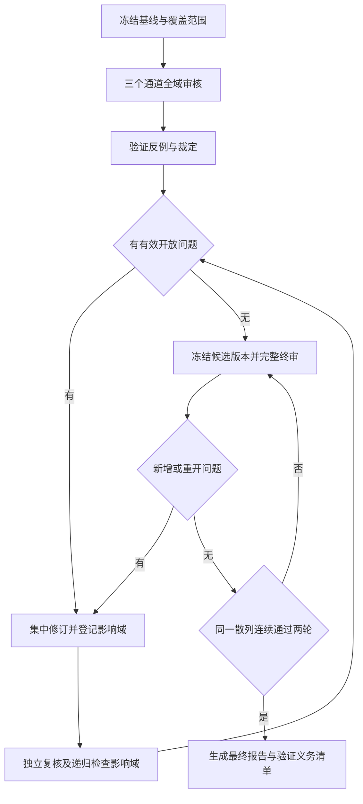

# CyxiaOS 全方位架构递归审核实施计划

> **For agentic workers:** REQUIRED SUB-SKILL: Use superpowers:subagent-driven-development (recommended) or superpowers:executing-plans to implement this plan task-by-task. Steps use checkbox (`- [x]`) syntax for tracking.

**Goal:** 审核并修订 CyxiaOS 全系统架构，递归检查修订影响，直至既定审核范围内所有设计问题关闭，并在同一冻结版本上连续通过两轮完整复核。

**Architecture:** 采用“冻结基线—全域审核—反例验证—集中修订—独立复核—影响递归—完整终审”的闭环。通过需求覆盖表、问题台账与版本散列追踪结论，首版单核 ARM 与后续多核/跨平台设计分别标记成熟度。

**Tech Stack:** Markdown 架构文档、JSON 审核台账、文件内容散列、官方技术规范、独立审阅上下文。当前审核对象为设计文件，不编写或运行操作系统实现。

**Spec:** [总体设计](CyxiaOS-design.md)、[详细设计](CyxiaOS-detailed-design.md)。执行者必须读取二者；不能只依据本计划审核。

计划版本：1.0 · 日期：2026-10-15 · 状态：执行完成；发现9项独立问题全部关闭，同版两轮完整终审通过，详见台账及最终报告。

## 1. 全局约束

- 操作系统名称为 CyxiaOS；全新内核，不基于 Linux。
- AI 大脑由 CyxiaOS 内部运行的本地模型实现，承担调度和资源决策。
- 首版采用单核 ARM；ARM64、Cortex-A53 和其他未确认选型保持“建议”身份。
- 总体架构考虑跨平台、多核与解耦；不能为使问题归零而删除这些要求。
- 本次只修改架构与审核文档。实现、安装依赖、编译、硬件验证、形式化证明分别需要后续工作。
- 首版范围为 P0—P4；P4-S、P4-X、P5、P6 的架构契约纳入审核，运行能力按其阶段验收。
- 审核不擅自新增产品定位、第二架构、实时等级或实体硬件要求。
- 保留全部真实问题与历史结论；重复、误报、范围外的判定均须有可检查理由。

## 2. “问题为 0”的含义和停止条件

归零对象是**已冻结范围内经审核识别的设计缺陷及未决裁定**。它不能证明尚未实现的系统没有 bug，也不表示性能、硬件行为或安全性质已经通过运行测试。

必须同时满足：

1. Critical、High、Medium、Low 四级有效问题的未关闭数全部为 0。
2. 待裁定、待修订、待独立复核、重开、被外部信息阻塞的问题数均为 0。
3. 所有已确认需求、INV-01—INV-10、审核域和强制跨域场景都有结论及证据位置；不能留 NOT_REVIEWED。
4. 每个关闭的问题都能定位到修订内容、反例的阻断机制、独立复核记录和关联验证场景。
5. 同一组最终文件散列上，连续两轮完整终审没有新有效问题，也没有重开问题。只复核改动段落不算完整终审。
6. 两份架构文档的术语、数值、容量、接口、阶段与验收口径一致。
7. 所有仍需实现/实验确认的假设单独列为验证义务，明确条件、验证方法和失败处理，且不再被文档表述为已证实事实。

终审中任何架构文件变化都会使连续通过轮数归零。新增有效问题后回到修订循环，不因已完成两轮、用时较长或发现数下降而提前结束。

未定的设计事实若影响当前安全边界或使接口无法实施，应保持 OPEN/BLOCKED，不能改名“后续验证”来凑零。明确非当前交付能力的未来功能，只审核其边界、依赖与准入条件，不要求提前实现整个产品。

若缺少用户决策、外部规范证据或运行预算，保存检查点并如实报告未关闭事项；不得宣称归零。正常循环不设“最多修订三轮”之类的成功替代条件，也不无限重复同一无进展检查：连续两轮在同一问题上无进展，应重新分析证据或提出具体缺失信息。

## 3. 文件、基线与交付物

所有主交付物放在项目目录 `/Users/robin/CyxiaOS`。

| 文件 | 职责 | 当前状态 |
|---|---|---|
| CyxiaOS-design.md | 修订后的总体架构与阶段范围 | 已修订，v0.7 |
| CyxiaOS-detailed-design.md | 修订后的机制、协议、状态机与验证要求 | 已修订，v0.7 |
| CyxiaOS-architecture-review-plan.md | 审核范围、步骤、问题关闭和停止规则 | 本计划 |
| CyxiaOS-architecture-review-ledger.json | 唯一问题台账、轮次、状态与基线记录 | 已创建 |
| CyxiaOS-architecture-review-coverage.json | 需求、章节、接口、不变量与场景覆盖 | 已创建 |
| CyxiaOS-architecture-review-report.md | 审核结论、修订摘要、关闭证据与剩余验证义务 | 已创建 |
| architecture-review/baselines/ | 每轮不可变输入快照和散列清单 | 已创建 |
| architecture-review/rounds/ | 各审阅通道输出、合并裁定与复核记录 | 已创建 |

计划制定时的参考基线：

| 文档 | SHA-256 |
|---|---|
| CyxiaOS-design.md | `23d1dd6149067d9fc63fc25a98971ccb3c945ac0505f2c486b779e9fa2b50762` |
| CyxiaOS-detailed-design.md | `0e84f348fdfad7aaeb817ef455f12c3973cb77b6da86a224745d7d394568df42` |

正式执行前重新计算散列。文件已变化时创建新的审核基线并记录差异，不覆盖用户改动，不沿用旧版“已审核”标记。当前项目尚无操作系统代码，计划不要求初始化 Git；如以后已有仓库，则遵守现有版本管理方式。

## 4. 审核焦点

以下五类跨模块条件必须贯穿全轮审核，并在任务 3 中给出具体反例或成立理由：

1. 用户模型错误、超时或恢复发生在预算边界时，系统是否仍能调度并避免重复发放资源。
2. 唤醒、超时、退出和迁移交错时，是否存在丢唤醒、双执行、无槽回滚或旧消息完成新等待。
3. 地址空间切换、远端 TLB 撤销和对象释放交错时，旧引用/旧映射是否还能访问已复用资源。
4. 平台寄存器、页大小、时间单位、原子能力或协议版本变化时，抽象层是否真实隔离差异。
5. 模型和日志的负载、容量及失败处理是否会反过来饿死业务任务，或让指标掩盖实际回退。

## 5. 全系统审核范围

审核深度使用三种标记：CURRENT 表示首版必须具备可实施契约；EXTENSION 表示已承诺扩展的协议与安全边界；FUTURE 表示尚未交付功能的范围、依赖和验收前提。FUTURE 不表示“不看”。

| 域 | 范围与重点 | 文档入口 | 深度 |
|---|---|---|---|
| D01 需求和不变量 | 用户要求、建议选型、目标冲突、INV-01—10、范围完整性 | 总体 §1—3；详细 §1 | CURRENT |
| D02 启动与平台 | ELF/DTB、异常级、MMU、IRQ、计时器、启动失败、固件边界 | 详细 §2、4.2、6.1 | CURRENT/EXTENSION |
| D03 解耦与可移植性 | contracts、依赖图、能力探测、逻辑类型、ABI 绑定、平台替身 | 总体 §4；详细 §3 | CURRENT/EXTENSION |
| D04 内存与映像 | 页所有权、W^X/别名、装载边界、内存预算、回收、cache/TLB | 详细 §4、9、10.6.7 | CURRENT/EXTENSION |
| D05 任务与权限 | TCB、状态完整性、代际、能力授予/撤销、任务终止、对象引用 | 详细 §5、9 | CURRENT |
| D06 IPC 与等待 | WaitCell、消息队列、等待代际、满队列、超时、重复完成 | 详细 §5.3、10.6.4 | CURRENT/EXTENSION |
| D07 调度与计时 | 公平、准入、抢占、idle、控制窗口、限流和计量口径 | 详细 §7 | CURRENT |
| D08 多核与同步 | 启动、所有权、锁序、IPI、迁移事务、TLB ACK、延期回收 | 详细 §10.6 | EXTENSION |
| D09 AI 模型与训练 | 特征闭合、量化溢出、推理成本、训练泄漏、模型包、目标函数 | 详细 §8、11 | CURRENT/FUTURE |
| D10 协议与版本 | v1/v2、序列化、字段长度、验证顺序、一次性提交、协商失败 | 详细 §6、10.1、10.6.6 | CURRENT/EXTENSION |
| D11 安全边界 | 模型权限、用户指针、不可信文本、DMA、启动信任、模型来源 | 总体 §8；详细 §2.3、3.5、5、11 | CURRENT/FUTURE |
| D12 故障与恢复 | 超时、重建、自检进展、恢复计费、CPU 失联、panic 和失败闭环 | 详细 §7.1、9、10.6.8 | CURRENT/EXTENSION |
| D13 驱动与 I/O | IRQ 有界性、非阻塞日志、DMA、块请求依赖、网络队列与配额 | 详细 §3、6.1、10.3—4 | CURRENT/FUTURE |
| D14 多资源控制 | 内存收缩、预算总和、跨资源事务、部分应用、振荡与退回 | 详细 §10.1—5 | EXTENSION/FUTURE |
| D15 审计与运维 | 丢失计数、跨核因果、模型/配置标识、更新回退、备份恢复边界 | 总体 §7—9；详细 §8.4、12、14 | CURRENT/FUTURE |
| D16 验证与工程落地 | V/A/S/X 覆盖、性能基线、测试假设、阶段依赖、容量算式与证据 | 总体 §10—13；详细 §13—16 | CURRENT/EXTENSION |

文档原有章节按最少一个域映射；任何未映射章节都作为覆盖缺口。若出现文件系统、设备热插拔、持久数据或电源管理等未交付主题，记录为 FUTURE 边界并检查是否已有模块暗中依赖它，而不是临时宣布已具备该能力。

## 6. 问题台账与分级

### 6.1 问题结构

每个问题使用稳定 ID `CYX-AR-0001` 起递增。台账至少包含：`id`、`title`、`severity`、`domain_ids`、`baseline_hashes`、`round_found`、`file_sections`、`evidence`、`trigger_trace`、`violated_requirement_or_invariant`、`impact`、`proposed_resolution`、`affected_domains`、`status`、`fix_revision`、`verification_scenarios`、`reviewer_result` 和 `closure_evidence`。

状态转换：

`PROPOSED → CONFIRMED → FIXING → FIXED_PENDING_REVIEW → CLOSED`

复核失败：`FIXED_PENDING_REVIEW → REOPENED → FIXING`。缺事实或用户决策时进入 BLOCKED，仍计未关闭。撤销意见使用 FALSE_POSITIVE、DUPLICATE、OUT_OF_SCOPE，但必须附依据；重复问题指向原 ID，其主问题未关闭时不能从未解决事项中消失。

严重级别与开发阶段 P0—P6 分开命名：

| 级别 | 判据 |
|---|---|
| Critical | 设计允许突破隔离、任意权限提升、数据破坏或同一任务多核同时执行 |
| High | 可导致启动失败、死锁、永久丢唤醒、失控资源消耗或恢复失效 |
| Medium | 重要接口不闭合、容量/时序矛盾、指标失真、跨平台约束泄漏 |
| Low | 有实际实施影响的局部歧义、版本/文档不一致、验收缺口 |

纯文字润色记为编辑建议，不伪装成缺陷。关键规则缺失即使尚无实现，也不能仅因“未来编码时再定”而降为编辑建议。若问题被证实为假设不成立，需要记录反证，不能直接删除。

### 6.2 关闭标准

关闭需要同时存在：明确修订、触发反例被阻断的机制、两文档一致性、关联验证场景，以及非修订者的独立复核。标注“风险已接受”“暂时延后”或“现在没有代码”不能关闭仍在本次范围内的问题。

性能假设可记录为验证义务，例如“模型能否在 250 μs 截止内完成”；但“没有超时保护”是设计缺陷，必须修订。验证义务与开放缺陷分别计数，最终报告同时显示，不能隐藏前者。

## 7. 审核组织与递归算法

建议采用三个独立审阅通道，总协调者负责合并与唯一写入：

- 通道 A：需求、平台、分层、内存、驱动和跨架构接口。
- 通道 B：调度、多核、IPC、锁、任务生命周期与资源回收。
- 通道 C：本地模型、协议、安全、恢复、多资源控制、审计和验证口径。

通道读取同一不可变快照，只输出发现与证据，不同时修改架构文件。必要交叉域故意重叠，合并时按根因去重，不按相同文字去重。后续完整终审轮换通道职责或使用新审阅上下文，避免仅沿用修订者的解释。

递归规则：

1. 从用户需求到不变量、组件、接口、状态转移、失败路径和验证场景逐层审查。
2. 任一问题修订后，复核原问题及所有受影响的生产者、消费者、计量、回收和测试；影响传播到其他模块时继续向外扩展。
3. 若问题改变公共契约、锁图、所有权、版本或预算，必须重审所有调用方，不能只检查一段新文字。
4. 递归结束条件是影响集合没有新增待查项，随后进入完整终审；局部闭环不能替代全局终审。

不在一个不断扩大的上下文中无限自我复读。各轮审阅包包含当前快照、范围、必要规范与输出格式；正式终审先独立审阅，再对照历史台账检查修订回归。

## 8. 执行任务

### 任务 1：冻结基线和建立完整覆盖表

**读取：** 两份架构文档、当前用户约束、本计划。

**创建：** 基线快照、ledger.json、coverage.json。

**输出契约：** 每个需求/不变量/章节有稳定记录 ID、适用阶段、审核域、判定项及状态；未审核状态为 NOT_REVIEWED，开放问题计数尚未建立时为 null，而非预填 0。

- [x] 逐项登记用户确认要求与建议选型，建立 REQ-001 起的需求记录。
- [x] 重新计算文件散列，保存不可变副本和时间戳；记录是否与本计划参考基线不同。
- [x] 将全部章节、INV-01—10、V00—V23/V08a、A01—A04、S01—S09、X01—X02 映射到 D01—D16。
- [x] 标注 CURRENT/EXTENSION/FUTURE 及“不依赖未实现功能”的判定项。
- [x] 检查无孤立需求、章节或不变量，再冻结首轮审阅包。

**通过条件：** 审核对象明确、覆盖记录齐全、无假定的已通过结果。

### 任务 2：首轮全域审核与裁定

**读取：** 冻结审阅包、必要的官方规范。

**修改：** 台账与覆盖表；此步不修改设计。

- [x] 三个通道分别审核完整职责域，输出问题、依据和逐项覆盖结论。
- [x] 对硬件行为、ABI 或内存序疑点查阅对应官方规范，记录版本/地址与支持结论的内容。
- [x] 每项发现给出最小触发条件；纯“不喜欢这种架构”不作为缺陷。
- [x] 合并重复根因，明确 CONFIRMED 或有依据的误报/范围外判定。
- [x] 审核所有无问题结论是否有覆盖证据，不能只接受一句“没发现”。

**通过条件：** D01—D16 全部有审核输出，候选问题均已裁定或保持明确 BLOCKED。

### 任务 3：强制跨域反例推演

**读取：** 设计快照、问题台账、覆盖表。

**创建：** 本轮反例记录，关联稳定问题 ID。

- [x] 推演模型在 10 ms 周期边界超时、自检与恢复同周期交接，以及正常任务持续占用 CPU 的情况。
- [x] 推演消息先于 BLOCKED、超时与消息同刻、旧唤醒晚于下一等待、任务退出时消息仍在途。
- [x] 推演迁移 PREPARE/COMMIT/ACK 的丢失、重复、迟到，源/目标满容量，回滚和旧模型动作同时发生。
- [x] 推演地址空间进入/退出与页撤销交错，远端 ACK 延迟、CPU 失联、代际复用和对象仍被引用。
- [x] 推演中断嵌套、持锁抢占、反向锁序、收件箱满、恢复清零超时和日志消费者停止。
- [x] 推演未知协议版本、错误长度、整数溢出、非法模型包、不同页大小/指针位宽/原子能力。
- [x] 推演新增全局 AI 协调器和多资源控制器后，预算总量、回退来源和性能分母是否仍正确。
- [x] 对每条轨迹记录有序事件、读写状态、持锁情况、线性化点、资源归属和预期结果；不足以证明安全时登记缺口。

**通过条件：** 五项审核焦点和所有强制场景均有可复核轨迹；没有用“实现时注意”代替机制。

### 任务 4：按根因集中修订

**修改：** 两份架构文档、台账、覆盖表及必要的验证矩阵。

**输出契约：** 每组修订关联问题 ID、涉及章节、旧/新规则、影响域与待复核证据。

- [x] 按 Critical→High→Medium→Low 排序，并将同一机制的关联问题合并为一致修订。
- [x] 保留已确认需求，在满足约束的方案中选择最小、可解释的设计变化；建议选型仍明确标记。
- [x] 同步总体与详细设计，包括状态机、容量、时序、接口和验收用例。
- [x] 建立影响集合：直接修改模块、接口两端、共享预算、权限、生命周期、审计及测试。
- [x] 将修订项标为 FIXED_PENDING_REVIEW，保存新版本散列；修订者不自行标 CLOSED。

**通过条件：** 修订具体可检查，且没有通过缩小用户目标或删除失败场景掩盖问题。

### 任务 5：独立复核并递归检查影响

**读取：** 新快照、原反例、问题修订及影响集合。

**修改：** 台账、复核记录和覆盖表。

- [x] 非修订者逐项判断旧反例是否仍成立，并写出阻断反例的明确规则。
- [x] 检查修订是否在上下游引入新的依赖、竞争、性能预算或权限问题。
- [x] 对新增影响域重新推演；继续传播直到影响集合稳定且全部已查。
- [x] 复核通过才 CLOSED；失败则 REOPENED，并保留失败证据。
- [x] 有新问题则返回任务 4；涉及范围或基础前提变动时返回任务 1/2 更新基线与覆盖。

**通过条件：** 有效开放问题为 0、无未裁定/待复核/阻塞项，准备进入完整终审。

### 任务 6：两轮冻结版本完整终审

**读取：** 同一最终候选快照及全部范围；每轮使用新审阅上下文。

**创建：** FINAL-1、FINAL-2 终审记录。

- [x] 冻结候选文件并记录散列；确认全部 D 域、需求、不变量和跨域场景覆盖完整。
- [x] 第一轮从需求到机制完整审查，并反查历史问题关闭证据。
- [x] 若发现新问题，重置通过轮数并返回任务 4，不生成虚假的通过结论。
- [x] 第二轮交换审核视角，从失败注入、资源耗尽、并发和契约演进反向完整审查。
- [x] 比较两轮前后的文件散列完全相同，确认无新有效问题或重开项。

**通过条件：** 同一冻结版本连续两轮完整通过；不能拿历史的局部复核充当本任务。

### 任务 7：交付最终结论与后续验证义务

**创建：** CyxiaOS-architecture-review-report.md。

- [x] 汇总各级发现数、已关闭数、误报/重复数、开放数与每轮记录。
- [x] 给出范围覆盖率、最终版本和散列、两轮独立终审证据。
- [x] 列出仍需实现验证的计时、性能、硬件、SMP、第二架构和故障注入义务，标注对应阶段与通过条件。
- [x] 检查 Markdown 链接、章节引用、表格数值、协议长度及模型参数计算，保留检查结果。
- [x] 对用户报告“本范围内设计问题已关闭”或明确未达到条件的原因，避免宣称系统已完成或绝对无缺陷。

**通过条件：** 用户能够从报告追溯每项结论，能够区分文档归零与尚未执行的实现测试。

## 9. 审阅输出格式

每个独立审阅通道返回以下内容，避免只给结论：

1. 输入文档版本/散列、职责域及完成覆盖项。
2. 按严重度排序的问题列表，每项包含位置、证据、触发轨迹、影响和最小修订方向。
3. 已检查但没有发现问题的关键场景及成立依据。
4. 未能检查的事项和原因；这些事项保持 NOT_REVIEWED/BLOCKED。
5. 是否需要重审其他域，以及具体传播路径。

复核者还需逐项返回 CLOSE、REOPEN 或 BLOCKED，并引用修订机制；不能仅返回“看起来没问题”。

## 10. 执行范围与当前交付状态

本文件规定审核流程。用户已授权立即执行审核并修订；执行结果记录在台账、覆盖表和最终报告中，不能仅凭本计划宣称设计问题已归零。

执行时按任务 1—7推进，由一个协调者负责写入，独立审阅通道负责发现和复核。过程中若需要用户决定改变已确认范围，只提出具体分歧，并继续不依赖该决定的审核；未解决的决定仍计入阻塞事项。
