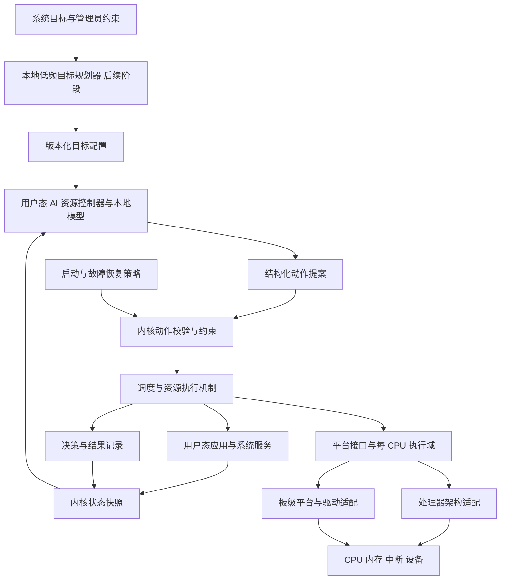

# CyxiaOS AI 原生操作系统设计文档

版本：0.12 · 日期：2026-10-15 · 状态：纳入轻量桌面与 Linux 应用兼容规划；新增契约尚未全域终审，v0.7 历史结论不覆盖本版

代码实施状态（2026-10-16）：已有 M1 单核 ARM 内核、[Shell 与 AI 文件系统](docs/implementation/shell-ai-fs.md)、[AI 内存/任务/设备切片](docs/implementation/ai-resource-management.md)，以及 [EL0/POSIX 文件接口子集](docs/implementation/posix-compatibility.md) 的指定 QEMU 验证。现有本地模型主要在内核集成路径运行，文件域具备有限学习；已有 [固定 ELF 多进程与 IPC 基础](docs/implementation/desktop-process-foundation.md)；独立用户态 AI 服务、全系统统一调度、通用应用装载和完整 POSIX 仍是目标，不能将局部实现等同于下文全部架构完成。

图形与应用扩展状态：规划 LXDE/X11 轻量桌面及 [Linux 应用兼容层](CyxiaOS-linux-compatibility-design.md)，详见 [GUI 设计](CyxiaOS-gui-design.md)。桌面与 Linux ABI 尚未实现；已有 [D1 显示/原始键鼠切片](docs/implementation/graphics-bringup.md)，不代表正式图形服务；直接运行 ARM64 Linux 二进制为待确认的规划假设，除实现文档所列 D1 与 D2 基础切片外，D/L 阶段不属于已验证能力。

配套文件：[CyxiaOS 详细设计](CyxiaOS-detailed-design.md)。本文件描述总体目标与边界；配套文件细化模块职责、状态机、接口、模型结构与验证方法。数值与接口为设计约束；运行验证范围仅限上述实现文档和证据中明确列出的部分。

交互入口：[全系统机制原型](CyxiaOS-system-prototype.html) · [原型范围说明](CyxiaOS-system-prototype-design.md) · [原型验证记录](CyxiaOS-system-prototype-verification.md)。这些是浏览器模拟，不代表客体操作系统已实现。

## 1. 设计目标与需求来源

CyxiaOS 的目标是从零开发一个独立操作系统，由本地 AI 根据运行状态和系统目标，持续决定任务调度与资源分配。系统应能够说明每次资源决策来自哪个模型、依据什么状态、执行了什么动作，以及结果如何。

用户已经明确的要求：

- 操作系统名称为 CyxiaOS。
- 不基于 Linux，开发全新操作系统。
- AI 大脑负责调度和资源决策。
- AI 大脑由本地模型实现，推理在运行 CyxiaOS 的设备内部完成。
- 首版采用单核 ARM 平台。
- 总体架构必须考虑跨平台、多核扩展和模块解耦。
- 系统具有学习功能，根据运行反馈改进模型。
- 所有管理模块的设计必须围绕本地 AI 大脑的调度、决策，不能由模块各自隐藏优化策略。
- 移植轻量桌面，目标是广泛运行 Linux 应用；规划 LXDE/X11 与独立 Linux 应用兼容层，准确架构/软件清单和二进制范围须冻结。
- POSIX 兼容是正式要求，先交付可重新编译 C 程序的接口子集，再按标准配置扩展行为兼容。
- 设计文档、浏览器原型和真实内核代码分别标记成熟度。

用户已确定首版采用单核 ARM。本文件按 ARMv8-A 的 AArch64（ARM64）方案细化；64 位、具体 CPU、Rust、微内核、模型结构、数值参数和阶段范围仍为建议选型。暂按研究型操作系统规划；桌面、服务器、工控或移动设备等产品定位尚未确定。操作系统名称由用户确定为 CyxiaOS。

“AI 决策”在本设计中有可验证的含义：正常运行时，可运行任务之间的选择及其时间片由学习得到的模型输出决定；未来扩展到内存、存储和网络资源。内核负责执行动作及维护不可破坏的约束。启动、故障恢复和强制公平保护使用确定性逻辑，并单独记录，不能计入 AI 决策比例。

第一版验证 CPU 调度闭环。它是完整目标的第一阶段，不能据此宣称全部系统资源已经由 AI 管理。

全系统约束：[AI 决策契约](CyxiaOS-ai-decision-contract.md)。正常策略必须来自模型本次动作或仍有效的模型计划；进程、内存、文件、设备、网络等模块负责观测、请求、校验、执行与反馈。高频机制在已提交的计划/授予内执行，不要求每次 IRQ、文件读取或页分配重新推理。启动、保护、恢复、操作员和机制来源必须分别记录，不能伪装成 AI 决策。

“首版单核 ARM”限定首个可运行配置，不限定系统的长期架构。通用内核、处理器架构适配、板级平台、驱动和本地 AI 服务从第一版分开；CPU 拓扑、任务所有权、跨核消息和协议演进在本版设计中确定，多核运行和第二架构移植分阶段实现。

## 2. 目标、非目标与失败判据

### 2.1 目标

1. 独立启动并运行自行编译的用户态程序，不依赖 Linux 内核、Linux 系统调用或 Linux 用户空间。
2. 在操作系统内部运行本地模型，形成“观测—决策—校验—执行—反馈”的闭环。
3. 隔离应用、控制器和内核；模型错误不能获得任意内存或设备访问权。
4. 模型超时、崩溃或权重异常时，仍能运行诊断与恢复任务。
5. 使用可重复实验，比较 AI 策略和传统调度策略的性能及成本。
6. 通过受限平台接口、每 CPU 状态与显式同步协议，支持后续多核及第二处理器架构，避免重写通用调度和资源机制。

7. 分阶段提供 POSIX 源码/API 与可观察行为兼容；标准基线、需求追踪和验收见 [POSIX 专项设计](CyxiaOS-posix-design.md)。

### 2.2 第一版不包含

最初 CPU 原型不包含桌面图形环境、Linux/Windows 二进制兼容、通用 GPU 驱动、生产级文件系统、多核调度、硬实时保证，以及系统运行时自主修改内核。运行时本地有限学习纳入新增 P3c，见配套学习设计。

POSIX 完整兼容不作为最初 CPU 原型的一次性交付条件，但 POSIX 接口、进程/FD/地址空间语义及兼容层解耦从现在起必须纳入架构。当前已实现子集不代表完整标准或认证。

此处多核调度指首版不交付多核运行能力；多核数据结构、同步边界和平台接口属于首版设计与验证范围。

大语言模型可以成为后续的目标规划组件，但第一版无需将大语言模型移植到新内核，才能验证 AI 调度。

轻量桌面已纳入 [LXDE/X11 路线 D0—D5](CyxiaOS-gui-design.md)，Linux 应用支持纳入 [L0—L5 兼容路线](CyxiaOS-linux-compatibility-design.md)。它们扩展后续系统目标，不改变最初 CPU 原型的历史边界，也不引入 Linux 内核。

### 2.3 失败判据

- 正常调度仍由传统算法完成，AI 只提供说明或偶尔调整参数。
- AI 控制器依赖被自己调度的任务才能获得运行机会，导致循环等待。
- 内核绕过隔离来满足模型输出，或模型可以自行取消权限边界。
- 为提高平均吞吐量而长期饿死任务。
- 只展示演示效果，没有基线、推理开销或故障恢复证据。

### 2.4 POSIX 兼容的正式要求

兼容基线为 POSIX.1-2024，按 [PX-R01—PX-R12](CyxiaOS-posix-design.md) 覆盖 C API/ABI、用户隔离、FD、进程生命周期、虚拟内存、VFS、IPC/信号/终端、线程/时间、AI 语义边界及跨平台验收。当前单 ELF、15 接口是 S1 有限切片；后续 S2—S6 是正式路线，不能删除缺失的必需项来扩大兼容声明。

AI 负责资源策略，必须保持标准所规定的可观察语义；不得修改调用对象、数据、权限、共享偏移或错误返回。模型失败与学习切换后仍须保持已成功提交的义务。完整 POSIX 配置与认证分开。新增 Linux 应用目标由独立兼容专项承接，不能把 POSIX 子集验收当作 Linux 二进制支持。

## 3. 技术路线与边界

| 项目 | 建议选择 | 原因及边界 |
|---|---|---|
| CPU 架构 | 已确定单核 ARM；建议 ARMv8-A / AArch64 | 首版只启用一个 CPU，具体实体芯片尚未选定 |
| 开发平台 | QEMU Arm virt，Cortex-A53，单核、256 MiB 内存 | 使用 TCG 做功能验证与故障注入；真实性能须在实体硬件验证 |
| 启动方式 | QEMU 裸机 ELF 直接启动，自研入口 | 首版不引入外部固件；内核运行于 EL1，应用与模型运行于 EL0 |
| 内核实现 | Rust `no_std`，少量汇编 | 汇编覆盖入口、陷阱与上下文切换；所有 unsafe 边界需记录 |
| 内核结构 | 自研微内核取向 | 内核保留机制和约束，资源策略与大部分服务位于用户态 |
| 平台分层 | kernel-core、arch、platform、drivers | 通用内核不读取 ARM 寄存器，不绑定 GIC/PL011 或设备树地址 |
| 并发基础 | 每 CPU 调度域、明确任务归属、版本化跨核消息 | 首版实例数为 1，后续扩展不依赖全局单一 current_task |
| 模型运行时 | 自研有限算子整数推理器 | 固定内存、有界执行、无运行时模型图编译 |
| 模型部署 | 模型权重与推理运行时部署在 CyxiaOS 内部 | 本地推理为明确要求；具体模型与运行时实现仍为建议选型 |
| 应用接口 | POSIX C API / C 库 → 独立版本化 ABI 与 IPC | 先验证项目 C 程序，分阶段扩展；源码兼容不要求 Linux ABI |
| 初期设备 | 串口、定时器、中断控制器 | 后续增加 VirtIO block/net |
| 训练环境 | 初始模型可外部离线训练；运行反馈在 CyxiaOS 本地增量学习 | 独立用户态服务、有限后台预算、候选验证和受控启用；运行不依赖训练主机 |

QEMU Arm virt 提供 Arm CPU、PL011 串口、GIC、VirtIO 和设备树。首版明确选 GICv2，并关闭安全与虚拟化扩展。采用裸机 ELF 启动时从 RAM 起始处取得设备树，设备地址由设备树解析；固定 QEMU 版本和机器配置，不能混用其他启动格式的寄存器约定。[QEMU Arm virt 官方文档](https://www.qemu.org/docs/master/system/arm/virt.html)

“全新操作系统”在本设计中指内核、系统服务、ABI 和资源控制机制自行实现；编译器和仿真器可复用。后续实体 ARM 板卡可能需要 Boot ROM、板级固件或引导程序，其 DDR 初始化、镜像装载和异常级交接需要单独适配，不包含在首版 QEMU 启动路径中。

本设计借鉴微内核将机制与策略分离的思想，不采用 seL4 内核，也不继承其形式化验证结论。相关参考：[seL4 官方白皮书入口](https://sel4.systems/About/whitepaper.html)。

### 3.1 路线比较

| 路线 | 优点 | 主要代价 | 本设计取舍 |
|---|---|---|---|
| 大语言模型直接处理每次调度 | 表达复杂目标方便 | 时延、内存、输出稳定性和启动依赖难以控制 | 不用于高频路径 |
| 小型学习策略负责高频决策，规划器负责低频目标 | 能直接控制调度，且可限制成本 | 需要训练、部署和验证两套接口 | 推荐 |
| 自研传统内核加 AI 管理代理 | 容易先得到可运行系统 | 无法证明 AI 是常态调度主体 | 仅作为基线和恢复模式 |

## 4. 系统总体架构

### 4.0 全系统决定权

AI 大脑是本地逻辑决策主体，可由不同频率和资源域的模型组成；统一目标、版本和资源总账不等于所有操作经过一个大语言模型。各管理模块不得自行更改任务间份额、优先级、回收对象或其他正常优化目标。资源域之间的联合提案通过有界准备/提交/取消，不能持锁调用模型或声称物理 I/O 可原子回滚。

用户/应用指定的读写内容、文件对象、权限、协议顺序和持久化语义不由 AI 自行改写。内核负责硬约束与执行；AI 负责合法动作空间内的资源取舍。预算上限、未提交计划额度和已预留的资源授予分别建模，已提交授予不会因模型计划过期而失去履约义务。详见全系统契约 §3—§7。

### 4.1 内核

内核实现启动后的基础机制：陷阱与中断、上下文切换、物理页管理、页表、地址空间、任务对象、最小能力权限、IPC、时间计量与调度执行。初期串口和平台中断代码可留在内核；这属于工程简化，不宣称所有驱动已隔离。

内核只向 AI 暴露受限资源控制能力，不允许其任意写页表、访问用户数据、映射任意物理页或关闭看门狗。约束检查本身不负责优化吞吐量或响应速度。

### 4.2 AI 资源控制器

控制器运行在独立 EL0 地址空间。它读取只读状态快照，执行固定模型，将动作写入受控消息区并通过系统调用提交。模型与中间缓冲区预先分配，热路径不申请内存、不等待文件或网络、不依赖其他用户服务。

本地模型的权重、推理代码和必要缓冲区均驻留在 CyxiaOS 管理的内存中，调度与资源决策不依赖云端 API、外部推理服务器或宿主操作系统上的模型服务。在 QEMU 开发阶段，模型也必须在 CyxiaOS 客体内部执行；由宿主机代为推理不满足本设计的本地部署要求。断网不应影响模型加载、推理及核心资源决策。

第一版只有 CPU 调度动作。未来的内存、存储和网络策略使用独立、有明确资源上限的动作接口；不把所有设备行为塞进一个无限制命令接口。

### 4.3 低频目标规划器

后续规划器可以把“优先保证交互响应”等目标转换为有边界的配置提案。配置仍需通过类型、权限、预算和版本检查。大语言模型产生的自然语言不能直接成为内核指令。

如果后续规划器采用大语言模型，也必须在 CyxiaOS 内部本地运行。建议将高频调度的小模型与低频规划模型分开部署，分别限制内存和推理预算；本地部署并不要求所有决策共用一个模型。具体模型、参数规模和量化方案尚未确定，需结合目标硬件与实测成本选择。本文的 4 MiB 控制器预算仅针对首版小模型，不适用于未来语言模型。

第一版使用静态目标配置替代该组件。语言模型移植所需的运行库、模型格式、内存容量和加速支持另行立项，不作为第一版隐藏依赖。

### 4.4 跨平台与解耦约束

`kernel-core` 只处理任务、能力、IPC、资源预算及调度状态机。`arch` 实现异常入口、上下文、页表编码、屏障和用户调用寄存器适配；`platform` 负责启动信息、CPU 发现、设备资源与固件交接；`drivers` 实现串口和中断控制器等具体设备。平台组合在构建入口完成，禁止通用调度器按 CPU 架构分支。

平台接口使用 CpuId、AddressSpaceId、DurationNs、MemoryRegion 等逻辑类型。DTB、GIC 编号、TTBR 和寄存器帧留在对应适配层。系统调用语义、能力检查、AI 消息格式与具体指令/寄存器绑定分别版本化。跨平台首先指源码与协议可移植，不承诺同一应用二进制跨指令集运行。

内核不链接模型运行库，也不解释神经网络层结构；AI 服务不读取 TCB、页表或驱动内部结构。模型包完整性由启动装载链检查，模型算子和量化格式由用户态运行时验证；内核只管理受信任模型标识、资源限额和测试结果。详见配套文档第 3 节。

### 4.5 多核目标结构

建议采用每 CPU 独立运行队列、计费账本、审计缓冲和本地模型控制器；只读权重可共享，快照与工作区独立。单核控制窗口推广为“暂停本 CPU 的普通任务”，不为一次推理停止所有 CPU。每个普通任务在任何时刻只有一个执行所有者；远端唤醒走消息，迁移须先停止源核执行，再原子转移归属。

低频全局协调器可给出核间放置建议；本核控制器只选择本域任务，不直接把其他 CPU 的任务取走。首个 SMP 阶段验证 2/4 核及竞争条件，第二架构阶段验证平台边界；支持矩阵仅在通过对应验收后更新。多核预算按总 CPU 容量核算，不能把新增协调器的成本隐去。

## 5. 启动与控制器运行机会

启动顺序：

1. QEMU 裸机装载器进入自研入口，内核确认异常级并定位设备树等启动信息。
2. 内核建立异常入口、物理内存管理、页表、定时器和串口。
3. 初始化任务表、能力表、状态缓冲区和固定恢复调度器。
4. 从启动映像载入控制器、模型和测试程序，创建隔离地址空间。
5. 控制器完成模型格式、边界和已知输入输出自检。
6. 自检成功后进入 AI 模式；失败则保持恢复模式并报告原因。

单核第一版采用**同步且有界的控制窗口**。时间片结束、任务阻塞、退出或关键唤醒事件发生时，内核生成快照，直接给予控制器一个专用运行窗口。本 CPU 的普通应用在窗口内暂停。控制器的运行机会由内核定时与状态机保证，不由其自身模型决定；首版只有一个 CPU，但该机制不要求全机暂停。

窗口使用独立的软件截止时间保护，与其他期限复用底层定时器；控制器运行在用户态，不能屏蔽内核中断。推理过程中到达的普通唤醒事件合并处理，不递归触发控制窗口。提案提交时重新核对状态，下一轮再纳入新事件。事件合并只能减少重复工作，还需下述累计预算才能约束连续触发的推理成本。

建议初始参数如下，均为待测目标而非已取得的性能：

| 参数 | 初始建议 |
|---|---|
| 普通任务数量 | 最多 64 个；启用学习时包含诊断、训练、验证、发布管理 4 个服务，最多 60 个测试应用；模型控制器独立计数 |
| 模型可选时间片 | 0.5、1、2 ms |
| 单次控制窗口上限 | 250 μs；包括推理与提交，不含应用时间片 |
| 累计保留预算 | 每个固定 10 ms 计费周期 1 ms，由用户态推理、自检、内核恢复维护及通用清理/驱动工作共享 |
| 控制窗口最小启动间隔 | 500 μs；应用事件不能绕过此间隔 |
| 总控制开销目标 | 基准负载下 CPU 时间占比不超过 5% |
| 保护触发阈值 | 可运行任务连续等待达到 100 ms |
| 等待验收目标 | 约定负载与 64 任务上限内，最大连续可运行等待不超过 250 ms |
| 控制器保留内存 | 4 MiB 固定预算，失败时不可借用应用的最后可用内存 |

250 μs 是故障截止时间，不是可接受的常态推理耗时。若每次推理都接近该上限，5% 开销目标会失败，必须缩小模型或重新评估控制频率。

内核维护计费周期、剩余推理预算和上次窗口启动时刻。每次启动先预留 250 μs，完成后按控制器实际 CPU 执行时间计费并退还余量；不足以预留、未达到最小间隔或距离周期结束不足 250 μs 时，不启动推理。周期边界不累积未用预算，第一版禁止主动启动跨周期窗口，异常越界仍需按实际时间分别计费并记录。该规则是固定周期限额，不宣称任意滚动 10 ms 都满足同一上限。

受限期间，当前仍可运行且未用完时间片的任务继续执行；如果必须选择下一任务，则执行一次固定轮转或公平保护。记录原因 `CONTROL_BUDGET` 或 `CONTROL_RATE_LIMIT`，均不计入有效模型动作。预算补充且间隔满足后，在下一调度点恢复推理，不把该情况误报为控制器崩溃，也不启动重建。95% 指标仅适用于提前冻结的正常负载集；恶意快速 yield 和阻塞唤醒风暴必须独立报告真实比例。

累计账本计入模型/自检的用户态时间及恢复维护、通用清理/驱动工作的内核态时间，状态切换不刷新额度。它不能自动限制其他系统调用和中断处理的内核成本；这些成本需单独计量，并由每任务调用限额、有限事件队列、非关键 IRQ 累计预算与源屏蔽/延迟续行控制。第一版在任务时间片内计入其系统调用消耗，超出调用限额则等待下一计费周期，不能以 yield 重新获取额度。配套详细设计给出调用限额与事件批次的建议值，P0 冻结并纳入压力验收。

没有普通可运行任务时，正常调度推理暂停；若自检、恢复维护或通用内核工作尚未完成，则仍按保留预算推进，其余时间空闲。自检与恢复也可在普通任务持续可运行时取得有界运行窗口，不依赖系统空闲。控制器不能调用阻塞 IPC、sleep 或普通任务 yield；这类请求作为控制器协议错误处理，防止其绕开提交或超时路径。

当存在超阈值任务时，内核按最久未运行顺序提供一次 0.5 ms 保护时间片，并记录为公平保护。等待计量只覆盖 runnable 状态；I/O 阻塞时间另记。上述等待指标用于研究验收，不等同于硬实时证明；内核最大不可抢占区间也必须测量。

通用回收/页清零/驱动工作不依赖模型健康，在 AI_ACTIVE、LATCHED 或无普通任务时仍由内核推进。有待执行工作时，每周期从既有 1 ms 额度预留一次至多 250 μs 批次，其他控制工作使用剩余额度；没有工作时不闲置此保留。SMP 在线核保留有界维护 tick，并以发布—通知—空闲握手保证远端 pending 最终被消费。详细契约见配套 §7、§9、§10.6。

## 6. 状态、动作和接口

### 6.1 状态快照

第一版快照显式携带完整 16 项任务特征、8 项全局特征所需原始计量与 Q15 目标权重，详见配套 §6.3、§8。第一版快照包含：单调时钟、快照序号、任务身份及代际号、runnable 位、连续等待时间、最近 CPU 用量、最近阻塞/唤醒次数、已运行时间片、受信任的服务类别和目标配置版本。

任务自行声明的优先级或期限只能作为提示，不能增加权限或绕过配额。系统级性能指标来自内核计量。第一版不读取应用正文、用户文件或网络内容作为模型输入。

任务槽位上限固定为 64，空槽位使用掩码；模型不得选择空槽位。用户态不能直接修改任务表或计量值。

### 6.2 CPU 动作提案

| 字段 | 意义 |
|---|---|
| schema_version | 动作格式版本 |
| controller_epoch 与 decision_seq | 所依据的控制器实例代际与快照/决策编号 |
| task_id 与 task_generation | 防止任务销毁后 ID 复用导致误操作 |
| cpu_id | 第一版绑定唯一逻辑 CPU 0；多核需协商 v2 协议，不能仅放开此字段 |
| slice_code | 只能选择已公布的三个时间片之一 |
| model_id | 引用内核模型注册表中的散列与版本，实际可信身份由内核绑定 |
| policy_version | 决策所使用的目标配置版本 |

每个提案只能消费一次，并且只对本轮控制窗口有效。内核检查版本、控制器身份、快照一致性、任务代际、可运行状态、时间片边界和公平保护状态。失败时返回结构化拒绝码，当前轮由恢复策略选择任务。

如果提案目标已阻塞或退出，不能沿用旧提案，也不能重新执行已消费动作。重新规划最多留给下一轮，避免重试循环占满控制窗口。

### 6.3 第一版最小 ABI

建议提供 `task_exit`、`yield`、`sleep_until`、`ipc_send`、`ipc_recv`、`map_owned_pages`、`read_clock`、`read_snapshot` 和 `submit_schedule` 等操作。普通任务无权调用调度提交接口；映射页必须由调用者持有对应能力。

任务创建与初始能力授予由内核启动包装载器完成；普通应用第一版不支持任意派生任务。配套详细设计规定 ABI v1 的建议调用号与寄存器约定，P0 冻结具体编码，必须通过版本号与模型接口分开演进。

#### 6.3.1 POSIX 兼容层与 ABI 配置

C API 与原 CPU 研究 ABI 分层。当前实验 POSIX 1–15 调用表和详细设计 §6.1 的 CPU 研究 ABI v1 编号重叠，禁止混用；引入多类映像前必须在装载时绑定 ABI 配置并拒绝不匹配版本/功能。跨平台适配只改变寄存器/布局编码，不改变对外语义。详见 POSIX 专项 §3、§5。

### 6.4 后续资源接口

| 资源 | AI 的决策范围 | 必须保持的执行约束 |
|---|---|---|
| CPU | 任务选择、时间片、多核映射 | runnable 状态、预算、亲和性、权限与公平下限 |
| 内存 | 任务预算、可回收缓存目标、分配优先次序 | 所有权、页表隔离、保留内存、固定页和 DMA 页不可任意回收 |
| 存储 | 合法请求的队列次序与带宽 | 写入顺序依赖、屏障、持久化语义和数据完整性 |
| 网络 | 队列权重与带宽配额 | 协议正确性、访问权限、连接与缓冲区上限 |
| 任务生命周期 | 授权请求的启动准入、资源合同、可管理任务暂停/恢复提案 | 受信任权限、依赖关系、不可中断区间与恢复路径；不能任意结束用户任务 |
| 文件与缓存 | 合法文件请求的 I/O 份额、缓存/预读、允许的后台刷写时机 | 文件内容/对象、顺序、权限、fsync 和持久化承诺不变 |
| 设备 | 队列份额、请求准入、允许的性能/电源/恢复策略 | IRQ/DMA/设备协议由驱动执行；关键设备与安全限制不能取消 |

AI 负责合法动作空间内的策略和资源授予；页分配器按有效授予执行实际分配，协议栈执行协议，文件系统维护一致性。文件/设备等子系统必须接入决策链，不能以“维护机制”为名另行优化资源份额。首版没有磁盘交换空间，不能把任意匿名页直接“回收”而不保存内容。

## 7. 模型、训练与目标函数

第一版建议使用本地小型量化神经网络。对每个任务使用共享的特征编码器，结合全局状态输出任务分数，并输出三个时间片的分数。掩码排除不可运行任务，选择采用确定性的最高分规则；同分按稳定身份排序，保证同一输入可重复。

本地推理与系统学习均为已确认要求。初始包可以由外部开发主机离线训练；运行时由 CyxiaOS 内的受限学习服务从数值反馈增量训练候选参数，经独立验证和受信任发布门控启用。学习不在调度关键路径执行。新增 P3c 为首版 CPU 原型的必需子阶段；跨重启保存学习结果依赖后续持久化机制，首个学习配置明确仅在当前启动内有效。详见[学习能力与交互原型设计](CyxiaOS-learning-prototype-design.md)。

训练流程：

1. 在确定性调度模拟器中生成计算、交互、阻塞、混合和突发任务轨迹。
2. 用简单策略示范数据初始化模型，再以离线仿真评估或强化学习优化策略；不在正式运行系统中自由探索。
3. 冻结输入特征、归一化、整数算子和溢出规则，导出有版本号的权重。
4. 使用训练中未出现的任务种子、比例及规模评估泛化。
5. 将相同模型移植到 CyxiaOS，以实际运行轨迹检查模拟器偏差。

吞吐量、响应时间和公平性有冲突，不预设存在一个对所有工作负载都最优的模型。建议第一版目标优先保证交互任务尾延迟，在满足等待约束后改善完成量。奖励设计可采用“归一化完成量减去尾延迟、等待及控制成本的加权惩罚”；权重作为实验配置公开，并在测试前冻结，不能用测试结果反复调参后仍称独立测试。

模型包包含特征定义、算子版本、量化参数、权重、校验值和已知答案测试向量。启动基线模型随映像打包；P3c 新增本次启动内候选参数的受控热切换和回退，运行时代码保持冻结。会话内候选须经封存对象、独立验证票据和发布能力认证，不能仅信任训练器给出的散列。外部包导入及跨重启保存仍需签名信任根、防回退和恢复映像；未实现前通过替换受信任启动映像重启部署。

为了证明模型确实在决策，需要同时记录：总调度次数、有效模型动作次数、拒绝次数、故障回退次数和公平保护次数。正常验收负载下，建议有效模型动作占常态调度次数至少 95%，并报告全部例外；故障注入阶段单独统计。

## 8. 安全约束与故障恢复

模型处于受限信任位置。它可以作出不理想的性能选择，但不能提升自己的权限。第一版威胁范围包括恶意用户任务、异常资源需求、损坏模型和控制器崩溃；不宣称抵御物理攻击或所有微架构侧信道。

| 事件 | 响应 |
|---|---|
| 单次提案不合法或过期 | 本轮执行恢复调度，记录拒绝原因 |
| 连续 3 个实际执行的控制窗口提交无效提案 | 停用控制器，进入降级模式；预算抑制、公平保护与内核状态变化不计入该失败计数 |
| 控制器超时、页故障或异常退出 | 立即降级；内核可以终止并重建其地址空间 |
| 模型自检失败 | 保持恢复模式，禁止进入 AI 模式 |
| 普通任务内存违规 | 终止违规任务并记录；其他任务继续运行 |
| 内存不足 | 保留内核与控制器预算，普通分配失败返回错误 |
| 日志消费者过慢 | 使用有界环形缓冲并累计丢失计数，调度不能等待日志写出 |

降级模式使用固定轮转，保证诊断服务有运行机会。允许对控制器进行一次自动重建与自检；再次失败则锁定降级状态，等待显式恢复操作或重新启动，避免不断崩溃重启。

状态机为：`BOOT → SELF_TEST → AI_ACTIVE`；失败进入 `DEGRADED`，允许一次 `RECOVERING → SELF_TEST`。恢复成功也必须保留之前的故障计数和记录。

权限策略和系统目标必须分开：目标权重可以调整，任务的内存隔离和控制器权限不能由模型修改。驱动隔离也不能仅靠 CPU 页表推断成立；涉及 DMA 的实体设备阶段必须单独设计 IOMMU 或受控 DMA 缓冲机制。

## 9. 观测、审计与复现

每次调度记录序号、单调时间、快照摘要、任务身份、模型版本、提案、实际动作、拒绝或保护原因、推理耗时及上下文切换耗时。调度原因使用枚举，不把模型生成的文字当作因果证据。

测试模式保存完整特征向量，支持在主机上重放并校验模型输出；普通模式使用固定容量缓冲。建议每 CPU 1 MiB 审计预算，其中 64 KiB 保存会话身份字典、960 KiB 保存事件环；事件环满时覆盖最旧完整记录并显式计数，字典保留仍被引用的身份。必须区分“调度运行正常”和“审计记录完整”；零丢失审计验收应在受控测试模式单独完成。

实验报告保存源码版本、工具链版本、QEMU 版本与 ARM 机器配置、模型散列、目标配置、工作负载种子和原始结果；实体板卡阶段另记固件版本。主机可收集串口输出，但关闭收集器不得影响客体系统继续运行。

## 10. 首版验收方案

首版最低演示：QEMU 独立启动，运行至少三个相互隔离的测试任务，由本地学习模型选择任务和时间片；能展示调度记录，并在控制器故障后继续运行。

正式验收分为以下项目：

| 类别 | 场景 | 通过条件 |
|---|---|---|
| 独立启动 | 无 Linux 客体、无远端推理服务 | 启动至 AI_ACTIVE，系统服务和应用由自研 ABI 运行 |
| 本地模型部署 | 禁用客体网络，不运行宿主模型服务，使用已部署模型启动并运行混合负载 | CyxiaOS 内部完成模型自检与推理，调度闭环持续运行；审计记录能关联本地模型版本 |
| 内存隔离 | 一个应用读写另一应用及内核地址 | 违规任务被隔离终止，其他任务继续 |
| 可抢占性 | 应用无限循环、控制器无限循环 | 定时器仍接管 CPU；分别完成切换或降级 |
| 事件与调用风暴 | 任务立即 yield、反复阻塞唤醒，并同时运行计算任务 | 累计推理预算与最小间隔生效，计算任务持续前进；报告内核成本和预算回退次数 |
| AI 决策来源 | 正常混合负载 | 动作可由冻结模型重放验证，有效模型动作比例达到目标 |
| 过期与越界动作 | 错误 ID、代际、时间片、重复提交 | 全部拒绝，不执行无效动作 |
| 公平性 | 1、3、16、64 个持续可运行任务 | 报告最大等待；满足约定的 250 ms 目标，保护次数透明 |
| 模型异常 | 损坏权重、已知答案不匹配 | 不进入 AI_ACTIVE，系统可诊断 |
| 恢复能力 | 崩溃、超时、重复恢复失败 | 按状态机降级，恢复次数有界 |
| 稳定性 | 混合负载持续 1 小时 | 无内核崩溃、任务表泄漏、控制器内存持续增长 |
| 审计 | 短时完整记录与日志消费者停止 | 完整模式可复现；消费者停止时不中断调度并报告丢失 |

性能比较使用相同内核下的轮转和多级反馈队列作为基线。基线与 AI 模式保留相同隔离、计时和审计开销，另外测量关闭详细跟踪时的表现。报告吞吐量、交互响应 p50/p95/p99、任务完成时间、最大等待、控制开销和回退比例。

每个工作负载至少运行 5 个固定种子，并报告离散程度。达到功能指标不意味着 AI 胜出：若模型在目标负载上没有可重复的收益，结果应写明并回到策略设计。第一版可以通过架构验证，但不得据此宣称性能更优。

QEMU 用于逻辑正确性和相同环境的相对比较。实体 CPU 上的性能、功耗、最坏响应和设备稳定性必须在确定目标板卡后重新测量。

## 11. 开发阶段与交付门槛

| 阶段 | 工作范围 | 可检查交付物与退出条件 |
|---|---|---|
| P0 规格冻结 | 固定全域 AI 决定权/来源、平台接口、模块依赖、每 CPU 类型、工具链、当前实施 ABI 与模型协议 | 可复现环境说明、接口契约和依赖检查规则 |
| P1 可启动内核 | 入口、串口、异常、定时器、物理页管理 | 启动日志、周期中断和分配边界测试 |
| P2 隔离执行 | 用户态、页表、任务切换、最小 IPC 和恢复调度 | 多任务抢占演示、跨地址空间访问被阻止 |
| P3 AI 闭环 | 快照、控制窗口、推理器、校验、状态机 | 模型选择任务与时间片；故障可回退 |
| P3c 本地学习 | 有界采样、后台训练、候选验证、热切换、观察与回退 | 学习可改变参数且业务继续；L01—L09，候选不能改权限和预算 |
| P4 首版验证 | 负载集、基线、审计重放、压力测试与平台替身测试 | 功能报告及通用模块无平台依赖的检查结果 |
| P4-S 多核验证 | ARM 2/4 核启动、消息、迁移、TLB 同步与每核模型 | 多核竞争、预算及回收验证通过后才宣称 SMP 支持 |
| P4-X 移植验证 | 选择第二个具备 MMU 的处理器架构实现适配 | 通用内核复用与同一协议的跨架构测试证据 |
| P5 资源扩展 | P5-M 内存、P5-P 动态进程、P5-F 文件存储、P5-D 设备、P5-N 网络、P5-C 联合控制 | 每域均围绕 AI 接入，先完成约束、预算、基线和故障测试；详见全系统契约 |
| P6 产品化方向 | 实体板卡、持久存储、更新恢复、应用开发支持 | 根据目标用途编写专项设计与验收要求 |

P0 至 P4 是首版单核 ARM 交付范围，包含跨平台与多核的接口、所有权和同步契约。P4-S、P4-X 分别实现多核与第二架构，不必等待所有存储/网络功能完成；第二架构尚未指定，不默认为用户要求。P5 各资源控制器先独立验证，再研究联合优化；分阶段实现不允许将未来模块设计成与 AI 无关的独立策略中心。多核协议与边界在详细设计第 10.6 节明确，后续实现不能只把 `cpu_id` 从 0 改成任意数字。

POSIX 专项以 S1—S6 分阶段交付，依赖 P2 隔离和 P5 各资源服务，并映射到代码路线 M2/M5—M9；详见 [专项阶段与 PX-T 验收](CyxiaOS-posix-design.md)。首版测试上限不能无条件用于一般兼容应用。

本文件不承诺工期。人力、内核经验、每周投入和最终硬件尚未确定，按阶段退出条件比给出未经验证的日期更适合当前规划。

## 12. 风险与设计决策记录

| 风险 | 对设计的影响 | 验证或处理方法 |
|---|---|---|
| 推理成本超过收益 | 调度本身抢占应用时间 | 测量全路径成本；缩小模型、减少特征，再评估频率 |
| 模型遇到未见负载 | 尾延迟或公平性退化 | 留出负载、突发测试、保护逻辑和显式降级 |
| 优化一个指标损害另一个 | 单一分数掩盖实际体验 | 同时报多项指标，目标权重版本化 |
| 控制器与内核耦合过深 | 无法独立恢复与更新 | 固定消息格式、独立地址空间、有限能力 |
| 驱动与应用生态拖慢研究 | 无法先验证核心假设 | 首版采用最少设备和自有测试程序 |
| 多资源控制产生振荡 | 配额频繁反转、吞吐下降 | 后续设置调整周期、变化上限和滞回，并做联动实验 |

设计建议的主要决策：D1 自研内核并允许复用固件工具；D2 微内核取向；D3 小模型负责高频调度；D4 硬约束由内核执行；D5 启动基线加本地有限增量学习、验证后受控发布；D6 CPU 优先；D7 通用内核与 arch/platform/drivers 分离；D8 每 CPU 执行域及显式所有权；D9 用户调用、AI 协议和模型包独立版本化。跨平台、多核和解耦属于已确认架构要求，D7—D9 是满足这些要求的建议方案。

后续实施者可决定模块内部组织、日志编码、测试框架与局部数据结构，但应遵守本文件中的权限边界和可观测性要求。改变架构、用户 ABI、控制器权限或首版范围时，应更新决策记录。

在确定产品化方向前仍需确认：主要面向哪类设备和应用、具体 ARM 板卡及其固件边界、具体要优先移植的 POSIX 应用与可选功能集合、是否存在硬实时指标。它们不妨碍交付当前研究架构文档，但会显著改变实体硬件及 P6 阶段的工作范围。

## 13. 文档适用范围

本文件描述目标架构、建议边界、关键接口和验收方法；它不是已实现功能清单，也不构成经过证明的安全或性能结论。下一份实施计划应在架构选择确定后，将 P0 至 P4 拆为可构建、可验证的开发任务。

### v0.6 递归审核修订

私有物理页统一经过撤销、TLB 确认、整页清零后才可交给新所有者；所有代际/序号有耗尽处理，禁止绕回。模型归一化、累加、缩放和舍入固定整数语义，跨平台使用同一黄金向量。

UP-ARM 的串口固定有界内存 ringbuf 后端并异步导出，不能将任意宿主输出链视为非阻塞。审计预算内划分不可随事件覆盖的身份字典，导出携带字典和客体/宿主两类丢失说明。未来配额允许经授权的零值激活，并始终受全局资源和权限硬上限约束。新增验证 V17—V23/S09，详见详细设计；本版仍未实现或运行这些测试。

### v0.7 发送进展修订

串口输出在首次入队及退避恢复时主动执行有界发送；中断作为通知，不作为唯一前进条件。设备失败按实际发送进展判断，预算等待不算失败；隔离后显式报告丢失及 CLOSED。详见详细设计 §6.1。

### v0.8 学习能力增量

根据用户新增要求，将本地反馈学习纳入首版 P3c。新增独立训练/验证/发布服务、共享后台额度、候选封存/验证票据、受控启用和回退。建议后台学习/验证共用 2 ms/100 ms，并另预留 8 MiB，不能借用原控制器预算；资源准入和全部 CPU 成本需一起测量。

[交互原型](CyxiaOS-learning-prototype.html) 在浏览器内真实更新一个小型回归模型，输入为合成反馈；并非 CyxiaOS 客体内训练或正式调度模型。该版本尚未执行 v0.7 那样的全域递归终审，新增验证见[学习设计](CyxiaOS-learning-prototype-design.md)。

### v0.9 全系统 AI 决策原则

根据用户明确要求，所有管理模块均围绕本地 AI 的观测—决策—校验—执行—反馈链设计。新增[全系统 AI 决策契约](CyxiaOS-ai-decision-contract.md)，规定模型动作/有效计划、资源授予履约、分域来源、多资源提交与阶段准入。当前 HTML 的内存/文件/设备/网络行为仍是机制模拟，不满足全域 AI 决策验收；不得以改标签代替模型接入。此增量未完成全域审核。

### v0.10 POSIX 兼容需求

将 POSIX 纳入正式目标、应用接口分层和阶段验收，新增专项 PX-R/PX-T 矩阵；区分已验证的 S1 子集、未来兼容配置、Linux 二进制与认证。同步修正实现状态与 ABI 配置边界；不沿用 v0.7 终审结论。

### v0.11 图形框架移植规划

根据用户要求选择 LVGL 核心移植路线，区分单进程工作台与多进程窗口桌面。新增显示/输入/运行环境、AI 图形资源契约及 GUI-T01—12 验收；尚未实现或运行验证。

### v0.12 轻量桌面与 Linux 应用兼容

根据进一步需求，当前桌面主线改为 LXDE/X11，增加 GTK/Qt 运行环境和 Linux 应用兼容专项；直接运行 ARM64 二进制为待确认假设，跨 ISA、软件包与具体应用能力单独验收。v0.11 的 LVGL 主线和预算已被取代，初始 CPU 范围与历史审核记录保留。
