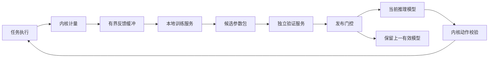

# CyxiaOS 学习能力与交互原型设计

版本：0.1 · 日期：2026-10-15 · 状态：已做独立构建检查并补足关键接口；尚未全域终审，不是 v0.7 递归审核通过项。

> v0.9 适用补充：CPU 学习方案继续有效；所有后续资源域的学习与发布必须遵守 [全系统 AI 决策契约](CyxiaOS-ai-decision-contract.md)。学习器不能改授权与验证门槛；现有浏览器预测实验不代表全域 AI 决策。

关联：[总体设计](CyxiaOS-design.md)、[详细设计](CyxiaOS-detailed-design.md)、[v0.7 审核报告](CyxiaOS-architecture-review-report.md)。

## 1. 用户要求与本次交付

用户新增明确要求：系统需要具有学习功能。保留原要求：本地模型、自研非 Linux 内核、首版单核 ARM，架构考虑跨平台、多核与解耦。

本次承接“设计原型”，交付可双击打开的单文件交互原型 `CyxiaOS-learning-prototype.html`，以及学习能力设计。交互原型用于回答：反馈怎样改变模型，如何检验候选模型、启用、观察和回退；发生模型故障或学习预算不足时，业务如何继续。它是可丢弃的浏览器演示，不是 ARM 客体、桌面系统或运行验证结果。用户尚未回答原型形态问题，交互机制原型为协调者采用的默认方向。

页面的小型回归模型会真实地在当前浏览器内更新参数，数据是明确标注的合成工作负载；页面所示时间、资源额度和调度状态是模拟值。原型不会调用云模型，不保存到 localStorage，不安装依赖；刷新丢失样本和学习结果。此原型没有证明操作系统内推理、训练速度或调度收益。

## 2. 学习范围与阶段

正式系统学习目标首先是既有四输出网络的任务评分/时间片选择；本次浏览器用 CPU burst 预测作为更易观察的学习实验，它是替代学习任务，不是正式网络增加的第五输出。未来扩展缓存目标、I/O 队列和跨核放置。模型参数由反馈更新，单纯保存日志、统计历史或固定规则切换不计作学习。

| 阶段 | 学习能力 | 限制 |
|---|---|---|
| P3a/P3b | 启动基线模型、固定推理、隔离和恢复闭环 | 可以从外部离线训练得到初始包，运行不依赖外部训练服务 |
| P3c，本版新增的首版必需子阶段 | CyxiaOS 内独立用户态服务采样、有限增量训练、验证、受控热切换及回退 | 首次启用保持受信任操作员确认；这是方案选择，用户尚未要求无人值守发布 |
| P4 | 连同学习全过程一起验证时延、预算、隔离、训练/验证分离和失败处理 | 学习收益与调度性能分开报告，不自动继承 v0.7 测试结论 |
| 持久化阶段（依赖 P5 存储/P6 更新机制） | 跨重启保存已接受模型、训练元数据及版本链 | 需原子落盘、来源认证、版本防回退、启动验证和恢复映像；缺少这些能力时明确仅当前启动学习 |

首版 CPU 原型原有“不在运行时训练”已由用户新增要求替代。运行时自主修改内核、授权规则、验收阈值和训练器可执行代码仍不在学习动作范围；学习的是受限模型参数。

## 3. 组件和权限



- 内核计量：记录有界数值特征、动作、执行结果、时间、模型/策略/工作负载版本；不收集任务正文、密码或任意内存。
- 本地训练服务：只读反馈，只写自己的候选区。不得写当前模型页、发布模型、改阈值或给自己授权。
- 独立验证服务：读取已封存候选和冻结样本，执行格式/整数一致性/回放和资源检查；不接受训练器自报的“通过”结果。
- 发布门控：受信任管理服务持有专用发布能力；只接收内核绑定的候选句柄和验证票据。票据绑定 boot_epoch、候选内容摘要、父模型、特征/算子/目标配置、验证集版本及过期条件；任何内容变化均使票据失效。日志文字不能充当票据。
- 推理控制器：继续使用只读参数和受限动作协议；训练/验证与推理的地址空间、权限和工作区分离。

学习服务、验证服务和发布管理服务各占一个普通任务槽，加上诊断服务共占 4 个，64 普通槽配置下测试应用上限变为 60；关闭学习配置时回到 63。启动准入按所选配置计算，不能把新服务算成免费隐藏任务。

## 4. 本地学习策略与数据边界

系统首个学习实现建议冻结特征编码器，只增量调整评分/时间片输出头，以限制内存、训练成本和变化面；完整网络重训练由后续实验决定。首个系统增量算法建议使用有界整数坐标搜索：冻结编码器和量化缩放，在输出层的 64 个 int8 权重及 4 个 int32 偏置中按固定索引循环，每轮最多考察 32 个坐标，各尝试量化单位 ±1，超合法范围则拒绝；在固定训练负载模拟的目标代价严格改善时才接受，平分保持旧值。目标代价为冻结策略权重下的规范化延迟、吞吐损失和公平惩罚，安全违规直接拒绝；具体度量归一化及负载单位在 P3c 实施前冻结。它是真实数据驱动参数搜索，不是改写调度规则；不新增 burst 输出头，也不对四输出网络计算不存在的预测误差。ARM 首版禁止 FP/SIMD 的约束不因加入学习而隐式改变。P3c 的运行时训练必须使用已经验证的有界整数更新，不能直接移植浏览器浮点演示。

反馈及分集总池建议 4 MiB，按不同物理页划分 1 MiB 原始环、2 MiB 训练快照、1 MiB 验证快照；固定条目最多 256 字节，对应容量 4096/8192/4096 条，不是在4 MiB环外再分配快照。原始环满覆盖完整最旧条目并计数；训练/验证快照冻结后不覆盖，新批次空间不足则等待或拒绝。受信任采样/分集代理（发布管理服务的一部分）按预先冻结的时间/负载种子把原始条目复制到分离页池，拷贝也计后台额度。训练器 FeedbackRead 仅映射训练快照只读页，不得映射原始环或验证页；验证标签仅验证服务可读，内核能力与页表实现隔离。首版不重复利用已用于决策的保留标签挑选多个候选，下一学习作业使用新的未暴露保留集；单次无改善就拒绝，不用反复试到通过。不同模型、目标配置或特征版本的样本不得无标识混用。

观测只说明已执行动作的结果，不能直接断言未执行候选动作的收益。影子模型只评价格式、推理成本、候选分布和预测误差；调度策略收益须在固定外生需求模拟器或受控试验中对照评估。任务反馈值限幅、可信来源由内核附加，异常/丢失样本标记；每任务采样上限和最低覆盖要求在学习实验配置中冻结，避免单个高频任务淹没数据。

## 5. 资源预算与抢占

以下是建议值，尚未在 ARM 上实测。学习与验证共用每核每固定 100 ms 最多 2 ms 的后台 CPU 额度，单片目标不超过 250 μs，低于关键维护优先级；与已有每 10 ms 1 ms 控制保留额度分账，二者都计入总 CPU 开销。按对齐的 100 ms 观测区间，上限为控制保留 10 ms 加后台 2 ms，即账面 12%，不包含未限额内核成本，不代表满足正常负载 5% 控制开销目标。

训练/验证作为普通用户任务受定时抢占及调用限额约束，后台预算不足则暂停，不触发模型故障。公平保护不能越过学习服务的合法后台限额；学习可在繁忙时推迟，业务进展不能依赖训练完成。状态切换、取消和重试不刷新额度。进入推理控制窗口仍沿用现有规则，不能借学习额度延长推理窗口。

学习配置启动时另预留 8 MiB：4 MiB 样本环、2 MiB 训练代码/栈/工作区、1 MiB 验证代码/栈/工作区、1 MiB 候选/上版参数及发布服务工作区（单模型包上限仍为 64 KiB）。该池与原 4 MiB 推理池、1 MiB 审计池分开；编译后逐项核算，实际不足则拒绝学习配置，不挤占最后一页应用内存。CPU/内存预算在未来 SMP 按核和全机总额重新准入，不能每核隐式追加。

## 6. 候选模型生命周期

学习状态独立于推理控制器的 BOOT/SELF_TEST/AI_ACTIVE 等健康状态：

`COLLECTING → TRAINING → CANDIDATE → VALIDATING → READY → OBSERVING → ACCEPTED`

旁路为 PAUSED_BUDGET、REJECTED、CANCELLED、ROLLED_BACK；拒绝/取消后可回到采集，旧当前模型继续运行。父模型或目标配置变化使旧候选验证失效。原型里训练一步可压缩完成多次数学更新，但系统实现必须以有界批次续行。

发布门槛包括：

1. 参数格式、算子/特征版本、幅度、摘要、资源容量合法；冻结包不可再写。
2. 独立验证服务属于新增可信计算基础，持有不可由训练器修改的整数参考实现。使用已封存候选权重与固定边界输入生成至多32组模型相关预期输出，并由独立候选运行时计算后比较；通用算子黄金向量另行保持固定。预期输出随候选摘要、输入集版本、参考实现摘要、运行时版本一起封存，并绑定到验证票据；内核只验证票据和对比候选 SELF_TEST 返回值，不解析网络或直接信任训练器自带答案。候选改变、票据过期或父版本变化均要求重新生成/验证；原始模型预期输出不能沿用给新权重。已有隔离、动作校验和限额不变。
3. 正式四输出策略在未暴露保留负载上做固定需求模拟对照，检查实际模拟调度指标；预测误差仅用于浏览器的独立三参数实验，不是正式四输出网络的验收指标。
4. 冻结的调度验收目标：安全约束零违规、公平下限满足；默认候选目标延迟改善至少 5%，p99 等待退化不超过 5%，吞吐退化不超过 2%，推理不超既有截止/预算。这是待实验配置，不能由学习器修改以让自身通过。
5. 受信任操作员通过发布门控确认；后续全自动发布须另行确定政策。

热切换是新增实现契约：在本核控制窗口外暂停新提交；检查候选票据及当前父模型；预留新 model_id/controller_epoch、注册字典条目和回退元数据；无资源则保持旧模型。撤销旧参数映射，完成 TLB/引用同步后安装封存候选只读映射，递增实例代际并进入有界 SELF_TEST；整个切换期间普通任务由确定性策略运行。候选参数通过受限固定入口重新绑定，不修改运行时可执行代码。程序计数/栈切到规定的新模型入口，旧提交不能携带新 epoch 复活。实际 ABI 与映射事务在 P3c 实施前冻结并专项审核。

原有效参数及不可变运行时映像保留；自检失败、超时或观察退化时关闭候选能力、撤销映射并安全切回上版，以新 epoch 重新自检，不能把 epoch 倒退。清理与自检仍使用既有共享保留额度；热切换/学习重试不能重置“每次启动一次控制器自动重建”机会或 LATCHED 状态。发生模型健康故障按原恢复状态机消费唯一机会；机会已耗尽时停留确定性模式，管理员重新启动。单纯离线候选被拒绝不影响健康控制器，也不消耗它的重建机会。

建议每次成功启用后观察至少 60 s，再接受下一候选；未完成观察不嵌套第二次发布。出现回退则本次启动停止自动候选发布，需明确管理操作恢复。动态热更新、回退和票据协议尚未通过 v0.7 的全域审核，不能以本文件替代专项实现/验收。

本地训练生成的会话内参数由发布能力和封存对象认证，不需把可签名私钥交给训练器。外部模型包导入与跨重启持久化仍须签名信任根、防回退及恢复映像；不是凭内存摘要免除持久更新验证。

## 7. 交互原型范围与画面

使用 frontend-design 与 prototype 技能。默认视觉为轻量实验工作台：雪白 #FFFFFF、冷灰 #F3F6FA、墨蓝 #152B45、蓝 #235BDE、深灰 #52637A。中文使用系统黑体，标题和数字同族但层级分明；一张占主区的学习过程图，避免把所有信息分割成重复卡片。无自动动画、无外部字体或图片，键盘焦点可见，窄屏顺序堆叠。

主要布局：

```
CyxiaOS                         机制原型 / 浏览器本地学习
研究问题、范围说明               重置
当前任务与派发状态               运行一步 / 超时 / 恢复
学习流程：采集—训练—验证—启用—观察
当前参数、候选参数               训练/验证样本及预算
验证误差对比                    学习动作按钮
场景标签：学习闭环 / 预算不足 / 故障恢复 / 越过验证
按顺序可点击的导览步骤           最近事件与拒绝原因
```

原型学习任务：从合成反馈估计下一次 CPU burst。输入三个量（常数、工作量类别数值、模拟阻塞比例），线性回归的三个权重通过梯度下降真实更新。固定种子产生有界样本；训练集与验证集分开，候选验证比较实际计算的均方误差。浏览器使用浮点，明确不同于 CyxiaOS 整数网络；不声称测试了正式 24→32→16→4 模型。

模拟任务选择可使用当前预测耗时与等待保护，页面标为“演示派发”。模型健康故障演示沿用唯一自动恢复及第二次锁定；采集/训练/验证/发布各动作可自由尝试，无效动作显示具体原因且不改变受保护状态。候选通过至少 10% 验证误差改善方可在演示中启用；这是预测实验的演示阈值，不等于系统的调度收益门槛。启用后 3 轮演示观察可接受；真实系统建议 60 s 观察仍待实现。

任务集 4 个是可视化样本，不代表系统 64 槽准入；一个“运行一步”推进虚拟时钟与示意派发，不能以浏览器按钮点击间隔测出 250 μs 接管性能。显式显示反馈数、分集数量、当前/候选模型身份和权重、误差、学习预算、健康状态、恢复机会、观察进度、拒绝/回退原因。保持有界事件列表，刷新重置。

## 8. 完成判据与待实施检查

本次原型须能手动走通：采集—训练后权重变化—验证—启用—观察；未验证不得启用；预算不足暂停且不刷新额度；首次故障恢复、再次故障锁定；切回上一模型及重置。无需为可丢弃演示建立测试框架，但须实际点击主路径和失败分支并检查页面/窄屏。

系统新增验证规格（未执行）：L01 训练器越权写当前模型拒绝；L02 样本满/丢失与分集隔离；L03 训练/验证总预算和抢占；L04 候选封存后内容/父版本变化使票据失效；L05 切换与提交/代际/映射/TLB交错；L06 失败自检/回退与唯一重建机会；L07 观察退化及无嵌套发布；L08 字典/候选/内存满时保持旧版；L09 学习开启后的整机W1—W6对照；L10 持久模型断电恢复、签名与防回退（依赖持久化阶段）。

未决实现细节留给后续专项规格：完整整数训练算法、ABI 字节编码、持久存储介质和最终 ARM 板卡。它们不得被浏览器演示标成已实现。设计的重要新增默认选择是本地有限增量训练、候选隔离、操作员启用、当前启动内保留学习结果；后续若要求全自动发布或首版跨重启学习，需要相应扩充准入与恢复设计。

## 9. 独立构建检查

[构建检查记录](architecture-review/learning-prototype-builder-check.md) 提出三项重要问题，均在本版明确：正式四输出策略与演示预测模型分开；原始/训练/验证数据分离页池和能力映射；新候选的自检答案由可信独立参考生成并随票据封存。没有要求用户再次决定这些内部实现选择。此检查不是全域问题归零证明。
