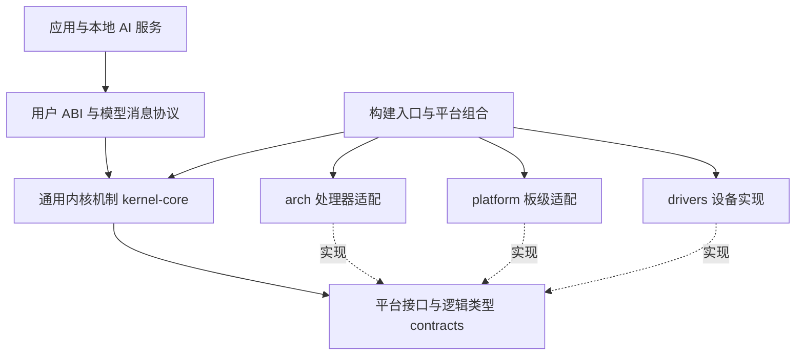
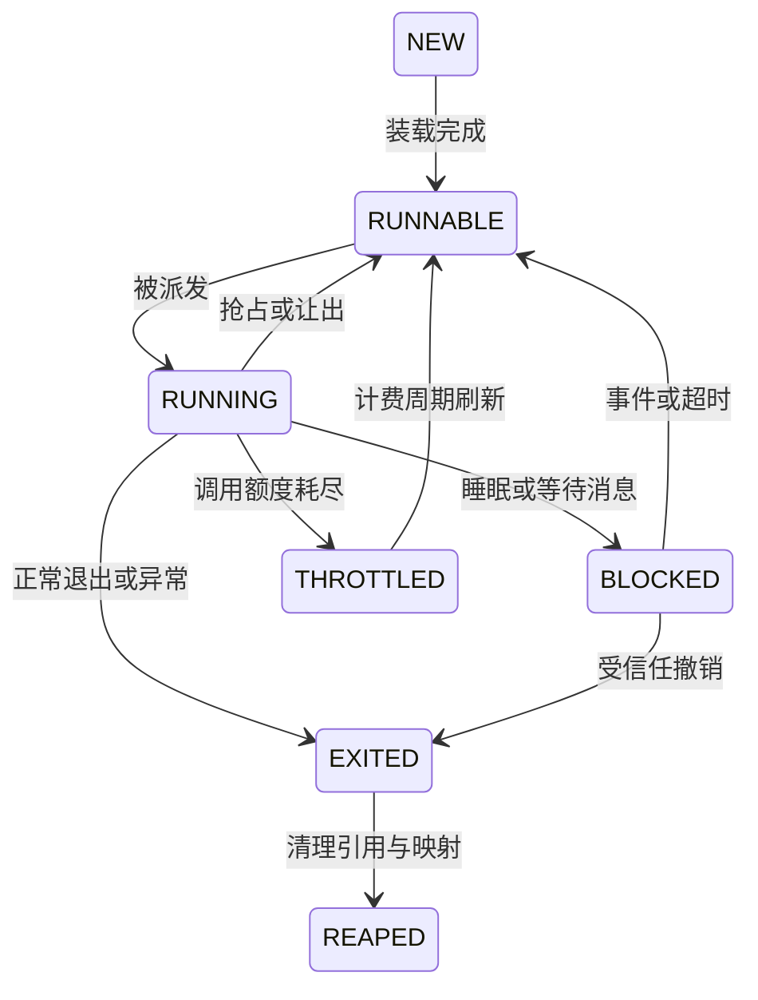
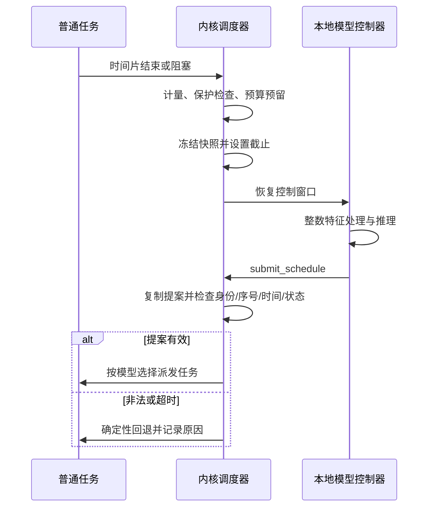

# CyxiaOS 详细设计

版本：0.5 · 日期：2026-10-15 · 状态：可评审的详细设计草案

总设计：[CyxiaOS-design.md](CyxiaOS-design.md)

## 1. 设计基线与阅读规则

已确认要求：系统名为 CyxiaOS；内核从零开发，不基于 Linux；首版采用单核 ARM；总体架构考虑跨平台、多核与解耦；AI 大脑由本地模型实现，承担调度和资源决策。权重和推理运行时部署在 CyxiaOS 内部，核心决策不依赖网络或宿主机推理服务。

本文件将研究原型具体化。单核 ARM 为用户已确定的要求；ARMv8-A / AArch64、Cortex-A53 仿真、Rust、微内核取向及数值参数是设计建议。用户尚未指定 32/64 位、最终芯片或产品用途；本版按具备 MMU 的 64 位 Cortex-A 方案编写，不适用于直接运行于 Cortex-M。以下“必须”指选择这套方案后的实现约束，不表示已经实现或用户已经确认全部选型。

第一版称为 CPU 原型，覆盖 P0—P4。内存、存储和网络部分给出后续接口及依赖，不把未来能力列作首版完成项。文件中的目录、数据结构和流程均为设计，不创建软件脚手架。

首版单核 ARM 配置记为 UP-ARM；后续 SMP-ARM 和第二架构配置分别验收。本文件第 2、4.2、6.1 节的 ARM 寄存器与启动细节是 UP-ARM 适配说明，不能进入通用内核接口。第 3 节定义平台和模块契约，第 10.6 节定义多核所有权与同步协议，它们从首版起约束类型和依赖设计。

### 1.1 必须保持的系统不变量

| 编号 | 不变量 |
|---|---|
| INV-01 | 每个 CPU 至多执行一个普通任务；同一任务任何时刻至多由一个 CPU 执行，首版 CPU 数为 1 |
| INV-02 | 任意物理页都有明确所有者或共享引用；不能同时分配给无共享关系的任务 |
| INV-03 | 模型提案不能新增能力权限、改变页表或取消内核限额 |
| INV-04 | 控制器不靠普通调度队列获得运行时间，且每次运行有截止时间 |
| INV-05 | 一个决策序号只能提交一次；已销毁任务的旧代际号永远不能重新有效 |
| INV-06 | 计量、故障记录和恢复调度不依赖模型正常工作 |
| INV-07 | 没有有效模型时，系统明确处于确定性启动或降级模式 |
| INV-08 | 每次普通任务派发只有一个实际来源标签；模型建议与执行结果分开记录 |
| INV-09 | 迁移、撤销和内存回收必须取得对应所有权；远端模型不能绕过本地校验抢占任务 |
| INV-10 | 通用内核不得依赖具体 CPU 寄存器、板卡 MMIO 地址或模型内部格式 |

### 1.2 版本与冲突处理

总设计说明目标，本文件规定本版本的详细行为。两份文档有冲突时先修订文档，不由实现者默默选一份。接口、模型特征和策略配置使用独立版本号；仅修改日志文字不能改变协议版本。

## 2. 平台、启动和可信边界

### 2.1 CPU 原型配置

| 项目 | 建议配置 |
|---|---|
| 虚拟平台 | QEMU Arm virt，Cortex-A53，1 CPU，256 MiB RAM，TCG |
| 特权层级 | 内核 EL1；应用与模型 EL0；首版 secure=off、virtualization=off，不运行 EL2/EL3 服务 |
| 地址转换 | AArch64 Stage-1，4 KiB 页，39 位虚拟地址配置；首版不用大块映射优化 |
| 浮点与向量 | 首版只使用通用整数寄存器；禁用 FP/Advanced SIMD 访问，用户违规触发异常，内核违规视为构建缺陷 |
| 编译约束 | Rust no_std，建议 aarch64-unknown-none-softfloat；所有内核/用户库与汇编保持一致 ABI，并检查生成指令 |
| 外设 | PL011 UART、GICv2、Arm Generic Timer；不挂载磁盘、网络或 GPU 设备 |
| 映像 | 内核加只读启动包，内含程序、模型、清单和测试向量 |

AArch64 使用异常级、异常向量和 Stage-1 页表构建隔离。相关依据为 [Arm 异常模型](https://developer.arm.com/-/media/Arm%20Developer%20Community/PDF/Learn%20the%20Architecture/Exception%20model.pdf) 和 [Arm 内存管理](https://documentation-service.arm.com/static/68e680a2587fd957f5efd742)。Rust 的 bare-metal softfloat 目标见 [官方目标说明](https://doc.rust-lang.org/rustc/platform-support/aarch64-unknown-none.html)。用户 ABI、地址布局和任务状态仍由 CyxiaOS 自定义。

首版机器配置明确指定 `virt,gic-version=2,secure=off,virtualization=off`、`cortex-a53`、单 CPU 和 TCG。由 QEMU `-kernel` 装载裸机 ELF，入口地址来自 ELF；不使用 raw Image 的启动约定。按 [QEMU 裸机说明](https://www.qemu.org/docs/master/system/arm/virt.html)，DTB 位于 RAM 起始地址 `0x40000000`；裸机入口段建议物理装载到 `0x40200000`，启动先验证 DTB 实际长度与各段物理装载边界并保留相应页，禁止覆盖设备树。内核主体的高虚拟地址与物理装载地址分离，启动转换见第 4.2 节。进入内核后检查 CurrentEL，首版只接受 EL1；其他入口级别明确报错，不静默假设已配置 EL2 的计时器访问权限。具体启动命令与映像布局在 P0 固定并用启动日志验证。

### 2.2 启动阶段和失败输出

| 阶段 | 输入与动作 | 成功标记 | 失败处理 |
|---|---|---|---|
| B0 进入内核 | 检查 CurrentEL/MPIDR_EL1，定位 DTB，建立 EL1 栈并清零 BSS | BOOT_ENTRY | 尚无可用输出时停机；主机捕获启动超时 |
| B1 识别平台 | 检查 RAM、保留区域、PL011、GICv2 与定时器中断；读取 CNTFRQ_EL0 | PLATFORM_OK | 串口输出原因并停止进入用户态 |
| B2 建立隔离 | 物理页表、内核页表、陷阱入口、定时器 | MMU_TIMER_OK | 内核 panic；保留最后阶段码 |
| B3 装载服务 | 验证启动包范围；装载用户程序；分配能力和模型保留区 | SERVICES_READY | 启动配置错误，进入诊断或停机 |
| B4 本地自检 | 验证模型包；在受限控制窗口内运行已知答案测试 | MODEL_OK | 进入 DEGRADED，普通任务可运行 |
| B5 接管调度 | 生成第一份快照并接受有效动作 | AI_ACTIVE | 无效或超时按控制器状态机处理 |

内核必须先有可靠陷阱与定时器，再执行任何用户态模型代码。模型自检可能跨多轮运行：使用专用 `selftest_step` 返回已完成向量编号，每轮同样限时、计费；最多 32 个向量，每向量最多一次窗口，失败即结束。自检进度由内核维护，控制器不能无限声称“仍在初始化”。

初始化服务建议首版由内核启动包装载器完成，不再引入一个需要动态创建任务权限的用户 init 服务。测试任务、诊断服务和模型控制器由清单静态实例化；后续再引入独立进程管理服务。

### 2.3 可信计算基础

虚拟 CPU/QEMU 装载环境、内核、启动包装载器、权限和动作校验器属于首版信任基础；后续实体平台还需纳入所用固件。模型控制器虽然持有调度提案能力，仍视为可能出错的用户进程。模型权重校验只检查预期内容，不抵御能够替换整个启动映像的攻击者。

首版不声明安全启动或形式化验证。后续加入可更新模型时，必须新增签名信任根、版本防回退和恢复映像；不能把摘要一致等同于发布者可信。

## 3. 模块职责与依赖

| 模块 | 持有状态 | 对外接口 | 不允许承担的职责 |
|---|---|---|---|
| arch | CPU 上下文、异常帧、页表编码与屏障 | exception_enter、switch_context、activate_space | 决定任务优先级或选择板卡设备 |
| platform | 启动信息、CPU 拓扑、设备资源和固件通道 | boot_info、topology、start_cpu | 实现通用调度与能力授权 |
| drivers | 中断控制器、时钟事件源、串口等设备状态 | irq_ack/eoi、program_deadline、console_try_write | 读取 TCB 或依赖模型层结构 |
| memory | 页所有权、映射、配额、保留池 | alloc/free/map/unmap | 根据模型直接回收未知内容页 |
| task | TCB、任务状态和代际 | make_runnable、block、exit | 自行调用推理器 |
| capability | 每任务能力槽、对象代际 | check_handle、revoke | 根据自然语言授权 |
| ipc | 端点队列、等待者 | send、recv、timeout | 同步等待模型或日志服务 |
| scheduling | 当前任务、预算、等待与控制窗口 | on_event、dispatch、commit_action | 修改模型权重 |
| telemetry | 原始计量、不可变快照、审计环 | snapshot、record、drain | 阻塞调度等待写出 |
| brain-runtime | 特征、整数算子、模型参数 | score_tasks、submit | 页表、设备和任意系统调用访问 |
| recovery | 失败计数、重建机会、回退队列 | enter_degraded、recover_once | 静默将回退伪装成 AI 动作 |

### 3.1 分层与依赖方向

建议代码边界为：`contracts`（平台与对象接口）、`kernel-core`（通用机制）、`arch/aarch64`（指令集适配）、`platform/qemu-arm-virt`（板级组合）、`drivers`、`abi`、`brain/runtime`、`brain/model`、`user` 和 `tools/evaluation`。第二架构新增自己的 arch 与 platform 组合，不复制 kernel-core。

kernel-core 仅依赖 contracts 与 ABI 语义；arch、platform、drivers 实现受限接口。最终内核入口负责组合各实现，具体异常入口通过类型明确的事件调用通用分派器。底层实现可以执行已注册的回调，但不能反向读取调度器私有字段，模块依赖图不能形成循环。

首版优先采用编译时静态组合，将可替换边界放在少数接口上，不要求所有函数动态分派。不同平台的寄存器约定和汇编仅存在于 arch；板级驱动选择与设备树解析仅存在于 platform。禁止在通用调度、任务、能力及 IPC 中散布 `cfg(target_arch)` 分支。

### 3.2 平台接口契约

| 接口 | 通用输入/输出 | 执行与失败约束 |
|---|---|---|
| BootInfo | RAM/保留区域、启动包位置、CPU 与设备描述、平台能力 | 由 DTB 或其他启动格式转换；通用层不解析寄存器或设备树节点 |
| CpuTopology | 逻辑 CpuId、硬件标识映射、在线状态、能力集合 | CPU 0 是引导 CPU 的逻辑编号，不假定硬件编号为 0 |
| ContextOps | 不透明 TaskContext、初始用户入口、内核栈和返回状态 | 异常帧布局与特权级转换由 arch 管理；通用 TCB 不展开寄存器 |
| AddressSpaceOps | 不透明空间句柄、VirtAddr、PhysAddr、PagePermissions | 将逻辑 RWX/user/cache 属性转为平台描述符；无支持能力必须拒绝 |
| ClockSource | 单调 TimeNs 与跨 CPU 可比较能力 | ticks→ns 在适配层完成；不能把某核频率当作全机默认 |
| ClockEvent | 当前 CPU 的绝对截止、取消和屏蔽 | IRQ 安全、有界、不可分配；不得调用模型 |
| InterruptOps | 逻辑 IRQ 句柄、确认/结束、路由与 IPI | 本地 IRQ 屏蔽与全机互斥是不同操作 |
| CpuLifecycle | prepare/start/online_ack、目标入口与启动令牌 | UP 返回 UNSUPPORTED；SMP 必须提供可验证的启动通道 |
| Cache/TlbOps | 地址空间代际、范围、目标 CPU 集合 | 本地维护与远端完成分别报告；未完成不能回收旧页 |
| ConsoleOps | 有界字节片段、非阻塞状态 | 正常路径不能等待设备或持锁无限轮询 |

`CpuId`、`TaskId`、`AddressSpaceId`、`IrqHandle` 为不同类型；地址也不与对象 ID 混用。首版 ABI 中的地址和计数使用固定宽度序列化，内核中的指针仍遵循本地位宽。共享消息不包含内核指针、Rust 引用、寄存器帧或 `usize` 布局。

每个接口须声明可否在 IRQ/关闭抢占状态调用、是否持锁、最大工作量及错误类型。硬件初始化可较慢，但派发、定时、消息提交和最终动作提交不可阻塞。平台无法提供所需时钟、MMU 或原子能力时启动失败，不能默默削弱隔离。

### 3.3 平台能力与配置

PlatformCaps 至少描述：支持的 CPU 数、基础页尺寸、物理/虚拟地址宽度、所需原子操作、时钟一致性、缓存一致性、IPI、远端 TLB 维护和可选 DMA 隔离。内核按能力选择已实现路径，不以平台名称猜测能力。

4 KiB 页、39 位虚拟地址、256 MiB RAM、64 普通任务和 1 个 CPU 是 UP-ARM 配置。通用内存管理使用 PageSize/PageCount，禁止散落 `<<12`；平台页尺寸由构建配置固定，启动时验证。共享区“16 KiB 快照/4 KiB 动作缓冲”是逻辑大小，其他页尺寸平台按页上取整映射，不把通信格式与物理页大小绑定。

首轮跨架构验证建议仍采用 64 位、具备 MMU 的平台，具体选项由后续需求确定。32 位需审查地址范围、64 位计时和原子操作，不能仅靠重新编译承诺支持；无 MMU 平台不满足当前隔离契约。所需原子能力按 [Rust target_has_atomic](https://doc.rust-lang.org/reference/conditional-compilation.html#target_has_atomic) 等构建信息检查，不假定所有目标都支持同一宽度。

### 3.4 每 CPU 状态与同步基础

从首版就使用 `CpuLocal`：当前任务、运行队列、空闲上下文、调度/控制窗口状态、预算账本、只读快照发布状态、跨核收件箱、审计环及统计。UP 创建一个实例；核心算法接受 CpuId/本核上下文，不访问可变全局 `current_task`。

TCB 的可执行归属单独记录在 Placement 中：owner_cpu、owner_version、执行状态与 migration_id。通用状态机只通过受检接口修改这些字段。SMP 的持锁规则、迁移与回收见第 10.6 节；UP 可以省去不必要的跨核通信，但必须保留相同所有权语义。

首版就区分 LocalIrqGuard、PreemptGuard 与 SpinLock。关本核中断不能保护其他 CPU 的访问，`volatile` 也不提供任务间同步；共享状态经短临界区或具备明确内存序的原子发布，发布/读取通常使用匹配的 Release/Acquire。内存顺序含义参见 [Rust 原子 Ordering](https://doc.rust-lang.org/core/sync/atomic/enum.Ordering.html)。硬件 MMIO 与缓存/TLB 屏障仍由 arch/driver 单独处理，不用语言原子替代。

### 3.5 内核、模型与用户 ABI 的解耦

划分四个版本域：系统调用语义版本、各架构寄存器绑定版本、AI 观测/动作协议版本、模型包/特征/算子版本。相同系统调用语义可以在不同架构上使用不同陷入指令；跨架构应用需要各自编译，模型权重可在特征和整数语义完全一致时复用，性能仍需重新评估。

内核只知道模型服务身份、已授权的能力、内容摘要、协议版本、内存与时间限额及自检结果，不链接神经网络算子。启动装载器检查普通文件边界和清单摘要；用户态模型运行时解析权重、层尺寸与量化参数。更换同协议模型不应修改调度执行器，更换推理后端不应修改页表管理器。

服务可替换不等于随意加载插件：首版仍静态打包已登记服务，模型更新仍通过重启映像生效。驱动初期留在内核也必须经设备接口访问，后续迁往用户态时另补 IRQ、DMA 和共享缓冲的授权协议，不在本版声称已完成驱动隔离。

## 4. 内存、地址空间与装载

### 4.1 物理内存分区

先解析 RAM 与固件/设备树/映像保留区，再分配剩余页；不硬编码“全部 256 MiB 都可分配”。建议使用位图页分配器，首版不压缩、不交换、不做按需调页。内核对象使用固定容量数组，常态调度不依赖堆分配。

| 用途 | 预算约束 |
|---|---|
| 内核、页表、TCB、能力和 IPC 元数据 | 总体目标不超过 16 MiB，启动时逐项计数；固件占用另列 |
| AI 控制器 | 4 MiB 独立保留池，包含代码、权重、栈、快照、动作页及工作缓冲 |
| 审计 | 固定 1 MiB，元数据计入内核预算 |
| 恢复 | 复用预留控制器池，重建前清理旧实例；不临时申请第二个完整控制器池 |
| 普通任务 | 从剩余内存分配；启动清单规定每任务上限，合计不足则启动失败 |

64 指普通调度槽上限，包含诊断与测试服务；控制器使用单独槽位，空闲线程不占用户槽。诊断服务保留一个普通槽，故最多 63 个测试应用。公平性测试中的 64 任务包含诊断服务，其生命周期与计时应写入实验清单。

本表是 UP-ARM 容量配置。SMP 为各核预留控制器工作区和审计区，重新计算总内存准入；不能无条件沿用 4 MiB 与 1 MiB 作为全机总预算。只读权重共享可减少物理占用，但每核栈、缓冲和恢复资源仍须独立保证。通用层计量类型为 user_cpu_ns/kernel_cpu_ns，ARM 的 EL0/EL1 只是其平台映射。

### 4.2 虚拟地址规则

首版采用 TTBR0_EL1 管理低地址用户空间，TTBR1_EL1 管理固定的高地址内核映射。通过页描述符 AP 权限区分 EL0 可访问页与仅 EL1 可访问页；内核页不允许 EL0 访问。普通程序使用低地址区自定义链接布局，例如代码从 `0x00010000` 起；实际地址由链接脚本与启动包清单固定，禁止与平台映射重叠。TTBR0/TTBR1 均采用 39 位地址范围、4 KiB granule，启动代码通过 TCR_EL1/MAIR_EL1 配置转换与内存属性，再启用 SCTLR_EL1 的 MMU 与缓存。RAM 为 Normal memory，MMIO 为 Device memory，属性不能混用。

启动段采用低地址恒等映射，内核主体采用独立高虚拟链接地址，ELF 的物理装载段不重叠。建议高地址基区为 `0xffffffc000000000`，主体偏移与对应物理装载段由链接脚本配对。启动先建立临时低地址映射及最终高地址映射，再启用 MMU，跳转到高地址主体并迁移内核栈、VBAR_EL1 和内核引用；确认无低地址依赖后撤销启动恒等映射，才将 TTBR0_EL1 用作用户空间。不得把全部代码只链接在低地址后直接切换用户页表。

每个程序独立 RX 代码、R 只读数据、RW 数据和堆、64 KiB 用户栈。栈下方保留一页 unmapped guard；空地址页不映射。禁止 W+X 映射。控制器另有只读快照区、RW 动作页和只读权重区。各任务内核栈与用户栈分离，内核栈同样有保护页。

用户指针访问通过受限 copy-in/copy-out：先检查长度溢出、地址范围、映射和权限，再经内核专用页映射复制。首版不直接解引用任意用户指针，也不允许用户在单次复制中触发缺页分配。首版不依赖可选的 PAN 扩展作为安全前提，访问检查必须独立成立。

首版不复用带缓存优化的 ASID，任务切换更新 TTBR0_EL1 并执行所需 DSB/TLBI/ISB；在高地址内核映射下完成切换。解除映射先撤销页描述符并同步，再释放物理页；修改已有有效映射遵循适用的 break-before-make 规则。可执行页装载后执行所需数据缓存清理和指令缓存失效；不能仅因 QEMU 上可运行就省略实体 ARM 所需的维护操作。具体序列依据 [Arm 内存管理](https://documentation-service.arm.com/static/68e680a2587fd957f5efd742) 在 P0 固定。使用 PXN/UXN 区分内核和用户执行权限，禁止 W+X 及可写别名绕过代码保护。

### 4.3 程序映像

建议使用静态 ELF64 可执行文件，限制为 EM_AARCH64、小端、固定地址与 PT_LOAD 段；不支持动态链接、解释器或运行时重定位。装载器校验文件长度、段范围、整数溢出、对齐、入口点、权限和段重叠，BSS 显式清零。拒绝清单之外的可执行文件。

## 5. 任务、能力与 IPC

### 5.1 任务控制块

TCB 至少记录：`task_id:u32`、`generation:u64`、不透明地址空间句柄、TaskContext、内核栈、状态、Placement 引用、允许 CPU 集合、剩余时间片、就绪起点、累计 CPU、10 ms 计费窗使用量、IPC/睡眠截止时间、能力表引用和退出原因。UP 的 owner_cpu 为逻辑 CPU 0。代际增加溢出时永久退役该槽，不绕回旧值。

连续就绪等待从进入 RUNNABLE 开始，到被派发结束；执行后再次进入 RUNNABLE 时重新计时。BLOCKED、THROTTLED 时间分别统计，不能通过把健康任务标为 THROTTLED 来掩盖饥饿。对象清理采用有界批次，不能在调度锁内遍历无限对象。

### 5.2 能力对象

首版采用每任务固定 32 个能力槽，句柄含槽号与槽代际。能力记录对象类型、对象代际及权限位。用户只能引用自己表中的有效句柄；猜到整数不能创造权限。

对象类型：自身内存区域、IPC 端点、快照读取、调度提交、审计读取和控制台输出。控制器只持有自身内存、快照与调度能力；诊断服务持有审计读取和受限控制台输出，不持有调度能力。首版静态授予，不允许任意跨任务转移或派生能力。

### 5.3 IPC 语义

首版最多 64 个端点；每端点 FIFO 深度 16，每条负载最多 64 字节。`ipc_send` 非阻塞，满时返回 AGAIN；`ipc_recv` 可非阻塞，或携带绝对截止时间阻塞。首版不实现同步 RPC，不支持将内核指针或能力通过消息转移。

发送者身份由内核附加。每个端点仅一个拥有者可接收，多个持有 SEND 能力的任务可以发送。消息到达与接收超时同时发生时按内核处理顺序提交一次状态转移；若超时先完成，消息留在队列，不能既超时又把消息交给已退出等待的任务。

每次阻塞等待分配独立 wait_generation；检查消息、登记等待与提交 BLOCKED 使用第 10.6.4 节的共同提交协议。UP 也使用同一逻辑状态，避免把首版的关中断偶然性当作跨平台语义。

端点拥有者退出时，清空队列、使端点失效，后续发送返回 CLOSED。不做阻塞发送，避免优先级反转依赖链；后续 RPC 必须另行设计预算捐赠或优先级继承。

## 6. 用户 ABI 与模型协议

### 6.1 系统调用约定

以下是 CyxiaOS ABI v1 的 AArch64 绑定，不是通用内核的寄存器接口，也不是 Linux ABI。EL0 使用 `SVC #0`，`x8` 放调用号，`x0..x5` 放参数；返回 `x0` 为状态，`x1` 为结果。arch 将其转换为通用 SyscallRequest 后进入能力与调用分派器。异常入口保存 x0—x30、SP_EL0、ELR_EL1 和 SPSR_EL1，并在需要时记录 ESR_EL1/FAR_EL1。SVC 返回地址已指向下一条指令，不再次给 ELR_EL1 加 4；使用 ERET 恢复 EL0。

VBAR_EL1 指向 2 KiB 对齐的异常向量表，处理来自 EL0 的同步异常与 IRQ，以及内核自身异常。EL1 使用独立内核栈，保持 ABI 所需 16 字节栈对齐；异常类型从 ESR_EL1 解码，不能把所有同步异常当作系统调用。普通应用不得修改 DAIF、定时器控制或 GIC；EL0 非法操作终止该任务，内核异常进入 panic。通过 CPACR_EL1 禁止首版 FP/Advanced SIMD 访问，用户误用作为违规异常，内核误用作为构建缺陷。模型控制窗口的 IRQ 接管必须在首次进入用户态之前验证。

| 调用号 | 名称 | 权限与行为 |
|---|---|---|
| 0 | abi_info | 返回 ABI 主次版本及功能位 |
| 1 | task_exit | 清理自身，不返回 |
| 2 | yield | 放弃剩余时间片，不能重置调用计费 |
| 3 | sleep_until | 绝对单调时间；到期立即成功 |
| 4 | read_clock | 返回单调时间，单位 ns |
| 5 | ipc_send | 检查 SEND 端点能力和 64 字节上限 |
| 6 | ipc_recv | 检查 RECV 能力、用户缓冲与截止时间 |
| 7 | map_owned_pages | 从自身预授内存配额映射页；不能指定任意物理页 |
| 8 | unmap_owned_pages | 只能释放自身非固定页；同步后清零再回收 |
| 32 | read_snapshot | 控制器专用，返回固定映射位置、长度与序号 |
| 33 | submit_schedule | 控制器专用，提交本轮动作并结束控制窗口 |
| 34 | selftest_step | 仅 SELF_TEST 阶段有效，返回整数测试结果 |
| 48 | audit_read | 诊断服务只读，固定最大拷贝长度 |
| 49 | console_write | 诊断服务输出；每次最多 64 字节，写入有界串口发送队列，满时返回 AGAIN |

状态枚举至少包括 OK、INVALID、PERMISSION、STALE、AGAIN、TIMEOUT、NO_MEMORY、CLOSED、UNSUPPORTED。数值在 ABI v1 中固定；用户程序不得依赖 Rust 枚举的隐式布局。

内存映射/解除映射每次最多 16 页，地址与长度按页对齐；预检整批所有权、权限和配额，资源不足时不提交部分映射。`audit_read` 单次最多复制 256 字节。串口每次中断最多处理 64 字节，发送队列固定 4 KiB；设备不就绪时不忙等，日志消费者可稍后重试。启动及 panic 的最小串口输出属于单独的受限诊断路径，不用于正常调度日志刷出。

普通任务每固定 10 ms 最多 64 次系统调用，调用处理 CPU 时间计入其时间片。第 65 次触发 THROTTLED，待下一周期返回限流状态；`task_exit` 仍可结束任务。该限制不适用于特殊控制器协议，控制器每窗口最多一次快照读取和一次提交或自检返回，其他调用直接判为协议错误。

### 6.2 序列化规则

共享协议固定小端、固定宽度整数、显式长度与版本；不直接共享 Rust 结构体内存。保留字段必须为零，未知主版本拒绝。解码器检查每个偏移与长度，尤其禁止 `offset + length` 整数溢出。

快照容量固定 16 KiB，动作页 4 KiB。快照在内核可写、控制器只读映射；内核进入控制窗口前复制并冻结本轮快照，窗口运行中不修改它。中断产生的新状态保存在内核实时任务表，下一轮快照才体现。

### 6.3 快照 v1

v1 是 UP-ARM 的首个配置，64 槽位和位掩码是该协议的容量上限，不是所有平台的任务总量。SMP 使用协商后的 v2 候选列表与每核身份，见第 10.6 节；不可通过扩展 Rust 数组静默改变 v1 布局。

头部包含 `magic`、`abi_major/minor`、`total_length`、`controller_epoch`、`decision_seq`、`timestamp_ns`、`policy_version`、`model_id`、有效任务数和 64 位 runnable 掩码。任务条目固定槽序，包含身份、状态和第 8 节特征所需原始计量；不足 64 槽清零。

序号标识一次决策窗口，不因窗口内普通唤醒就变化。这样不会因新任务唤醒而使所有在途提案永久失效；仍必须检查被选任务当前是否可运行。控制器重建会递增 epoch，旧实例的提案无条件失效。

### 6.4 动作 v1

v1 只对单核配置启用，cpu_id 必须等于该控制器绑定的唯一逻辑 CPU 0；多核启用前必须实现 v2 的归属版本与域校验。

动作固定 64 字节：`magic:u32`、`abi_major:u16`、`byte_length:u16`、`controller_epoch:u64`、`decision_seq:u64`、`policy_version:u64`、`task_generation:u64`、`task_id:u32`、`cpu_id:u16`、`slice_code:u16`、`model_id:u64`、`reserved:u64`。字段按上述顺序紧密序列化，不采用宿主结构体 padding。

`slice_code` 的 0/1/2 对应 0.5/1/2 ms。内核从固定动作页复制 64 字节到内核缓冲后再校验；模型散列保存在内核模型注册表，动作的 `model_id` 只是引用，不能充当自报身份的证明。

成功提交后控制器被冻结，进入普通任务；本次系统调用在下一控制窗口恢复时返回，并通知新快照可用。无效提交也立即结束本窗口，错误码保留到下一次入口返回；不允许同一窗口无限修正重试。第三次连续非法提交后不再恢复旧实例。

## 7. 调度控制环与时间预算

### 7.1 两个独立状态机

控制器健康状态为 BOOT、SELF_TEST、AI_ACTIVE、DEGRADED、RECOVERING 和 LATCHED。当前调度来源另设 AI、FAIRNESS、BUDGET、RATE_LIMIT、REFERENCE、RECOVERY 和 IDLE，不把短期预算不足当作模型故障。

| 当前状态 | 事件 | 下一状态与操作 |
|---|---|---|
| BOOT | 内核和映像可用 | SELF_TEST |
| SELF_TEST | 所有规定测试结果匹配 | AI_ACTIVE，非法动作连续计数归零 |
| SELF_TEST | 测试不匹配、超时或故障 | DEGRADED |
| AI_ACTIVE | 合法动作 | 保持状态，非法动作连续计数归零 |
| AI_ACTIVE | 权限/格式/枚举等非法提案 | 本轮回退；连续 3 次进入 DEGRADED |
| AI_ACTIVE | 选中任务被可信事件撤销等环境变化 | 记录 STALE_STATE 并回退，不增加模型非法计数 |
| AI_ACTIVE | 控制器异常或超时 | 立即 DEGRADED |
| DEGRADED | 尚有自动重建机会 | RECOVERING；消费本次启动唯一重建机会 |
| RECOVERING | 有界清理并装载成功 | SELF_TEST |
| RECOVERING 或第二次 SELF_TEST | 重建或自检失败 | LATCHED |
| 再次 AI_ACTIVE | 再次出现需降级故障且机会已消费 | LATCHED |
| LATCHED | 无显式管理操作 | 持续轮转；首版通过重新启动解除 |

自检阶段的预算抑制只是等待下一可用窗口。控制器没有普通任务 sleep/yield 能力；初次进入和后续恢复通过固定入口约定传入快照或自检编号。

### 7.2 调度点的处理优先级

1. 先结算被中断执行段的用户态与内核态 CPU 时间，提交已经完成的任务状态转移。
2. 处理本批定时到期和唤醒，每批最多 64 个任务事件；首版所有用户定时器使用按任务槽合并的有界表，睡眠和 IPC 等待互斥。
3. 若控制器窗口正在运行，仅处理必要中断与截止检查，不嵌套调用模型。
4. 若有等待超过 100 ms 的 runnable 任务，选择等待最久者，给 0.5 ms 保护时间片；同分按任务 ID 排序，本轮跳过模型及维护。
5. 若处于 SELF_TEST 或 RECOVERING，且共享保留账本、500 μs 最小启动间隔和周期尾部规则允许，安排一次自检窗口或维护批次。该入口位于普通轮转之前，即使普通任务持续 runnable 也会获得运行机会；结束后重新经过本优先级判断。
6. 若无普通 runnable 且本轮不能执行自检/维护，则空闲至最近定时事件；不能因空闲而取消自检/恢复的下一次唤醒期限。
7. 若控制器不在 AI_ACTIVE，使用 1 ms 轮转。
8. 检查共享保留账本、500 μs 最小启动间隔和周期尾部规则；不满足则继续尚有余额的当前任务，或用 1 ms 轮转选择下一任务。
9. 否则创建快照、开启一个控制窗口，完成后原子校验与派发。

正常应用的睡眠到期/消息唤醒合并到下一普通调度点处理调度选择，最多等待当前时间片结束；它可以立即成为 RUNNABLE，但不为每次唤醒额外启动模型。真正实时抢占需求不在首版范围。

### 7.3 定时器与预算精确定义

使用 Arm Generic Timer 的非安全物理计时器：在 EL1 读取 CNTPCT_EL0，按 CNTFRQ_EL0 的频率换算单调时间，以 CNTP_CVAL_EL0 设置绝对截止并通过 CNTP_CTL_EL0 控制；对应 PPI 从设备树解析并由 GICv2 路由到唯一 CPU。CNTKCTL_EL1 禁止 EL0 修改计时器或直接访问不允许的计时资源，普通任务通过 read_clock 读取时间。参见 [Arm Generic Timer 指南](https://developer.arm.com/-/media/Arm%20Developer%20Community/PDF/Learn%20the%20Architecture/Generic%20Timer.pdf)。一只底层定时器复用为多个软件截止时间，设置最近的到期值：应用时间片、控制窗口截止、睡眠/IPC 截止、调用额度刷新及自检续行。处理中断时先读取 GIC 中断确认寄存器识别来源，更新或屏蔽到期计时器以解除持续电平，再执行 GIC 中断结束流程，避免中断风暴。

`control_start` 定义为内核决定进入推理路径、开始制作快照的时刻；`deadline = control_start + 250 μs`。该墙钟截止覆盖快照、切换、用户推理和提交。推理累计额度只计控制器 EL0 时间，推理路径的 EL1 时间单独计入控制开销。

每固定 10 ms 设一个 1 ms 的共享保留账本，普通推理 EL0 时间、自检 EL0 时间和恢复维护 EL1 时间都扣减它。RECOVERING、SELF_TEST 与 AI_ACTIVE 之间切换不刷新额度，也不刷新最小启动间隔。普通控制路径的其他 EL1 开销仍单独计量，不算作用户推理时间。

入场预留完整 250 μs，剩余少于该值则拒绝入场；结束后按对应执行类别的实际时间结算并退还余量。若当前时间距周期边界不足 250 μs，直接走 BUDGET，不启动跨周期窗口。达到边界时重置额度；异常迟到产生的运行时间必须据实归属，不能在刷新时丢弃。维护不可抢占小步骤的截止超调可能使账本透支，透支照实记录并停止该周期后续工作，不能宣传该软件限额为硬实时上界。

在内核关键区暂时无法处理中断时，模型截止不是硬实时保证。内核任何提交路径在接收提案和最终派发前都重查截止；过期动作不得执行。记录“预定截止至实际接管”的延迟，功能测试中必须可观察。

最小启动间隔从上次 `control_start` 计算，不从上次提交时刻计算。两项限制并存：累计预算抑制推理负载，最小间隔抑制高频入口；都不能替代普通任务系统调用限额。

### 7.4 快照至动作提交的时序

动作提交的原子区只包含最终状态检查、消耗序号、更新当前任务和时间片。中断计量、日志序列化和内存释放不能全部塞进原子区。先锁定提案内核副本，再检查；不能校验后又从可写共享页重读目标任务。

模型被唤醒期间新任务变为 runnable，并不强制废弃旧快照；选中任务仍有效且没有公平保护优先事项时，允许提交。若在模型运行期间有任务越过公平阈值，最终提交改为 FAIRNESS，不把该例外记为模型非法输出。

### 7.5 公平性与预算的约束关系

保护选择优先于模型和模型预算，只选 runnable 且未被合法限流的任务。每次保护服务 0.5 ms 后重新评估等待队列。最多 64 个任务的服务轮次有界，但其严格墙钟上界仍取决于内核最长不可抢占段和外部中断，因此 250 ms 是实验验收目标，不能写成已证明的最坏时延。

“5% 总控制开销”是正常负载性能目标；“10 ms 内最多 1 ms 用户推理”是故障限制，两者并不相等。报告需同时给出用户推理占比、控制相关内核占比和所有内核占比。

## 8. 本地模型详细设计

### 8.1 模型选型建议

首版建议设计专门的任务评分网络 `Cyxia-Sched-v1`，不是未经验证的现成模型名称。它属于学习得到的本地小模型；低频语言理解模型后续单独选型。首版只用 CPU 整数指令推理，不引入 GPU、云推理或通用模型服务。

对每个有效任务拼接 16 个任务特征与 8 个全局特征，共 24 维；全部任务共用 `24 → 32 → 16 → 4` 的三层网络。前两层 ReLU，输出层为一个任务分数和三个时间片分数。先从合法任务中选最高任务分数，再对该任务选最高时间片分数；平分用较小 task ID、较短时间片作固定决胜规则。

该结构共 1,396 个权重与偏置参数，每任务 1,344 次乘加；64 任务约 86,016 次乘加，不含特征计算、比较、缩放和数据复制。数量由结构计算，**不代表已测得推理时延**。固定结构可以先验证内核闭环，若性能不足再调整并升级模型版本。

### 8.2 输入特征 v1

特征值均来自内核，时间以 ns 原始计量保存。归一化采用 `clamp(value / cap, 0, 1)` 的确定性整数实现，再转为非负 Q15；布尔值为 0 或 32767。窗口计量使用对齐到启动时刻的固定窗口，边界处计数按实际执行段切分。

| 任务特征 | 上限或编码 |
|---|---|
| 连续 runnable 等待 | 250 ms |
| 最近完整 10 ms 窗口 CPU 时间 | 10 ms |
| 最近完整 100 ms 窗口 CPU 时间 | 100 ms |
| 最近一次 CPU burst | 10 ms；从唤醒至阻塞/退出累计，不因抢占重置 |
| 上次请求的 sleep 或 IPC timeout 长度 | 100 ms；缺省为 0 |
| 最近完整 100 ms 的阻塞次数 | 64 |
| 最近完整 100 ms 的唤醒次数 | 64 |
| 最近完整 100 ms 的派发次数 | 128 |
| 上次执行结束距今 | 250 ms |
| 任务存活时间 | 10 s |
| 上次分配时间片 | 2 ms |
| 当前 10 ms 窗口系统调用次数 | 64 |
| 是否刚唤醒且尚未被派发 | 布尔值 |
| 是否为上一普通执行任务 | 布尔值 |
| 是否受信任交互类别 | 启动清单授权，布尔值 |
| 是否受信任诊断服务 | 启动清单授权，布尔值 |

8 个全局特征：runnable 数/64、blocked 数/64、throttled 数/64、最大 runnable 等待/250 ms、上次用户推理耗时/250 μs，以及延迟、吞吐、公平三项目标权重。权重非负且和为 1，初始建议 0.5/0.3/0.2；该选择是实验配置，不是已经证实的最优目标。

任务 ID 和代际用于输出映射，不作为网络特征。模型输入中的类别来自受信任清单，应用不能自报成为诊断任务。无有效任务时不推理；缺失历史值取 0，模型训练必须覆盖冷启动样本。

### 8.3 整数推理规则

权重 int8、激活 int16、累加 int32；每输出通道使用明确的整数乘数和移位做缩放，缩放中间量用 int64，按模型格式定义的舍入规则执行。前两层饱和到 `[0,32767]`，输出层饱和到有符号 int16。偏置边界在装载时验证，避免加偏置后超出累加器范围。

算子集合仅为全连接、ReLU、饱和、固定整数缩放和 argmax。没有动态循环次数、递归、图编译或模型提供的可执行代码；运行时按固定层尺寸读取参数。所有循环上限由受信任格式固定。

模型文件建议最大 64 KiB，权重与偏置段远小于该上限；控制器整个 4 MiB 预算还包含 ELF、栈、快照和运行时，不能只核算模型权重。具体编译体积在 P3 实测。

### 8.4 模型包与自检

包头包含 magic、包版本、总长度、模型结构 ID、特征版本、算子版本、各段偏移与长度、缩放参数版本及内容摘要。用户态模型运行时只接受本版固定维度，拒绝重复段、越界段、异常偏置或未知算子；内核的启动装载器仅验证外层清单与文件边界、摘要，不解析神经网络图。

已知答案向量包含正常、全零、边界饱和、平分和单候选等情形。内核持有预期输出，控制器执行推理并通过 selftest_step 返回结果；内核逐一比较。自检验证执行路径一致性，不能证明所有权重都公平或性能最优。

### 8.5 训练与策略发布

首轮使用轮转和多级反馈队列生成示范，训练任务选择与时间片分类；该步骤只能初始化行为，不作为 AI 超过基线的证据。第二轮在离散事件模拟器中搜索或训练多目标策略，然后量化并做整数一致性检查。

训练集、验证集、测试集按工作负载族与随机种子分离，测试清单在训练前冻结；禁止从最终测试集挑选权重。模拟器输入应是外生的 CPU 工作量、睡眠及消息需求，而不是重放某个旧调度策略产生的完成时间，以免反事实评估失真。

发布条件：包格式通过、全部整数测试向量一致、独立负载无非法动作、满足公平与故障要求，并提供基线对照。若学习策略未达到性能目标，可保留研究结果，但不能用手写规则替换后仍标为 AI 模型成功。

## 9. 故障恢复与资源清理

控制器被撤销时立即关闭其提交能力、递增 epoch、终止窗口并结算预算。普通任务切换到恢复轮转。重建分为释放映射、清零保留页、重装 ELF/模型、重建只读快照映射、自检几个阶段；每次工作量有上限，阶段之间允许普通任务运行。

首版允许一次自动重建，重建工作使用第 7.3 节的共享保留账本；模型停用时维护仍可进行，但状态切换不会额外创造额度。每批同时受 250 μs 目标截止和最多 32 页或等量受限元数据限制，先达到者立即返回调度点。每处理一个最小原语都检查时间，测量该原语的最大不可抢占耗时与截止超调。不能仅凭页数推断执行时间，也不能关闭中断一次清零整个 4 MiB 池。

重建运行在内核受信任路径，因此它的错误不能靠重启同一用户模型修复。内核遇到结构损坏或不变量失败时输出 panic 记录并停机；不声称任意内核故障都能自动恢复。

普通任务退出先变为不可调度，取消定时事件，关闭端点，撤销能力，再分批解除映射与回收页；清理完成后才释放槽位并更新代际。审计引用只保留身份值，不保留已经释放的 TCB 指针。

## 10. 内存、存储与网络的后续决策接口

### 10.1 统一控制事务

未来资源动作使用 `resource_type`、`proposal_id`、`controller_epoch`、`config_version`、受影响对象代际、有效期及资源上限。先校验整个提案，再原子更新版本化策略配置；实际设备操作异步执行并返回状态。CPU 首版动作依旧采用第 6 节固定协议，不提前承诺兼容未来格式。

跨资源原子性仅指预算配置发布，不意味着磁盘写入或网络发包能回滚。后续设计必须区分 REJECTED、ACCEPTED、APPLIED、PARTIAL 和 FAILED；已发生的 I/O 不能通过恢复旧配置撤销。

### 10.2 内存策略

在页分配和隔离稳定后增加内存控制器，每 100 ms 或压力事件触发；最小触发间隔 20 ms。模型输出各任务软预算和可回收缓存目标，不输出页表写操作。硬预算与保留区由内核限定，所有预算变化经过总量检查。

降低预算低于已用量时，标为收缩中，先停止非必要新增分配，向缓存拥有者发出可回收请求；不能强行丢弃匿名页、固定页或 DMA 页。没有交换支持时，内存不足返回错误。任务终止需独立授予生命周期权限，不能隐含在“优化内存”动作中。

首个可验收场景是两个缓存任务竞争剩余内存，模型调整软预算；要求不碰保留池、不破坏数据，且对照固定分配策略报告命中率与延迟。

### 10.3 存储策略

依赖 VirtIO block 驱动和请求完成路径。先在 RAM 磁盘验证队列语义，再接虚拟块设备；只在满足依赖的请求集合内由模型选择次序。flush、写屏障和同一区域写入顺序是不可覆盖约束。

第一步只实现按队列的带宽权重与最大在途数，建议每 10 ms 更新。模型不能重新排序所有请求来换取吞吐量，也不能宣称无文件系统阶段已有持久化数据一致性。

### 10.4 网络策略

依赖 VirtIO net、缓冲区管理和最小协议处理。模型每 10 ms 调整发送队列权重、速率及缓冲配额；包处理和速率执行由确定性机制完成。访问控制规则独立于带宽优化，不允许性能模型自行开放端口。

### 10.5 联合控制与多核

每个控制器有独立预算和总控制器预算上限；启用新模型前必须重新分配总预算，不能各自占用 10% 后相加失控。第一步采用单一资源逐项试验，再引入联合状态与共享目标。

配额调整初始建议每轮不超过原值的 10%，并设置两轮观察期；紧急内存压力可跳过性能优化、直接执行约定保护机制。具体稳定性必须通过相互竞争负载验证，不能只靠变化上限推断系统稳定。

多核的基础接口、运行队列归属、迁移、快照和同步语义在下节确定，P4-S 执行实现与验证。第一版单核的临界区不能直接当作全机原子性。

### 10.6 多核执行与并发协议

本节为架构契约与后续实现目标，不表示已有 SMP 支持。首个多核配置建议采用同构、缓存一致、时钟可比较的 ARM 2/4 核；NUMA、异构核调度、CPU 热拔插及故障 CPU 的透明接管另行设计。

#### 10.6.1 启动、拓扑和配置切换

CPU 生命周期为 DISCOVERED → PREPARED → STARTING → ONLINE；失败 CPU 停留 FAILED，不能接收任务。引导 CPU 发现硬件后分配逻辑 CpuId，先准备从核栈、异常向量、CpuLocal、页表和启动令牌，再由平台启动通道释放从核。从核完成本地中断、时钟与内存同步后回送 online_ack，携带本次 boot_epoch；旧启动消息无效。

UP-ARM 的 ELF/EL1 直接入口不保证提供从核释放服务。SMP-ARM 必须另行固定平台启动契约，例如具有受支持 CPU-start 服务的固件路径或受控复位入口，并验证异常级交接和计时器权限。不得认为只把 QEMU 的 CPU 数改为 4 就已具备多核启动能力，也不能将某一固件调用硬编码到通用内核。

全机配置给出最大 CPU、任务及控制器数，启动时做内存和能力校验。首个 SMP 实验可保持全机 64 普通任务以隔离并发变量；更大容量必须升级相应配置和协议，不能把 UP 的 64 槽扩成隐式全局扫描热路径。

#### 10.6.2 每核模型与全局协调

每个 ONLINE CPU 有本地运行队列、独立模型控制器实例、快照、动作缓冲、预算和审计环。控制器绑定 CPU，不参与普通任务迁移；权重可只读共享，运行时工作区、栈与故障状态不能共享写。某核模型超时只使该核进入确定性调度，其他核继续；同一坏模型导致多核故障时，各核仍受自身保护，不假定重启实例能修复权重缺陷。

本核控制窗口期间只暂停本核普通任务。其他 CPU 可以继续处理自己的任务和消息；内核不能在推理前获取全机调度锁，也不能持锁进入用户态。首个 SMP 版本允许静态任务放置，随后引入可选的低频协调器，依据负载摘要提出迁移建议。本核与全局两类模型都在 CyxiaOS 内部运行。

全局协调器不能直接改远端队列。模型提案经过受信任迁移机制执行；没有协调器时，只使用已声明的初始放置和恢复策略，明确报告未启用 AI 核间优化，不伪称全资源 AI 控制。

#### 10.6.3 预算和计量

每核每 10 ms 保留最多 1 ms，覆盖该核推理、自检和恢复维护，沿用单核共享账本规则。N 核的账本总量为 N ms/10 ms，分母是 N 核的总 CPU 容量，等于最多 10% 的账面保留容量；它不包含未限额的内核成本，也不表示满足正常负载 5% 目标。

若启用全局协调器，必须从指定承载核的既有保留额度中划拨，默认不追加总额度。配置发布前校验所有保留额度之和；更新及恢复不重置账本。普通任务的调用额度与计量随任务迁移，不能换核后重新领取 64 次调用或额外时间片。

快照、动作和审计包含 CpuId、boot_epoch、controller_epoch 与本核序号。跨核等待/迁移使用平台保证可比较的 TimeNs；若时钟校验失败，禁止启用该 SMP 配置，不能直接比较未同步的本地 tick。审计以每核序号及因果 ID 关联，不声称仅按时间排序能还原全机唯一执行顺序。

#### 10.6.4 归属、就绪队列与远端唤醒

任务的 Placement 是唯一归属事实，包含 `owner_cpu`、`owner_version`、`state` 和 `migration_id`。任何 CPU 将任务从 RUNNABLE 改为 RUNNING 前，必须在任务归属锁下检查自己仍是 owner、版本未变且该任务未在其他 CPU 运行。任务上下文只由执行 owner 修改。

运行队列只由所在 CPU 的正常调度路径修改；本核中断处理先写有界待处理事件，之后在本核调度点提交。远端核通过收件箱发 WAKE/CANCEL/RESCHEDULE 请求，不能直接操作另一核队列。收件箱可用短 SpinLock 保护，首版 SMP 不以无锁实现作为前提；接收方一次取出有界批次，释放收件箱锁后处理任务。

远端唤醒以任务身份、代际、owner_version、wait_generation 和 wake_seq 识别，重复消息只造成一次 BLOCKED→RUNNABLE。收件箱满时，唤醒事实保留在任务的 pending_wake 状态，并设置目标核的有界任务位集/待扫描标志；随后 IPI 或周期调度点继续处理，不能直接丢弃唯一唤醒。迁移期间的相关事件保留在 Placement 附属状态，最终 owner 接收后消费。

阻塞与唤醒使用 WaitCell 共同提交协议，不能先判断“当前任务不是 BLOCKED”就丢弃完成事实：

1. owner 创建绑定任务代际及新 wait_generation 的 WaitCell，初始 PENDING；在本次操作完成前禁止复用其存储或代际。
2. 接收路径在端点锁下原子完成“检查已有消息或登记等待令牌”。有消息时，在 WaitCell 锁下提交结果并消费消息；无消息时登记令牌后释放端点锁。
3. owner 在安全点按 Placement→WaitCell 的顺序取锁，重查结果。如果已经 COMPLETED，则直接返回结果，不进入 BLOCKED；若仍 PENDING 且登记已成功，提交 BLOCKED，之后释放锁并派发其他任务。
4. 消息路径按 Endpoint→WaitCell 顺序取锁，仅能将对应代际的 PENDING 完成一次。超时路径单独取得 WaitCell 锁争夺同一完成权；胜者写入 MESSAGE/TIMEOUT/CANCELLED 结果。败者不能再交付消息，消息继续入队或留给其他合法接收操作。
5. 完成方释放全部对象锁后才发布 WAKE。完成发生在 BLOCKED 提交之前，步骤 3 会观察到它；发生在之后，WAKE 或 pending 位唤醒任务。结果保持到 owner 明确取走，不能因任务一度仍在 RUNNING 就清除。

旧 wait_generation 的迟到消息不能完成下一次等待。等待结束后，在释放 WaitCell 之前取消/摘除端点与定时器登记并解除其引用；清理采用有界步骤，不在 WaitCell 锁内反向获取端点锁。IPC 非阻塞接收不创建可挂起的等待，消息容量和调用额度仍照常检查。

每 CPU 的归属容量、候选列表与消息队列容量在启动配置中声明。准入计数包括该核所有 RUNNING/RUNNABLE/BLOCKED/THROTTLED 普通任务、迁出未定事务保留及迁入预留，而不仅统计当前 runnable 队列。阻塞或限流不释放归属额度；解除阻塞因此始终有逻辑槽可重新入队。调度候选上限至少覆盖配置允许的全部本地归属任务。

额度不足只拒绝新的创建/放置/迁入，不拒绝已归属任务的合法唤醒。迁出保留在确认归属转移或本核回滚后才释放；两端短期重复预留属于容量成本，不是允许双重执行。空闲 CPU 不未经授权地从远端拿任务；如加入窃取优化，必须通过同一归属转移协议并单独记录其确定性决策来源。

#### 10.6.5 迁移协议与唯一执行

迁移只允许在源 CPU 的安全调度点进行。正在运行的任务先被源核抢占并保存完整上下文；首个 SMP 版本只迁移停止执行且 RUNNABLE 的普通任务，不迁移控制器、阻塞任务、固定核任务或持有不可迁移资源的任务。允许 CPU 集合必须包含目标。

1. 源核发 PREPARE 请求，目标预留队列槽及接收资源，返回绑定 `migration_id`、任务代际、目标 boot_epoch 和到期时间的令牌。未获令牌，源核不移除任务。
2. 源核在本地安全点及归属锁下确认任务仍由自己持有，移出本地可派发队列但保留一个回滚槽，置为 MIGRATING，递增 owner_version；此时任何核都不能派发该任务。该源核槽不能被新任务占用，直到确认任务已归属目标或已经回滚。
3. 源核向目标发送 COMMIT，包含令牌和版本；目标在归属锁下检查令牌未过期、任务仍处于对应 MIGRATING 状态，完成 owner 转移并插入已预留的本地槽。归属转移与本地入队之间不允许本核调度观察半完成状态，成功后 ACK。
4. ACK 丢失时源核只查询事务状态，不能直接重新入队。若超时且归属锁下任务仍是同一 MIGRATING 事务，源核可以使令牌失效并用保留槽恢复源归属；目标随后收到迟到 COMMIT 必须拒绝。若已经归属目标，则源核只释放自身回滚槽，不得回滚或恢复执行。

令牌释放、取消与超时使用同一事务记录幂等处理。提交前验证目标资源，成功归属转移后入队不得再因临时分配失败；实现必须预留所需空间。源/目标 CPU 真正失联不属于普通消息超时：无法证明任务停止时，不允许将其重新派发到另一核，应停止相关资源回收并进入系统故障处理。

迁移会使原有模型候选的 owner_version 失效；同一任务不能同时留在两个可派发队列。WAIT/MIGRATING 时间单列，不能被用来隐去普通就绪等待或降低统计中的最大延迟。

#### 10.6.6 快照与动作协议 v2

v2 先交换支持的版本、容量和特征集合，拒绝未知必需特性。候选列表携带显式 count、TaskId、generation、owner_cpu、owner_version 和状态；不以全机 task ID 作为位图索引。每核模型可以继续最多处理 64 个本地候选，容量为协议声明的限制；超出时应在准入阶段拒绝或采用已设计的新模型，不静默截断使部分任务永远不可见。

v2 动作至少包含协议版本、长度、boot_epoch、cpu_id、controller_epoch、decision_seq、policy_version、任务身份、owner_version、model_id 和时间片编码。消息长度按 v2 编码另定，不能复用 v1 的 64 字节结构后直接添加字段。内核同时检查：提交者绑定本核、快照属于本窗口、任务仍归属本核且可运行、版本和预算有效。

候选快照是本核队列在某时刻的冻结视图；全局摘要允许有界陈旧，并标出采样时间。提交时只复查安全和相关对象事实，不要求全机状态在推理期间完全静止。普通唤醒不让全部提案失效；任务迁移、撤销和归属变化会使相关候选失效。

调度动作仅改变本核下一次派发；核间迁移使用独立事务协议。全局协调器不能通过一个“选择目标 CPU”的普通调度动作绕过迁移。

#### 10.6.7 锁、对象生命周期与 TLB 回收

本核队列更新使用本核抢占/IRQ 约束；共享 Placement 使用任务归属 SpinLock。需要多任务归属锁时按 TaskId 递增获取；不在持有归属锁时获取收件箱、端点或物理分配器锁。等待提交仅允许 Placement→WaitCell 与 Endpoint→WaitCell 两条嵌套边，WaitCell 内不得反向获取这些锁，也不得同时持有 Placement 与 Endpoint。端点和收件箱先提交自身有界状态，再释放锁并发出唤醒/取消事件。内存操作先预留资源、释放分配器锁后提交映射，失败再回收；跨模块操作拆为有版本验证的阶段，不依赖一把大锁覆盖全路径。

IPI 处理不得阻塞等待可能被被中断路径持有的锁。持有共享自旋锁时禁止进入模型、睡眠、等待远端 ACK 或做长批次清零；同核可能在中断中取用的锁必须有 irq-save 保护。正式实现需在调试构建记录锁顺序和持锁时长；任何新增锁必须扩充已声明的锁图。

页表修改先在地址空间锁下递增 mapping_epoch、发布撤销映射并取得可能缓存旧映射的 CPU 集合，然后释放锁、发 TLB_INVALIDATE。每个目标 CPU 执行 arch 指定的维护与屏障后 ACK。要等所有相关核确认该代际后，才能释放或重新授权旧物理页。超时只允许隔离/保留这些页并报告故障，不能以“已发 IPI”代替完成确认。

任务切入地址空间时先登记 active CPU 并检查 mapping_epoch，和撤销路径通过地址空间锁串行化；取得的旧代际在恢复用户态前再次检查并做必要本地失效。退出 CPU 不能仅清 active 位就假设缓存消失：首个 SMP 实现先在内核中切离旧用户页表、执行所需本地失效和屏障，确认不再使用旧映射后才清登记。简化算法要与远端失效流程共同验证，不能仅凭单核 flush 的通过结果推断多核正确。

TCB、能力对象和端点的释放同样须等待所有持有引用或待处理消息解除。首版 SMP 使用显式引用及延期回收队列，代际只用于识别旧消息，不能替代内存存活保证；不引入未经验证的 RCU 快路径。

#### 10.6.8 故障域和可移植边界

各核模型故障可局部降级，但内核锁损坏、未知 CPU 执行状态或无法确认的页撤销不能视为普通模型重启。对共享物理页或能力的安全条件不明确时，停止相关操作并进入受控故障处理。

第二架构复用这些逻辑状态和协议，只替换异常、上下文、页表、中断、时钟、IPI 与 CPU-start 实现。模型的整数输出需跨平台逐项一致，计时性能则各自校准。首个 SMP 和第二架构通过验收后，才将对应能力标记为已支持。

## 11. 本地低频规划模型

后续可增加本地语言模型，将受信任管理员的目标转为结构化权重或限额提案。建议低频规划的触发间隔以秒计，部署空间由目标设备决定；现有 256 MiB 原型配置和 4 MiB 调度控制器预算不承诺容纳该模型。

规划模型和调度模型使用不同进程、内存配额与能力。规划模型只能提交策略提案；内核或受信任配置服务校验允许范围后发布新版本。任务名称、日志文本和应用内容均作为不可信数据，不能被当成管理员授权。

目标配置的生效点固定在下一调度窗口前，窗口内不更换版本。更新失败保留旧版本；需允许管理员将目标恢复到先前版本。首版没有该组件，静态目标配置来自启动清单。

## 12. 审计格式、指标与复现

### 12.1 记录种类

记录头包含类型、长度、记录序号、单调时间和版本；负载按类型编码，设定最大长度。类型包括 BOOT_STAGE、MODEL_LOAD、DECISION、DISPATCH、REJECT、CONTROL_FAULT、MODE_CHANGE、TASK_EXIT、BUDGET_SKIP 和 AUDIT_LOSS。

DECISION 关联快照序号与模型标识；DISPATCH 关联实际任务、时间片、来源及决策序号。模型 hash 只在注册记录保存，后续使用内核分配的 model_id 关联。模型输出的解释文字不进入控制链。

### 12.2 指标口径

| 指标 | 精确定义 |
|---|---|
| 有效模型派发比例 | AI 来源普通任务派发数 / 全部普通任务派发数；不含恢复同一未耗尽时间片的中断返回 |
| 公平保护比例 | FAIRNESS 派发数 / 同一分母 |
| 控制抑制比例 | BUDGET 和 RATE_LIMIT 造成的新派发数 / 同一分母；另报跳过推理次数 |
| 控制开销 | 控制器用户 CPU + 快照/提交/校验/相关切换 CPU，除以观测总 CPU 时间 |
| 最大等待 | RUNNABLE 到 RUNNING 的最大间隔；阻塞及限流另列 |
| 交互响应 | 预先定义的外部/定时请求到该任务完成固定工作量的时间 |
| 模型非法率 | 非法提交数 / 实际运行且结束的推理窗口数；环境变化、预算抑制另列 |

每份报告必须注明是否包含启动、自检和故障注入阶段。95% AI 派发目标用于冻结的正常负载集；对达不到的负载如实列出，不能通过事后删去回退记录提高比例。

### 12.3 有界日志与重放

1 MiB 环形缓冲不可能无限保存全部特征。首版完整重放测试只采集固定长度短片段：记录足量快照、模型版本和动作后停止该测试，由诊断服务在模型停用的采集阶段导出；实际捕获上限按编码后的记录长度计算，禁止写入半条记录。

持续运行使用摘要审计，满时覆盖完整旧记录并更新丢失计数。停止日志接收器不应导致控制器等待。重放保证相同整数输入得到相同模型输出；不保证换一台主机后 QEMU 墙钟时间完全相同。

## 13. 验证矩阵与基准工作负载

### 13.1 必测项目

| ID | 验证内容 | 预期结果与证据 |
|---|---|---|
| V00 | ARM 入口级别、低到高地址跳转、IRQ 与 SVC 返回 | 入口为 EL1；切换用户页表后内核继续运行；SVC 返回不跳过下一条指令；定时器正确接管 EL0 |
| V01 | 断网、无宿主模型服务启动 | BOOT 到 AI_ACTIVE，模型来自启动映像 |
| V02 | ELF 段越界、重叠和 W+X | 装载拒绝，写出具体错误，无部分映射遗留 |
| V03 | 跨任务/内核地址访问 | 仅违规任务终止，独立任务计数继续增长 |
| V04 | 普通任务和模型各自死循环 | 前者可抢占，后者超时降级，记录接管延迟 |
| V05 | 旧 epoch、旧代际、重复动作、非零保留字段 | 全部拒绝；不执行伪造目标 |
| V06 | 模型运行期间新任务唤醒或目标被撤销 | 前者不使所有提案失效；后者 STALE_STATE 回退 |
| V07 | 连续非法 2 次、合法 1 次、再非法 2 次 | 合法提交正确重置连续计数，不错误降级 |
| V08 | 第 3 次连续非法及第二次模型故障 | 首次触发唯一重建，重复故障锁定降级 |
| V08a | 持续计算负载下重建与自检，且同周期完成状态转换 | 维护/自检持续取得受限进展，共享账本不重置、不重复发放；健康任务仍前进 |
| V09 | 10 ms 边界及 500 μs 间隔 | 不启动预算不够或尾部不足的窗口；计费无遗漏 |
| V10 | 立即 yield、消息风暴、反复 timeout | 调用/推理额度生效；另一正常任务有可测进展 |
| V11 | 64 普通槽、不同模型时间片 | 最大就绪等待满足目标，所有保护派发可追溯 |
| V12 | 大量任务退出及控制器重建 | 页与对象计数回到预期，旧能力不可复用 |
| V13 | IPC 队列满、到期与消息同刻 | 无双重完成、重复消息或无界队列 |
| V14 | 整数推理边界与量化测试 | 主机参考与 CyxiaOS 输出逐项一致 |
| V15 | 完整短片段重放与日志覆盖 | 重放一致，覆盖准确计数且不阻塞调度 |
| V16 | 混合负载持续 1 小时 | 无内核崩溃、对象泄漏或控制器内存增长 |

### 13.2 正常工作负载集

所有负载定义用 CPU 工作单位、消息和定时等待表达；首版所谓 I/O 型负载仅用睡眠/IPC 模拟阻塞，不宣称测试真实磁盘或网络性能。

| 族 | 基础配置 | 重点 |
|---|---|---|
| W1 计算 | 1、3、16 个相同固定计算任务 | 吞吐量、开销、公平 |
| W2 交互混合 | 2 个 2 ms 校准工作量后等待 20 ms 的任务 + 2 个计算任务 | 响应尾延迟 |
| W3 阻塞混合 | 4 个计算任务 + 4 个交替计算与 IPC 的任务 | 唤醒计量、模型泛化 |
| W4 突发 | 静态创建 16 任务，分组按固定种子定时唤醒 | 突发后的最大等待与恢复 |
| W5 容量 | 63 个测试任务 + 1 个诊断任务 | 槽位上限、开销及保护 |
| W6 对抗 | yield 风暴、损坏提案、消息拥塞 | 生存性，单独报告，不要求 95% AI 比例 |

“2 ms 工作量”先在固定环境下校准循环次数，正式比较使用同一固定工作单位，不能每次运行到墙钟超时从而改变实际工作量。每个正常场景至少 5 个独立种子或重复序列，固定测量长度与预热区间，报告每次结果和区间估计。

### 13.3 对照设计

轮转基线固定 1 ms。建议多级反馈队列为 0.5/1/2 ms 三档，用完整档时间片后降档；阻塞保留档位；每 100 ms 全体提升到最高档；单纯 yield 不提升档位。具体基线配置与模型一起冻结，不在看到结果后削弱基线。

三种模式共用相同内核计时、隔离和公平保护；传统基线不运行推理，将省去的推理成本自然体现到结果。另做空控制器实验测量控制窗口与跨地址空间开销，不把这部分成本强加给传统基线来制造优势。

功能通过、AI 主体性通过、性能收益通过分别给结论。AI 派发比例高只能证明决策来源，不能证明优化效果；性能提升也不能补偿隔离或恢复失败。

### 13.4 解耦、移植与多核验收

| ID | 阶段与场景 | 通过证据 |
|---|---|---|
| A01 | P0/P4 通用层依赖检查 | kernel-core 不导入 arch/板卡/模型运行库；仅组合入口依赖具体实现 |
| A02 | P4 平台替身测试 | 使用假时钟、假中断、假上下文执行同一调度/预算状态机；不读取 ARM 寄存器 |
| A03 | P4 协议边界 | 不同 native 指针布局不改变消息编码；未知版本和能力明确拒绝 |
| A04 | P4 单核同步检查 | 全局可变当前任务被 CpuLocal 替代；共享对象注明所有权、锁与回收规则 |
| S01 | P4-S 2/4 核启动 | 所有 ONLINE 核完成独立栈/中断/时钟初始化；未确认核不能被派发任务 |
| S02 | P4-S 多核竞争选同一任务 | 归属与版本检查确保同一任务没有重叠 RUNNING 区间 |
| S03 | P4-S 唤醒先于 BLOCKED 提交、旧唤醒迟于下一代等待、满容量唤醒 | 每次等待只完成一次，提前到达结果不丢失；阻塞任务保留容量并能重新入队 |
| S04 | P4-S COMMIT/ACK 丢失、重复与迟到，以及满容量回滚 | 事务幂等；只有最终 owner 执行；源核回滚槽未被重用，无双重入队或无槽遗失 |
| S05 | P4-S 远端 TLB 失效延迟 | 未收到全部所需 ACK 前旧页不能释放或重新授权 |
| S06 | P4-S 本核模型故障 | 本核降级，其他核继续；恢复不重复领取预算 |
| S07 | P4-S 并行推理与协调器 | 各核账本及全机 CPU 容量口径一致；协调器无隐含额外预算 |
| S08 | P4-S 锁序和弱内存压力 | 无持锁等待 ACK、无反向取锁；共享发布有对应同步，压力下无双执行/丢唤醒 |
| X01 | P4-X 第二架构构建与启动 | 修改集中在适配层及组合配置；通用状态机、权限语义和消息协议复用 |
| X02 | P4-X 模型与 ABI 一致性 | 相同输入的整数模型输出与协议编码一致；各架构寄存器入口单独验证 |

平台替身及交错模拟能揭示逻辑竞争，但不能代替真实 SMP 的缓存/TLB/内存序验证。P4 只说明完成单核与可移植性准备；S01—S08、X01—X02 未运行前，支持矩阵必须标为“设计中”。

## 14. 分阶段设计交付与退出条件

| 阶段 | 设计和实现交付 | 必须先满足 | 退出证据 |
|---|---|---|---|
| P0 | 平台接口、依赖图、CpuLocal/Placement、ABI v1、启动清单和负载清单 | 确认采用此研究原型范围 | 文档一致性、A01 规则及工具链能力检查 |
| P1 | 启动、陷阱、页管理、串口、计时 | P0 | B0—B2 日志、分配边界与中断演示 |
| P2 | 用户态装载、能力、IPC、轮转、清理 | P1 | V02/03/12/13 与普通任务 V04 |
| P3a | 主机整数参考、模型包、自检向量 | 特征与模型格式冻结 | 参数量核算、参考输出和包边界验证 |
| P3b | 控制窗口、快照、提交与恢复 | P2、P3a | V01、V04—V10、V14 |
| P4 | 审计、基线、平台替身和完整实验 | P3b | V11/V15/V16、W1—W6 与 A01—A04 报告 |
| P4-S | ARM 2/4 核启动、IPI、迁移、v2 协议及回收 | P4；固定 SMP 启动平台和预算配置 | S01—S08，形成已验证 SMP 支持项 |
| P4-X | 第二架构的 arch/platform 实现 | P4；选定目标架构与能力契约 | X01—X02，保留各平台测试结果 |
| P5 | 内存→块设备→网络→联合控制 | CPU 原型各项结果明确 | 每资源独立设计、基线和故障报告 |

开发任务应按以上依赖展开。P3a 的外部训练可以独立推进，但不能在 P2 的基本隔离缺失时将模型放入高权限内核“先跑起来”。后续实现计划应把每个交付拆为小任务，指定输入、输出和验收命令；本文件不声称这些任务已经执行。

P4-S 与 P4-X 是独立能力验证阶段，不要求等全部 P5 完成。迁移性不通过“存在几个目录”验收，多核也不通过“能看到几个 CPU”验收；必须有对应接口复用和并发正确性证据。

## 15. 当前决策与尚待验证项

| 项目 | 当前建议 | 下一步证据 |
|---|---|---|
| 本地模型类型 | 专用小型量化调度网络 | 整数一致性、真实推理耗时与收益 |
| 高频/低频划分 | 高频调度、后续本地语言规划 | 目标硬件和语言模型内存测算 |
| 首版架构 | 已确定单核 ARM；建议 AArch64 Cortex-A53 仿真 | 平台启动与工具链验证；实体芯片另选 |
| 跨平台/解耦 | 已确认要求；建议 contracts + kernel-core + arch/platform/drivers | 依赖检查、平台替身与第二架构启动 |
| 多核 | 已确认架构扩展要求；建议每核模型和独立队列 | 2/4 核的唯一归属、消息、TLB 回收与预算验证 |
| 故障限制 | 250 μs 截止、1 ms/10 ms 推理额度 | 模型开销与内核接管延迟 |
| 性能目标 | 5% 控制开销、95% AI 派发 | 冻结负载下逐项实验，未达标则修订设计 |
| 产品方向 | 研究原型 | 用户后续确定服务器/桌面/工控等用途 |

优先验证的三项技术假设是：在选定硬件上本地小模型能在预算内运行；模型对目标混合负载有可重复收益；高频异常和重建情况下内核仍保持隔离与任务进展。模型参数规模、预算和性能目标均可据实验修订，但必须记录原因与新版本。

## 16. 参考资料与变更记录

v0.5 根据用户要求将跨平台、多核和解耦设为架构约束，新增平台契约、每 CPU 状态、协议版本边界、迁移与 TLB 回收规则，以及 A/S/X 验收矩阵。首版仍是单核 ARM，P4-S/P4-X 实现与验证尚未开展。

平台依据为 [QEMU Arm virt 官方文档](https://www.qemu.org/docs/master/system/arm/virt.html)、[Arm 异常模型](https://developer.arm.com/-/media/Arm%20Developer%20Community/PDF/Learn%20the%20Architecture/Exception%20model.pdf)、[Arm 内存管理](https://documentation-service.arm.com/static/68e680a2587fd957f5efd742)、[Arm Generic Timer](https://developer.arm.com/-/media/Arm%20Developer%20Community/PDF/Learn%20the%20Architecture/Generic%20Timer.pdf) 和 [Rust AArch64 bare-metal 目标](https://doc.rust-lang.org/rustc/platform-support/aarch64-unknown-none.html)。这些资料用于确认硬件和工具链机制，不构成对 CyxiaOS 自研设计的性能或正确性背书。实施时固定参考版本与源码提交，避免跟随滚动文档无意改变平台行为。

v0.4 根据用户要求将首版确定为单核 ARM，并按建议 AArch64 方案同步改写裸机启动、EL1/EL0 隔离、GICv2、Generic Timer、Stage-1 页表、SVC ABI、上下文保存和构建目标。实体板卡和 64 位选型仍待用户后续确定，本文未进行编译或启动验证。

v0.3 新增本文件，细化本地模型结构、模型包、任务与 IPC、ABI、调度预算、故障重建和验收口径；同时将总设计的跨周期窗口简化为周期尾部拒绝入场，并区分模型非法提交与普通预算抑制。
